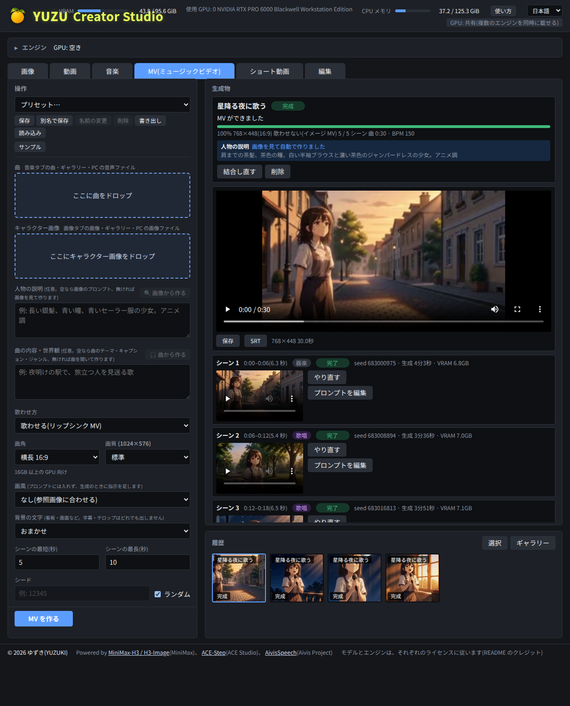

# YUZU Creator Studio
[日本語](README.md) | **English**

(The repository is still named `h3-creator-studio`.)

**Latest: 2026-11-26 JST** — Fixed setup's questions being unreadable in Windows 10 PowerShell. When the image engine's models (the text encoder) are not prepared, the failed job and the Image tab now say to run setup to the end. Setup reuses the video engine's 32B text encoder for the image engine when it exists (the video engine saves it when it ran in its 32gb / 48gb tier, i.e. on cards of roughly 20–48GB or in the studio's share mode; skips a 67GB download). In the Short Video tab, dropped images now default to the **Scenery / object** role (switch it for a person). Narration without a person image is no longer refused: it plays as an **off-screen voice-over** over scenery, without lip-sync. The instruction of an image made with the Image tab edit (such as "extend the surroundings") is no longer used as a character description. When an engine exits in the middle of a job (for example out of RAM), the studio says so with the last log lines and restarts it to try once more. On PCs with under 32GiB of RAM, idle text-to-speech and the bundled LLM are stopped before a GPU job to free RAM. The engine panel has a row for the bundled LLM (state, RAM, Stop). Earlier the same day: setup also builds the MiniMax-H3-Image main-model cache, a **Camera angle** for Image edit, and **Visual style** in every tab. [GitHub commits](https://github.com/animede/h3-creator-studio/commits/main).

The UI language can be switched between **日本語 / English** next to the Help button at the top right (the choice is remembered in the browser; by default it follows the browser language). Progress, error and engine-status messages from the server follow the chosen language too (a few untranslated messages and the engines' own logs stay as they are).

Note: the installer (`setup.bat` / `setup.sh`) prints its output and questions in Japanese. This README quotes the key messages with translations, and the two notices `setup.bat` shows about uv also carry an English line.

**Images, videos with audio, music, text-to-speech, music videos, story videos and editing, all in one browser tab. Everything runs locally, and there are no nodes to wire up.**
A creative studio for everyone that brings the ideas of the author's earlier creation tools together in one place.

## What it does

- **Image**: generate from text, or edit with reference images (MiniMax-H3-Image)
- **Video (with audio)**: from text / from first and last frames / from reference images, video and audio (MiniMax-H3). It can also make still images
- **Music**: songs with vocals or instrumentals, from a theme or genre. The bundled LLM writes the lyrics (ACE-Step)
- **Text-to-speech**: turn text into a voice to use as audio material for videos (AivisSpeech)
- **Music Video**: from one character image and one song, make a lip-sync music video or an image MV with no singing
- **Short Video**: from a story, a song, narration and reference images, make a short video with a narrative (no length limit; above 5 minutes, it warns you that generation will take a while). Narration is spoken by TTS with matching lip movement, and captions can be burned in
- **Edit**: join, cut and insert your videos, images and songs; color tones, zoom, pan, fades, replacing the music. Join the videos you made into one long video. Undo / redo, with a preview (no GPU needed)
- **Prompt enhancement, lyrics and story writing**: the bundled LLM (Gemma 4) helps. It looks at an image to describe the character, and listens to a song to describe it
- **Gallery and presets**: everything you make stays in the gallery and can be reused across tabs by drag and drop. Input values can be saved as presets

## Highlights

- **One tab per workflow**: the six tabs (Image / Video / Music / Music Video / Short Video / Edit) each have the full path to a finished result built in (what ComfyUI calls a workflow). Instead of wiring nodes, pick a tab and drop in your materials. Input values can be saved as presets, and bundled presets cover things like social media sizes and song styles
- **Runs on low VRAM**: uses each engine's low-VRAM path (streaming a quantized cache from disk, narrowing the aspect) and **runs from 6GB of VRAM** (12GB or more recommended). CPU memory assumes 32GB, and there is a path that makes videos even on 16GB
- **The app manages VRAM**: on GPUs under 40GB it automatically swaps engines one at a time (unload, then load); at 40GB and above it gives each engine a VRAM allocation and loads several at once. Usage meters for VRAM and CPU memory sit at the top of the screen, and on Windows it warns you when VRAM overflows into shared GPU memory
- **Faster generation**: video uses a 4-step turbo LoRA, music uses the 8-step 2B turbo, and images use W4A8 quantization, keeping waits reasonable even on entry-level cards. Work that doesn't use the GPU (audio separation, assembly, editing) proceeds without waiting for generation
- **Jobs that keep running**: the bundled LLM loads only as much as fits in free VRAM and is stopped before GPU generation. If asked during generation, it answers on CPU only. Long projects (Music Video, Short Video) can be paused, resumed and redone, and continue where they left off even after the supervisor restarts
- **Also**: editing is non-destructive (source videos are never changed). Everything runs locally and nothing is sent out. The code is Apache-2.0

## Examples

| Short Video: A Day in the Harbor Town (story text only, no song or references, 60 s) | Music Video: Singing on a Starry Night (one character image and a song, lip-sync, 30 s) |
|---|---|
| [](samples/short-harbor-day/sample.mp4) | [](samples/mv-starry-night/sample.mp4) |
| [Original video (with audio, 1024×576, 60 s)](samples/short-harbor-day/sample.mp4) | [Original video (with audio, 768×448, 30 s)](samples/mv-starry-night/sample.mp4) |

The GIFs show the first 14 seconds (click for the original video). The original videos and the inputs and materials used to make them are in [samples/](samples/), and can be loaded as-is with the **Sample** button in each tab of the app.

## VRAM and memory requirements

| Item | Details |
|---|---|
| GPU | NVIDIA. There is no hard VRAM minimum. 6GB works with a narrowed aspect, but it is slow. **12GB or more recommended** |
| CPU memory | **Assumes 32GB or more.** With less, video preparation (quantization) and the bundled LLM for music get tight |
| Storage | **NVMe recommended.** About **175GB free** (models and Python environments for the four engines combined; breakdown below. About 145GB with `--no-ref`) |

Storage breakdown (model sizes as installed through each engine's low-VRAM preparation path. Each file is quantized and the original deleted as it downloads, so usage never balloons temporarily):

| Engine | Models | Python env |
|---|---|---|
| MiniMax-H3 (video) | About 60GB (quantized cache) + about 32GB for reference mode (Ref2VA / Vocal Lock; skip with `--no-ref`) | About 5GB |
| MiniMax-H3-Image (image) | About 25GB (of which the text encoder is about 17GB) + main-model cache of about 11GB (per step count used; setup builds only the default, 3). The bf16 text encoder (about 67GB) and main model (about 62GB) they are built from are fetched and deleted one shard at a time, so they do not stay (about 130GB downloaded in total). If the video engine has already built the 32B text encoder (it does so when it ran in its 32gb / 48gb tier, i.e. on cards of roughly 20–48GB or in the studio's share mode; the unpruned encoder its 80gb / 96gb tiers build is not reused), setup uses it and skips the 67GB download | About 5GB |
| ACE-Step (music) | About 15GB (2B models; +about 30GB with `--ace-xl`) | About 9GB |
| AivisSpeech (TTS) | About 1.2GB (release build; includes its own runtime and the standard voice model. The download is about 0.3GB) | — (included in the release build) |
| Bundled LLM / Music Video tools | About 5.6GB (Gemma 4 E4B + projector file) / about 1.3GB | — |


## Supported OS

- **Windows 10 / 11** (x64, NVIDIA GPU and driver. The studio itself has been verified on Windows 11 (RTX 4060 Laptop 8GB, 16GB RAM) and Windows 10 (RTX 3060 12GB, 32GB RAM): setup, music videos, image edit, music and short videos. Each engine on its own has also been verified on real RTX 3050 6GB / 3060 12GB / 4060 Laptop 8GB machines)
- **Linux** (x64. Debian / Ubuntu family; verified on an RTX A4000 16GB and an RTX PRO 6000 96GB)

### Prerequisites

- **An NVIDIA driver that supports CUDA 13 (580 or later).** The image engine uses torch 2.11 (cu130), and the video and music engines use cu128 torch builds. With an older driver, the engines cannot use CUDA and fail to start.
- **On Windows 10**, the one-line install below (`winget`) needs the **App Installer** from the Microsoft Store (Windows 11 ships with it). Without it, install it from the Store, or install Git, Python 3.12 and ffmpeg by hand (`setup.bat` installs uv itself).

## Engines under the hood

The studio runs the following four engines as separate processes (the config file calls them `[components.<name>]`). Each one is an existing repository, used as-is.

| Engine | Role |
|---|---|
| [MiniMax-H3](https://github.com/animede/Diffusers_minimax-h3) | Video + audio (from text / first and last frames / references) and still images |
| [MiniMax-H3-Image](https://github.com/animede/minimax-h3-image-server) | Images (from text, editing with reference images) |
| [ACE-Step](https://github.com/animede/ACE-Step-1.5-fast) | Music (with vocals, instrumental) |
| [AivisSpeech](https://github.com/Aivis-Project/AivisSpeech-Engine) | Text-to-speech (voice material for videos) |

The **Music Video tab** makes a music video with matching mouth movement (lip-sync MV), or an image MV with no singing, from one character image and one song. It uses MiniMax-H3's Ref2VA per scene (plus Vocal Lock for lip-sync), and Demucs for vocal separation (installed by setup by default).
The **Short Video tab** makes a short video with a narrative from a story, a song, narration and reference images (the length depends on the song or text; above 5 minutes it warns you that generation will take a while). It is built on the Music Video tab's machinery and uses only H3.
The **Edit tab** does simple editing: join, cut, recolor your videos, images and songs, and swap their audio. It runs on ffmpeg alone and never uses the GPU (no engine needs to be running).

What the engines can't do on their own is **manage VRAM and CPU memory**, and that is this app's job (see "[VRAM and CPU memory management](#vram-and-cpu-memory-management-what-this-app-is-for)").

## Installation

The first run spends **several hours downloading models** (about 175GB). Even on a fast connection, plan for more than an hour.
If you stop partway, run setup again and it picks up where it left off.

### Windows (quick version)

1. Open **PowerShell** (type "PowerShell" in the Start menu), paste the line below and run it (installs Git, Python and ffmpeg).

   ```powershell
   winget install --id Git.Git -e --source winget; winget install --id Python.Python.3.12 -e --source winget; winget install --id Gyan.FFmpeg -e --source winget
   ```

2. **Close and reopen** PowerShell, then paste the following (clones into `C:\` and starts setup; downloading the models takes several hours).

   ```powershell
   cd C:\; git clone https://github.com/animede/h3-creator-studio.git; cd h3-creator-studio; .\setup.bat
   ```

   The audio processing tools used by the Music Video tab and the Short Video tab (when using a song), about 1.3GB, are installed by the same line. To skip them, use `.\setup.bat --no-mv`. You can add them later with the **Install tools** button on the Music Video tab or `.\setup.bat --only mvtools`.

   If it tells you to reopen PowerShell and run it again ("PowerShell を開き直してもう一度実行"), reopen it and run `cd C:\h3-creator-studio; .\setup.bat` again.

3. When it finishes, start it with `.\run.bat` and open **http://127.0.0.1:8700** in your browser.

If you run into trouble, see "Windows (detailed)" and "Troubleshooting" below.

### Windows (detailed)

Open PowerShell (type "PowerShell" in the Start menu) and run the following in order.

```powershell
winget install --id Git.Git -e --source winget
winget install --id Python.Python.3.12 -e --source winget
winget install --id Gyan.FFmpeg -e --source winget
```

When they are installed, **close PowerShell and reopen it** (so it picks up what you installed). Then:

```powershell
cd C:\
git clone https://github.com/animede/h3-creator-studio.git
cd C:\h3-creator-studio
.\setup.bat
```

- **Put it in a short, ASCII-only path such as `C:\h3-creator-studio`.** Some tools fail under long paths or a user name with Japanese characters.
- **Get it with `git clone` (not the GitHub ZIP).** With the ZIP, the line endings (CRLF) of the `.bat` files can break and they may not run.
- Pressing Ctrl+C in the console asks "Terminate batch job (Y/N)?" (「バッチ ジョブを終了しますか」). Answer **Y**. Also, clicking inside the window while QuickEdit mode is on pauses output, and the server looks frozen (press Enter to resume).

`setup.bat` installs uv (a Python tool), clones the engines into `components\`, and prepares the environments and models.
If it tells you to reopen PowerShell and run it again right after installing uv, do just that (only uv has been installed at that point).

### Linux

```bash
sudo apt install git ffmpeg curl      # Debian / Ubuntu example
git clone https://github.com/animede/h3-creator-studio.git
cd h3-creator-studio
./setup.sh
```

### Main setup options

| Option | Meaning |
|---|---|
| `--no-models` | Create the environments only. Models come later (run setup again to download them) |
| `--only h3,ace` | Only the given engines (`h3` `h3image` `ace` `aivis`; the Music Video audio tools are `mvtools`). With `--only`, only what you list is handled, so the tools are skipped too unless `mvtools` is listed |
| `--llm` | Also download the bundled LLM (about 5GB) and the projector file that reads images and audio (about 0.56GB; used by "From image" and "From song" in Music Video) up front. Without it, they are downloaded on first use |
| `--no-mv` | Skip the Music Video tab's audio processing (Demucs, librosa, CPU torch; about 0.3–0.4GB download, about 1.3GB on disk), which is installed into `components/mvtools/` by default. `--only mvtools` installs just this. `--mv` is still accepted but does nothing |
| `--ace-xl` | Also install the XL models for music (about 45GB; the default is 2B only, about 15GB) |
| `--no-ref` | Skip the cache (about 32GB) for video reference mode (from references, Vocal Lock). For people who won't use reference mode (on Windows and on PCs with less than 48GB of RAM, this also rules out music videos and short videos that use reference images (lip-syncing narration to a person image, or using scenery images); to build it later, see "Troubleshooting") |
| `--components-dir <path>` | Change where engines are cloned |
| `--clone-anyway` | Clone again even if the folders described in "Already have minimax-h3 etc." below exist |

Rough sizes: MiniMax-H3 models about 60GB (takes the longest), MiniMax-H3-Image about 25GB + a main-model cache of about 11GB (quantized from the bf16 text encoder, about 67GB, and main model, about 62GB: about 130GB downloaded in total; uses the GPU), ACE-Step about 15GB, AivisSpeech about 0.3GB (download; about 1.2GB extracted).

### Already have minimax-h3 etc. installed

You can use that location. Nothing is copied or downloaded again. Copy `studio.local.toml.example` to `studio.local.toml`, and
put the folder in `dir` for each engine you want to use.

Windows example (wrapping the path in `'...'` lets you write `\` as-is):

```toml
[components.h3]
dir = 'C:\AI\minimax-h3'
[components.h3image]
dir = 'C:\AI\minimax-h3-image-server'
```

Linux example:

```toml
[components.h3]
dir = "/home/you/minimax-h3"
[components.ace]
dir = "/home/you/ACE-Step-1.5-fast"
```

- For engines with `dir` set, setup skips both cloning and model downloads. The environment and models in that folder are assumed to be ready.
- Even without `dir`, setup looks for engines you already installed (your home folder and its `AI`, `Documents`, `github`, `src` subfolders; on Windows also each drive root and `\AI`; aliases such as `Diffusers_minimax-h3` included). When it finds one it asks "Use this? [Y/n]" — **press Enter (yes) and it writes the path into `studio.local.toml` for you**, skipping clone and model download. Answer n to leave the file alone and skip that engine (it never re-clones on its own; use `--clone-anyway` for that).
- For an existing MiniMax-H3, setup checks its quantized caches (in the engine's `models\prequant`: the main `transformer_int8` and the reference-mode `transformer_ref_int8`). If both are there, it just prints "キャッシュ: 本体 ✓ 参照用 ✓" (caches: main ✓ reference ✓). On Windows and on PCs with less than 48GB of RAM, if any are missing it lists them (main about 60GB, reference mode about 32GB; building takes hours) and asks "いま作りますか? [Y/n]" (build them now?). **Press Enter (yes) and it runs the engine's `scripts\prepare_lowvram.py --ref`** (with `--no-ref`, without `--ref`, and the reference-mode cache isn't counted). If you answer n, or setup runs without a terminal, it only prints the command and moves on. If the engine has no venv, it asks you to run the engine's install first; if the engine is too old to have `prepare_lowvram.py`, it asks you to update it first (see "Updating engines"). On Linux with 48GB of RAM or more, the engine can build the caches itself at startup, so setup doesn't ask; it only prints the command with `--keep-source` (prepare deletes the bf16 weights it has quantized, which such a PC may still use).
- For an existing MiniMax-H3-Image, setup checks its main-model cache (in the engine's `models\cache`, e.g. `ckw4a8_adaln_table_pdmd3`; default step count 3, or `H3IMG_STEPS` if you set it in `[components.h3image.env]`) and its text encoder (`models\te`). If either is missing, setup asks "いま作りますか? [Y/n]" (build it now?); Enter (yes) runs the engine's `scripts\prepare_models.py --build-cache 3` (about an hour, uses the GPU; another 67GB download if the text encoder is missing too). On n, or when not run from a terminal, it only prints the command.
- If MiniMax-H3-Image has no text encoder and MiniMax-H3 has the 32B one (`models\prequant\te_bnb-4bit_prune1`, built when MiniMax-H3 ran in its 32gb / 48gb tier, i.e. on cards of roughly 20–48GB or in the studio's share mode, which gives it the 32gb tier even on 80–96GB cards; the unpruned encoder built by the 80gb / 96gb tiers is not reused), setup points the image engine at it by writing `H3IMG_TE_DIR` under `[components.h3image.env]` in `studio.local.toml` (the two engines use the same text encoder; this skips a 67GB download and the quantization).

## Starting and using it

```powershell
.\run.bat        # Linux: ./run.sh
```

Open **http://127.0.0.1:8700** in your browser. To stop, press `Ctrl+C` in the window where you started it (the engines stop too).

**The first time, engines take a few minutes to start while loading models.** Progress shows in the **Engines** (エンジン) row on screen. Just wait and they become ready automatically.

### The screen

- **Top**: memory usage meters (VRAM and CPU memory; on Windows, shared GPU memory too) and the list of **Engines** (エンジン). You can see which engine is on the GPU, which is starting and which has an error. Below that are the GPU mode (one engine at a time / several at once) and each engine's running and queued jobs.
- **Help** (使い方, top right): opens the usage guide (docs/USAGE.en.md) in a floating window, starting at the section for the current tab.
- **Six tabs**: Image / Video / Music / Music Video (lip-sync MV / image MV) / Short Video / Edit.
- **Presets**: top left of every tab except Edit. Save input values under a name and recall them just by selecting it (see "Presets" below).
- **Sample**: the **Sample** (サンプル) button under the presets field (only on tabs that have samples; see "Samples" below).
- **Left: controls**. **Top right: outputs** (shows the result large, with a save button). **Bottom right: history** (what you made in that tab).
- The **Gallery** (ギャラリー) button in history switches the right side to the **gallery** (all outputs, filterable by All / Image / Video / Music). **Back** (戻る) returns to history.
- **Drag and drop**: input fields accept files from your PC and outputs from the gallery or history **the same way**. Use what you made as the next input.
- **Delete**: the "×" on thumbnails in history and gallery, **Delete** (削除) in the output viewer, or pick several with **Select** (選択) and delete them together. The files are removed too, and this cannot be undone. Outputs used by running or queued jobs, or by a Music Video project that can still continue, cannot be deleted. When deleting a Music Video or Short Video project, you can choose whether to delete the finished video as well.



### Image tab (MiniMax-H3-Image)

Pick the mode with the two buttons at the top (named as in MiniMax-H3-Image).

- **T2I (from text)**: set a prompt and size, then **Generate** (生成).
- **edit (edit with reference images)**: drop in reference images (up to 16) and point to them by number in the prompt, like `<Picture 1>`.

**Enhance prompt** (プロンプト強化) rewrites a short instruction into a detailed prompt (bundled LLM).
**Visual style** (画風) adds an English style instruction at generation (not written into the prompt box; in edit mode the reference's look is kept and the background, lighting and materials follow the style).
In edit mode, **Camera angle** (アングル: None / Front / Three-quarter, facing left / Three-quarter, facing right / Side profile / From behind / High angle / Low angle) adds an English instruction to redraw the reference from that angle (the person and place are kept; left/right are as seen in the picture; low angle becomes a full-body shot; works even with an empty prompt).
**Steps** (ステップ数): each step count uses its own main-model cache (about 11GB). Setup builds only the default, 3, so the first time you pick 2 or 6, that first run starts by building the cache (a 62GB download, over an hour). A note appears under the field, and the job shows "Building the main-model cache (first time only)". To build them ahead, stop the studio and run `cd <h3image folder>; .\.venv\Scripts\python.exe scripts\prepare_models.py --build-cache 2 6`.

### Video tab (MiniMax-H3)

Pick the mode with the four buttons at the top (using MiniMax-H3's abbreviations).

- **T2VA (from text)**: make video and audio from text.
- **FL2VA (from first and last frames)**: give the first image (and optionally the last) and animate between them. Either one alone is fine.
- **Ref2VA (from references)**: generate using images, video and audio as references.
- **T2I / Ref2I (still image)**: make a single still image instead of a video. Ref2I if there are references, otherwise T2I.

The native resolution is 768 on the short side. On 6GB cards, 512² to 768×512 is realistic. Length is 5–15 seconds.

**Create audio (TTS)** (音声を作る(読み上げ)) has AivisSpeech read text aloud. Drop that into "from references" as **reference audio** to get a video with that voice.
Check **Vocal Lock** to use the reference audio as the output audio as-is, with the mouth movement matched to it.

**Visual style** (画風) is a setting that appends an English instruction to the prompt at generation (the prompt box is unchanged, and prompt enhancement does not include it).

| Visual style | Instruction added (English) |
|---|---|
| None (match the reference) | (nothing; the default) |
| Realistic | photorealistic, natural lighting, real camera, true-to-life skin and materials |
| Cinematic | cinematic film look, anamorphic framing, shallow depth of field, graded color |
| TV drama | TV drama look, naturalistic lighting, handheld-feel camera, everyday locations |
| Anime | Japanese anime style, clean line art, flat cel shading, expressive eyes |
| Illustration | digital illustration, clean shapes, bold colors, polished finish |
| Sketch | pencil sketch, hand-drawn lines, hatching, paper texture, mostly monochrome |
| Watercolor | watercolor painting, soft bleeding edges, paper texture, muted palette |
| Oil painting | oil painting, visible brush strokes, rich impasto texture |
| 3D CG | 3D CG render, stylized characters, soft global illumination |

Without a reference, `Visual style: <instruction>.` is appended to the prompt; with one (Ref2VA / Ref2I / FL2VA, Image tab edit, music videos, short videos with images), `Keep the referenced subject exactly as in the reference image; render the scene, background, lighting and materials in <instruction>.`

### Music tab (ACE-Step)

Choose one of two options under **Mode** (作り方) at the top.

- **Simple (from genre)**: just pick a genre. Theme, lyrics and caption are written by the AI at generation time, **only for the empty ones** (anything you wrote yourself is kept).
  The three buttons next to the fields let you create and tweak them one by one before generating: **✨ Create theme** / **✍️ Write lyrics** (also creates the theme if it's empty) / **🎵 Create caption**.
  **Auto caption** (on by default) has the AI write the caption at generation time when it's empty. You can also pick mood, vocals (press again to deselect), vocal language, length, and **Instrumental only** (no vocals).
  A caption you wrote yourself also guides the mood of the AI-written theme and lyrics (if you picked a mood, the mood is explicit and the caption supplements it), and when no mood is picked, the spectrum colors come from it too.
  **✍️ New lyrics and generate** (shown only when there are lyrics) clears the lyrics and rewrites the lyrics and caption while keeping the theme.
  **＋ Add** in the genre chips creates your own genre (enter a name and the LLM writes and saves a definition of its world, scenes and emotions; it becomes a chip marked ✦, whose contents you can edit or delete). **✎ Free text** replaces the chips with a sentence like "a wistful end-of-summer song mixing 90s city pop with shamisen" (up to 200 characters), and **Save as genre** turns that into a chip too.
- **✨ Auto (from one line)**: make a song from just one line, like "a sad ballad for a rainy night". The supervisor's LLM is not used; ACE-Step's own LM decides the lyrics, caption, BPM and key.

**Details** (collapsed) holds the model (from ACE's list; an unloaded model is loaded automatically before generating, and models that don't fit in VRAM can't be selected), STEP (8 for Turbo, 50 otherwise),
Thinking, seed (random / fixed / **remake with the same skeleton** = the previous seed), negative prompt, Shift, Sampler, and number of songs (1 / 2 / 4; two or more become separate outputs).
The plan (theme, caption, start of the lyrics) is shown below during generation. The song title is the theme (the one-liner for Auto), and the LLM is not called after generation.
While a song plays, a **spectrum** animates on the song card in the output viewer (its colors come from your custom genre's mood, otherwise the song's mood, otherwise the caption's wording, otherwise the genre. The selector at the top right of the card switches to waveform, ring, particles, pulse, aurora, fireworks, matrix, orbit, flame or auto, and remembers your choice. It stops on pause or end).

### Music Video tab (lip-sync MV / image MV)

Make a music video with matching mouth movement from one character image and one song (setup installs the audio tools by default; without them, the tab shows a notice and an **Install tools** button). On Windows and on PCs with less than 48GB of RAM, it also needs MiniMax-H3's reference-mode cache (without it, a notice with the command to build it appears above the form and **Make music video** is disabled; see "Troubleshooting").
Choosing "no singing (image MV)" under **Vocals** (歌わせ方) makes an image video where the character doesn't sing (a so-called image PV). The song is added at assembly (see "no singing" below).
**Visual style** (画風) keeps every scene's direction in that style (the character keeps the look of the image).

1. Drop in a **song** (from the Music tab, the gallery, or an audio file on your PC) and a **character image** (from the Image tab, the gallery, or an image on your PC).
   When dropped from the gallery, the image's prompt goes into **Character description** and the song's theme and caption go into **Song concept** (only if empty; feel free to rewrite them).
   For **images and songs brought in from elsewhere** (no prompt or theme), fill them with **🔍 From image** next to the field (the bundled LLM looks at the image and writes one line in Japanese about hair, eyes, clothes and art style only; about 15 seconds on CPU, and the first time it downloads the projector file for reading images and audio, about 0.56GB) and
   **🎧 From song** (the bundled LLM listens to up to two 30-second parts of the song, picks up language, genre, mood, instruments, vocals and tempo, and drafts the song description and world. About 30 seconds on CPU. ACE-Step is not used and no GPU swap is needed. What it heard appears collapsed under "What it heard (reference)". It does not transcribe lyrics and doesn't use them in the draft).
   Check and fix the text before generating (text you wrote is never replaced without confirmation). If you press **Make music video** (MV を作る) with these empty, the project does the same thing automatically, and the project screen shows which descriptions were automatic (if it can't listen to the song, it proceeds without a song description).
2. Pick the **aspect** (landscape 16:9 / portrait 9:16 / square 1:1 / portrait 4:5 / landscape 4:5 / custom), **quality** (Low VRAM / Fast / Standard / High) and scene length (5–10 seconds), then **Make music video**.

| Aspect | Low VRAM | Fast | Standard | High |
|---|---|---|---|---|
| Landscape 16:9 | 512×288 | 768×448 | 1024×576 | 1344×768 |
| Portrait 9:16 | 288×512 | 448×768 | 576×1024 | 768×1344 |
| Square 1:1 | 384×384 | 512×512 | 768×768 | 960×960 |
| Portrait 4:5 | 416×512 | 512×640 | 640×800 | 768×960 |
| Landscape 4:5 | 512×416 | 640×512 | 800×640 | 960×768 |
| Custom | Width and height directly (256–1344, rounded to multiples of 32; quality is not used) | | | |

Low VRAM is a small 512-on-the-long-side image, for GPUs with 6GB or less or for a quick first try.

Internally it goes through these steps (the top right shows each scene's status and finished clips).

- **Separation and splitting** (CPU): Demucs separates the vocals, and the song is split into 5–10 second scenes at silences, breaths and bars.
- **Listening to the song** (bundled LLM; only when the song description is empty and the song has no info in the database): listens to part of the song and drafts the song description and world (using the BPM found in analysis as well).
- **Direction** (bundled LLM): if the character description is empty, it first writes one from the image, then organizes the character's appearance (without location or lighting) and writes per-scene direction in the official MiniMax-H3 Ref2VA format. Sung ranges get frontal or 3/4 shots where the mouth is visible.
- **Scene generation** (MiniMax-H3): Ref2VA + Vocal Lock with the image and that scene's vocals as references. The next scene is queued only after each one finishes, so generations from other tabs can cut in between.
  With **no singing**, no vocals are passed; scenes are made from the image alone with the scene length (seconds) specified (the audio H3 adds is not used). What moves the mouth is the audio reference itself, so without it the "not singing, mouth closed" instruction works (confirmed with the author's earlier tool). The direction also drops the singing assumption and uses any composition: walking, gazing, scenery and so on. Scene cuts are the same (dips in the separated vocals, breaths, bars).
  The mouth won't move, but the LLM writing the direction may still pick singing scenes like a microphone or stage because it's an "MV" (in testing, a scene with a mic and a slightly open mouth appeared). **If you want only scenery or everyday shots, write what to leave out in "Song concept", such as "No microphones or stages. No singing scenes."** (it goes straight to the LLM; choosing no singing shows the same tip under the field).
- **Assemble**: join the clips and replace the audio with the original song to make an MP4 (it goes into the gallery).

Every scene is instructed to show no subtitles, captions, lyric text, titles or logos (H3 sometimes draws subtitles in MV-like scenes). For **background text** such as signs and screens, choose from "auto / large text only / no text" (video can draw large, short text, but small text tends to break up).

You can pause / resume / cancel, and per scene **Redo** (changes the seed) and **Edit prompt**. After a redo it re-assembles automatically. An unfinished MV survives a supervisor restart as paused.

Time estimate: on an RTX A4000 (16GB), landscape Fast, a 30-second song is 5 scenes and about 17 minutes (about 3 minutes per scene). On an RTX 4060 Laptop (8GB) with 16GB RAM and a SATA-class SSD (~400MB/s), the same settings take about 31 minutes for 5 scenes (5.5–6.5 minutes per scene; VRAM 7–7.7GB, shared GPU memory steady at 0.8GB, with `H3_REF_IMAGE_SHORT_EDGE=768`). Longer songs take proportionally longer.

### Short Video tab

Make a short video with a narrative from a story. It uses the same machinery as the Music Video tab (analysis → direction → per-scene generation → assembly), with H3 only. A video with only a song uses the same audio separation (Demucs) as Music Video, so only that case needs the audio tools (installed by setup by default; not needed with narration or with neither).
**Visual style** (画風) keeps every scene's direction in that style (reference images keep their look).

**Inputs** (left)

- **Story / visual idea**: what to depict. The LLM uses it to write the overall plot and scene breakdown. Required when there's no song and no narration; optional otherwise.
- **Song** (optional; from the Music tab, the gallery, or an audio file on your PC): becomes background music if given.
- **Narration** (セリフ・ナレーション, optional): spoken by AivisSpeech; with a character image the character lip-syncs to it, and without one it plays as an **off-screen voice-over** over the scenery scenes (no lip-sync; see the table). **📝 From story** drafts narration from the story text (check and fix before generating; text you wrote is never replaced without confirmation). Empty means a video with no narration. Choose the **Voice** (話者) from the same AivisSpeech list as the Video tab's TTS (required when there is narration).
- **Reference images** (0–4; from the Image tab, the gallery, or images on your PC): choose a **role** for each. Dropped images start as **Scenery / object** (a reference for scenes showing that place or thing); for a person, switch the role to **Character** (the same person in every scene; one at most, multiple cast members aren't supported). For images made with the Image tab edit, the edit instruction (such as "extend the surroundings") is not used as a description (an empty description is made by looking at the image during the project). Adding a character image shows a **Character description** field (🔍 From image works as in Music Video).
- **Length**: the song's length if there's a song, the TTS length if there's narration; set it yourself only when there is neither (30 seconds to 1 hour, default 60 seconds). With both narration and a song, the TTS length wins and the song is laid underneath as background music.
- **Aspect, quality, scene length (5–10 seconds), background text and seed** work as in Music Video. No subtitles or captions are drawn by the model.
- **Final audio**: **Auto** / **No audio** (video-only MP4, for people who want to add sound in another tool). After it's done, change it with the selector next to **Re-assemble** (結合し直す) and assemble again (the previous video stays in the gallery).
- **Narration captions (subtitles)**: check "Burn in narration captions (subtitles)" (「セリフのテロップ(字幕)を焼き込む」) to burn white captions at the bottom of the frame (a bit higher for portrait), timed to the TTS sentences (no speech recognition; it uses the timing of the synthesized sentences, so they never drift). An **SRT** with the same content is saved next to the final video (for subtitles on video sites), and an **SRT** link appears on the finished screen. After it's done, toggle them with "Captions" next to **Re-assemble**. The font is `[mv] subtitle_font` in `studio.local.toml` (empty means Noto Sans CJK JP; if that's missing, ffmpeg (libass) substitutes a font that has the characters, e.g. Meiryo on Windows). Projects without narration ignore this.

**The timeline is decided by the inputs as follows.**

| Input | Length | How scenes are cut | Scene audio |
|---|---|---|---|
| Narration + character image (song optional) | TTS length | Grouped into 5–10 seconds at sentence breaks | Character image + that scene's TTS (Ref2VA + Vocal Lock). Lip-synced to the TTS |
| Narration without a character image (voice-over) | TTS length | Same | Scenery images (Ref2VA if any, otherwise T2VA), made silent with the scene length given; the TTS (+ the song as background music) is laid on at assembly. The direction follows the narration sentences and shows no people |
| Song only | Song length | Same as Music Video (separated with Demucs, cut at silences, breaths and bars) | Generated without audio, replaced with the song at assembly |
| Neither | The length you set | The LLM splits the story into 5–10 second scenes | The audio H3 makes (ambience, sound effects) is kept as-is |

- **Narration without a character image** becomes an off-screen voice-over (the screen says so: "There is no person image, so the narration plays as an off-screen voice over the scenery"). To lip-sync, add an image with the role **Character**. With a character image, the TTS runs through the whole video, so scenes without the character can't be made.
- **When final audio is Auto**: with narration, the TTS (the song mixed in quietly as background music and cut to the TTS length; a short song is not looped); with a song only, the song; with neither, H3's audio.
- **Above 5 minutes you get a warning** (it doesn't stop you). On an RTX A4000 at Fast, one scene takes about 3.5 minutes, so a 5-minute video (about 40 scenes) takes about 2.3 hours, and 10 minutes about 4.7 hours. Time grows with the number of scenes. A PRO 6000 or 5090 takes a fraction of that. Narration length isn't known until the TTS is made, so the warning is an estimate from the character count.

The project screen on the right (progress, per-scene videos, final video, history, delete) is the same as in the Music Video tab. Each scene also shows its location, its narration (if any) and the references used. **seed, Redo, Edit prompt, pause, resume and cancel** work the same as in Music Video (a redo re-assembles automatically; an unfinished project survives a supervisor restart as paused). The finished video is `outputs/video/short_<ID>.mp4` (re-assembling gives `_2`…).

### Edit tab

Simple editing of gallery videos, images and songs: **join, cut ranges, insert in the middle, change colors, change the transitions at cuts, and swap the music**. **Source videos are never changed** (non-destructive). An edit is just settings ("which part of which clip, in what order, with what effects"), and ffmpeg (CPU) rebuilds the result. **No GPU and no running engine are needed**, so you can use it while Music Video or video generation runs.

1. Pick an **edit project** from the selector at the top, or create one with **New** (新規) and give it a name (rename and delete are here too).
2. Drop videos and images into the **Clips** (クリップ) field (outputs of the Video, Music Video and Short Video tabs, the gallery, or files on your PC). **They are added at the end.**
3. **The preview rebuilds every time** you pick a range or an action. When you're happy, **Export** (書き出し).

| Action | What it does |
|---|---|
| Clip rows | **in / out** (the part of the video to use, in seconds of the source video); for images, **duration** (3 seconds when dropped). **▲▼** to reorder, **×** to remove (the source video stays). Click a thumbnail to play from that point |
| **Delete range** | Cut from start to end and join what's before and after. Clips that overlap are split at that point (into two with different in / out from the same video) |
| **Insert at position** | Insert another video or image at the **start** position (a clip there gets split). Set the duration for images |
| **Color tone / adjust** | Tone (looks): monochrome / sepia / warm / cool / film (faded) / vignette / invert / blur. Adjust (values): saturation (0–3, 1 = unchanged) / contrast (0–3, 1 = unchanged) / brightness (-1–1, 0 = unchanged). **Apply to range** or **Apply to all**. Remove with **×** in the applied list. They stack without limit |
| **Range effects** | Act from the start to the end of the range (outside the range is unchanged): fade to black / fade from black / black / fade to white / fade from white / zoom in / zoom out (1.05–2×, toward the center) / pan right, left, down, up (scaled up by the factor, moving the visible window from edge to edge) / zoom in while panning right or left. All are good for animating inserted stills (Ken Burns). For stills that came in with black borders (square ones, etc.), set the factor high enough for the borders to disappear (1.75× or more for a square in 16:9 landscape). To separate with black, chain "fade to black" → "black" → "fade from black" |
| **Transitions** | Per cut between clips: cut / crossfade / dip to black, and duration (0.5–2 seconds, up to half the shorter adjacent clip). **Apply to cuts in range** applies one to every cut inside the selected range, using the range length. Splits from range deletes or inserts become plain cuts |
| **Fade in at start / fade out at end** | Seconds. 0 for none |
| **Audio** | Original audio / replace with song / original + song (the song is mixed at -14dB) / no audio. For the song, drop **a song from the Music tab, the gallery, or an audio file on your PC** into the field (dropping one switches original audio or no audio to "replace with song") |

**Setting a range**: type the **start** and **end** seconds (arrow keys and Tab work). Or play the preview on the right, stop at the spot you want, and press **Set start** (ここから) / **Set end** (ここまで) right under the preview (also available in the range field on the left) to set the start and end (the current range shows on the right as "range a–b s"). **◀ 1 frame** / **1 frame ▶** move the stopped position one frame (1/fps seconds) at a time. **Clear** removes the start and end. **Grab this frame** (このコマを画像に) turns the frame at the stopped position into a PNG at the source resolution, taken from the source video, and adds it to the gallery (images) (color tones and other effects are not applied; use it directly as an Image tab reference or an edit insert). **All** is 0 to the end. Click on the scale on the right (one band per clip) to play from that point; the current range is overlaid as a blue band.

**Adding from the gallery**: open the **Gallery** at the bottom right (in the Edit tab, the preview above stays visible and the gallery appears at the bottom right), then just click a video or image to add it to the end of the clips, or click a song to put it in the audio (the gallery stays open, so you can keep picking; **Back** returns to history). To insert, drop onto the insert field. **Range seconds count the plain joined time of the clips, before crossfades shorten it** (from the preview's playback position, "Set start" corrects this automatically). Deleting a range also shifts color-tone ranges by the removed amount.

**Preview and export**:

- Every action rebuilds the **preview** (a light MP4, 480 on the short side). While it's building, the video is blurred and progress shows. If you keep editing, the half-built one is cancelled and a new one starts. If it says the preview is out of date ("プレビューは古い版です"), press **Rebuild** (作り直す).
- **Export** makes an MP4 at the source resolution (`outputs/video/edit_<ID>.mp4`; `_2`… from the second time) and adds it to the gallery. It can take a few minutes (progress shows). Save it from "Last exported video" under the preview, or drop it into other tabs' input fields.
- Output size and frame rate follow **the first clip** (1024×576 at 24fps if there are only images). Videos of different sizes are scaled down and letterboxed with black.

**Undo / redo**: one action is one step (up to 100 steps). It still works after a supervisor restart.

The history at the bottom right is the **list of edit projects** (click a card to open it, × to delete, **Gallery** to switch). Videos, images and songs used by an edit project **can't be deleted from the gallery**. Deleting a project leaves the exported videos in the gallery.

**Not included**: subtitle input, speed changes, picture-in-picture, fine volume control, keyframes, a mouse-draggable timeline. No presets either (each edit depends on its materials).

### Presets

The field at the top left of every tab except Edit saves input values (prompt, size, duration, STEP, model, genre and so on) under a name (Edit has no presets because every edit depends on its materials). Selecting one fills in the inputs (it doesn't generate). Dropped outputs such as reference images and songs are not included in presets.

- **Bundled presets** (image styles, social media sizes, song styles, Music Video and Short Video aspects, etc.) can't be changed. Duplicate one with **Save as** (別名で保存) and edit that.
- For your own presets: **Save** (overwrites the selected one) / **Save as** / **Rename** / **Delete**. **Export** saves them as JSON, and **Import** moves them to another PC.

### Samples

Press **Sample** under the presets field in the Short Video and Music Video tabs to list the bundled examples (`samples/<id>/`). Each card shows the finished video (playable right there), a description and the materials used. **Load** (読み込む) sets the input fields (story, aspect, quality, length, etc.) and materials (reference images, song) to match the example. It doesn't generate, so check things and then press **Make Short Video** or **Make music video** to make one under the same conditions (your current song, reference images, story, narration and character description are replaced by the sample's).

- There are two samples now: the Short Video "A Day in the Harbor Town" (story text only; no song, narration or reference images) and the Music Video "Singing on a Starry Night" (a lip-sync MV from one character image and a Music tab song, with mouths matched in the sung ranges). Tabs without samples don't show the button.
- Materials (images, songs) are copied **into the gallery once** when loaded (`outputs/samples/<id>/`). Loading the same sample again doesn't add more. Once in the gallery they behave like any other output and can be deleted (delete and reload, and they come back).
- The sample videos, images and songs are CC0 (free to use). The sample materials were generated by the author with the engines themselves (the image with MiniMax-H3-Image, the song with ACE-Step, the videos with MiniMax-H3).
- To add your own sample, place `samples/<id>/sample.json` (tab, title, description, input values, materials, video, thumbnail) along with those files (`<id>` matches the folder name). Unreadable samples or ones with missing files are skipped with a warning when the supervisor starts.

## VRAM and CPU memory management (what this app is for)

There is never enough GPU memory. Load all four engines at once and it overflows right away. So:

1. **Load what fits; if it doesn't fit, wait.** Generations queue per engine (one at a time per engine). Generations on different engines run in parallel if they fit on the GPU together. Jobs are looked at in the order received, and whatever can start, starts. But when the head of the queue is waiting for GPU space, later jobs are not let into the engine it wants to unload (so it doesn't get overtaken forever).
   - **12–24GB (`[gpu] mode` default `auto` → one engine at a time)**: only one engine on the GPU. MiniMax-H3-Image for images, MiniMax-H3 for video, ACE-Step for music.
   - **40GB and above (`auto` → several at once)**: each engine gets a VRAM allocation, passed to it at startup (`H3_PROFILE` and `H3_VRAM_LIMIT_GB` for MiniMax-H3, `H3IMG_VRAM_GB` for MiniMax-H3-Image, `ACESTEP_GPU_PROFILE` for ACE-Step). Nothing is unloaded while the allocations add up to what the GPU holds. When space runs out, idle engines are unloaded, least recently used first. Default allocations: MiniMax-H3 = half of total VRAM (up to 48GB), MiniMax-H3-Image = 35% (up to 31GB), ACE-Step = 14GB. Change them with `[components.<name>] vram_budget_gb`.
   - Work that doesn't use the GPU (Music Video separation, splitting, assembly) runs in parallel with GPU generation (up to two at a time).
2. **Swapping is automatic.** When there isn't room, the supervisor goes through these steps.
   1. Free the engine currently on the GPU. **Image and video engines are offloaded** (the model is unloaded from the GPU; the process stays). **Music is stopped** (ACE-Step has no way to unload, so the process is stopped). It can't switch while an engine is generating ("生成中のエンジンがあるので…" appears). Press again once it's done.
   2. Confirm the VRAM is free.
   3. Start or reload the next engine and wait until it's ready (the steps show in the outputs area).
3. **The bundled LLM (Gemma 4 E4B)** is a single instance held by the supervisor for prompt enhancement, lyrics, Music Video direction, writing character descriptions from images (image input) and song descriptions from listening (audio input). If asked while the GPU is generating, **it runs on CPU only to answer** (GPU generation isn't stopped). It is started on first use and **loads onto the GPU only as much as fits in the free VRAM next to the engine currently there** (the rest runs on CPU). **It is stopped right before GPU generation** to give back the VRAM, and isn't started during generation. The engines' built-in LLMs are not used.
4. **With less than 10GB of VRAM (8GB cards, etc.), memory-saving settings are applied to music automatically.** These five:
   - `ACESTEP_GPU_PROFILE=12gb` (2B model profile)
   - `ACESTEP_LM_OFFLOAD_TO_CPU=1` (keep the language model on CPU)
   - `ACESTEP_RESIDENT_COMPONENTS=none` (no resident components. Not left empty: on Windows, empty is the same as unset)
   - `ACESTEP_VAE_DECODE_CHUNK_SIZE=128` (split the final decode into small chunks)
   - `ACESTEP_QUANTIZATION=int8_weight_only` (int8 quantization)

   To change them yourself, write them in `[components.ace.env]` in `studio.local.toml`.
5. **Warning on spill into Windows "shared GPU memory".** When VRAM overflows, Windows starts using CPU memory in place of GPU memory. It doesn't stop, but it gets extremely slow. If **"VRAM があふれて共有 GPU メモリに退避しています…"** (VRAM has overflowed into shared GPU memory) appears at the top of the screen, use a smaller aspect or close other apps that use the GPU.

6. **PCs with 2 or more GPUs.** The supervisor counts VRAM on one GPU only (the first entry of `CUDA_VISIBLE_DEVICES` in the supervisor's environment, or GPU 0). By default (`[gpu] devices = "auto"`) every engine and the bundled LLM get `CUDA_VISIBLE_DEVICES=<that index>`, so they all stay on the same GPU (this prevents, for example, MiniMax-H3-Image putting its text encoder on a smaller 2nd GPU and running out of memory). The top bar shows "GPU in use: 0 <name>". To use another GPU, write an index such as `devices = "1"`; to not pin at all, `devices = "all"` (in `[gpu]` of `studio.local.toml`; VRAM accounting still covers one GPU). If you set `CUDA_VISIBLE_DEVICES` in the supervisor's environment or in `[components.<name>.env]`, that wins.

### Reading the usage meters

- **VRAM**: GPU memory usage (reads nvidia-smi every 2 seconds).
- **Shared GPU memory**: Windows only. If this grows, VRAM is overflowing.
- **CPU memory**: total PC usage, including the engine processes. Near 32GB, quantization and the LLM slow down.

## Updating engines (git pull)

Each engine is a **plain git clone** inside `components\`. To update, `git pull` in that engine's folder and **run that engine's setup again** (finished steps are skipped, so it's quick).

**Stop the supervisor before updating** (`Ctrl+C` in the `run.bat` window). For engines pointed elsewhere with `dir` in `studio.local.toml`, do it in that folder.

| Engine | Folder | Update |
|---|---|---|
| MiniMax-H3 | `components\minimax-h3` | `git pull` → `.\scripts\install.bat` (Linux: `bash scripts/install.sh`) → only when models changed, `.\venv\Scripts\python.exe scripts\prepare_lowvram.py --ref` (Linux: `venv/bin/python scripts/prepare_lowvram.py --ref`; if you installed with `--no-ref`, leave out `--ref`) |
| MiniMax-H3-Image | `components\minimax-h3-image-server` | `git pull` → `uv pip install --python .venv\Scripts\python.exe -r requirements-windows.txt` (Linux: `uv pip install --python .venv/bin/python -r requirements.txt`) → only when models changed, `.venv\Scripts\python.exe scripts\prepare_models.py` (Linux: `.venv/bin/python scripts/prepare_models.py`) |
| ACE-Step | `components\ACE-Step-1.5-fast` | `git pull` → `.\setup.bat --12gb` (Linux: `./setup.sh --12gb --no-client`). If you also installed the XL models, drop `--12gb` |
| AivisSpeech | `components\AivisSpeech-Engine` | Not git (a release build). Delete the folder and run the Studio's `setup` again to download it fresh |

For example, to update MiniMax-H3 on Windows:

```powershell
cd components\minimax-h3
git pull
.\scripts\install.bat
cd ..\..
```

- Whether the models changed is noted in that engine's README / changelog. When in doubt, just run the preparation command (finished items are skipped in seconds).
- If `git pull` stops because of local changes ("手元の変更があるので…"), something in that folder was modified by hand. Check with `git status`, then `git stash` or revert the changes.

**Updating the Studio itself**:

```powershell
git pull
.\setup.bat --no-models
```

`--no-models` updates the supervisor's environment (`.venv`), clones any missing engines, and checks each engine's environment (quick if already done). Engine models are left alone.

**To reinstall an engine**, delete its folder and run `setup` again (only the deleted folder is set up from cloning onward). setup never deletes folders pointed to by `dir` in `studio.local.toml`; delete those yourself.

## Configuration

`studio.toml` holds the defaults (included in the repository). Put settings for your own PC in **`studio.local.toml`** (not tracked by git; only the keys you write override the defaults. See `studio.local.toml.example`).

| Key | Meaning |
|---|---|
| `host` / `port` | Where the supervisor listens. Default `127.0.0.1` / `8700`. Not exposed to other PCs (first release) |
| `components_dir` | Where engines are cloned. Default `components` |
| `dir` in `[components.<name>]` | Points directly at an engine's location. When set, cloning and model downloads are skipped |
| `enabled` (same section) | `false` disables that engine (e.g. you don't need music) |
| `port` (same section) | The engine's port (change it on conflicts) |
| `env` (same section) | Environment variables passed to the engine. Written as `[components.h3.env]` |
| `port` / `tools_dir` in `[llm]` | Port of the bundled LLM (llama-server; default 8701) and its download folder |
| `gpu` in `[llm]` | Where to load the bundled LLM. `auto` (as much as fits on the GPU) / `off` (CPU only) / `all` / number of layers |
| `gguf` / `llama_server` / `mmproj` in `[llm]` | When set, those files are used instead of downloading (`mmproj` is the projector file that reads images and audio. Empty means search automatically, and if none is found, download it once for "From image" / "From song") |
| `mode` in `[gpu]` | `auto` (several at once if total VRAM is 40GiB or more, otherwise one engine at a time) / `exclusive` (one engine at a time) / `share` (several at once) |
| `devices` in `[gpu]` | On PCs with 2 or more GPUs, which GPU the engines run on. `auto` (pin every engine to the one GPU the supervisor counts VRAM on) / `all` (don't pin) / an index such as `"1"` |
| `free_cpu_engines` in `[gpu]` | Whether to stop idle text-to-speech (AivisSpeech) and the bundled LLM before a GPU job to free RAM. `auto` (only on PCs with under 32GiB of RAM) / `always` / `never` |
| `vram_budget_gb` in `[components.<name>]` | That engine's VRAM allocation (GB) when several are loaded at once |
| `tools_python` in `[mv]` | Python that runs the Music Video audio processing (Demucs, librosa). Empty means `components/mvtools/.venv` created by setup |
| `device` in `[mv]` | Where vocal separation runs. Default `cpu` (runs in parallel with GPU generation) |
| `subtitle_font` in `[mv]` | Font for Short Video narration captions. Empty means Noto Sans CJK JP (if missing, libass substitutes a font with the same glyphs; on Windows, `"Meiryo"` etc.) |

Engine names are `h3` / `h3image` / `ace` / `aivis`.

## Troubleshooting

- **An engine shows "Error"**: open "Log" on that row. The same content is in `logs\<name>.log` (`logs/h3.log`, etc.). If the model or environment is missing, run setup again.
- **"The Python environment of ... is incomplete (module uvicorn is missing)"**: that engine's virtual environment was only partly installed (its log has `No module named ...`). Stop the studio, then run `.\setup.bat --only <name>` (Linux: `./setup.sh --only <name>`). The name (h3 / h3image / ace, etc.) is in the message.
- **Port already in use**: another app is using one of 8700 (supervisor), 8701 (bundled LLM), 8611 (video), 8633 (image), 8001 (music) or 10101 (TTS). Stop it, or change the port in `studio.local.toml`.
- **The "VRAM があふれて…" warning appears**: lower the aspect (size, resolution). Close other GPU apps (video playback in the browser, games, other generation tools).
- **"Cancel" doesn't stop right away**: cancel **stops after the current step**. For music, the language model (LM) stage and the final decode may not stop mid-way.
- **Externally running engines are not stopped**: the supervisor only stops what it started. If a separately started engine is already listening on the port, it is used as-is and never stopped (the screen shows "external"). Image and video engines can be unloaded from the GPU even when external, but ACE-Step has no way to unload and can only be stopped. When an external ACE-Step is on the GPU and a swap is needed, the next engine coexists without stopping it if the GPU has room for it (roughly: video 12GB, image 13.5GB, music 14GB + 1GB); otherwise it refuses with "can't coexist" ("同居できません"). In that case, stop it yourself first, or write a different `port` in `[components.ace]` in `studio.local.toml` so the supervisor starts its own.
- **Not enough CPU memory**: if it crashes during video preparation (quantization), close other apps. Under 32GB, video and the bundled LLM are tight. On PCs with under 32GiB of RAM, before a GPU job (image, video, music, or a Music Video / Short Video scene) the studio stops idle AivisSpeech (started by the studio and not speaking) and the bundled LLM (not in use); the job shows "Freeing memory (stopping text-to-speech and the bundled LLM)", and both restart the next time they are needed. Choose `"auto"` (default) / `"always"` / `"never"` with `[gpu] free_cpu_engines` in `studio.local.toml`. The bundled LLM also has a row in the engine panel (Stopped / Starting / Ready (GPU / CPU), RAM) with a **Stop** button.
- **"Video (MiniMax-H3) had exited (possibly out of RAM). Last log lines: …"**: the engine process ended in the middle of a job (usually the OS killed it for lack of RAM, e.g. the log stops in the middle of "Loading checkpoint shards"). The studio marks the engine stopped and **restarts it and tries once more automatically** (Music Video / Short Video scenes and Image / Video / Music jobs). If it exits again, the job fails. Close other apps to free RAM, then retry or resume. The job's detailed log (`log_tail`) holds the end of the engine log.
- **The Music Video tab says the MV audio tools were not found** (set up with `--no-mv`, or with an older setup): press **Install tools (about 1.3GB)** on the tab, or install them with `.\setup.bat --only mvtools` (Linux: `./setup.sh --only mvtools`). If you already have a Python with Demucs and librosa, set it in `[mv] tools_python` and skip the install.
- **"The MiniMax-H3 cache for the reference modes (transformer_ref_int8, about 32GB) is missing" appears** (the same notice also appears above the Music Video and Short Video tabs and on the Video tab for Ref2VA and stills with references; on the Music Video tab, **Make music video** is disabled): on Windows and on PCs with less than 48GB of RAM, the engine streams its weights from the quantized cache files, so the reference modes (music videos, short videos that use reference images, and the Video tab's Ref2VA / Ref2I) need this cache (short videos without reference images don't, even with narration only). Engines installed by setup have it, but an engine you already had (set in `dir`, or found by setup) may not. If you installed with `--no-ref`, you don't have it either (this cache is exactly what `--no-ref` skips). Build it once:
  1. Stop the studio (`Ctrl+C` in the `run.bat` window). This frees RAM; building it does not use the GPU.
  2. In PowerShell, run `cd <h3 folder>; .\venv\Scripts\python.exe scripts\prepare_lowvram.py --ref` (on Linux, `cd <h3 folder> && venv/bin/python scripts/prepare_lowvram.py --ref`). The h3 folder is `dir` under `[components.h3]` in `studio.local.toml`; if it isn't set, it's `components\minimax-h3` in the studio folder (for example `C:\h3-creator-studio\components\minimax-h3`). The on-screen notice and the error show the exact command for this PC.
  3. It downloads transformer_ref (66GB) one shard at a time, quantizes each shard and deletes it, and writes about 32GB to `models\prequant\transformer_ref_int8`. It needs about 37GB of free disk, takes hours depending on your connection, and works with 16GB of RAM. Caches that already exist (such as the main `transformer_int8`) are skipped. Interrupting it is safe: just run the same command again (the partly built reference-mode cache is then rebuilt from the start).
  4. When it's done, start the studio with `run.bat` and press **Resume** on the failed project. The song analysis and direction are kept; only the scenes are redone (if it was refused before it started, just make it again).
  5. Alternatively, run `.\setup.bat --only h3` (`./setup.sh --only h3` on Linux). It checks the caches, asks "いま作りますか?" (build them now?), and runs the same command.
- **Image generation fails with "The image engine (MiniMax-H3-Image) has not finished preparing its models (the text encoder is missing)"** (the Image tab shows the same note): setup was stopped midway, or an engine that was already there was accepted without its models being prepared. Stop the studio, then run `.\setup.bat --only h3image` (Linux: `./setup.sh --only h3image`) to the end (preparing the text encoder downloads about 67GB).
- **The first image takes over an hour / downloads keep going** (RAM fills up repeatedly): MiniMax-H3-Image's main-model cache (per step count, about 11GB) is missing, so the first generation fetches the bf16 model (about 62GB) one shard at a time and quantizes it. Earlier versions of setup did not build this cache. If you wait, it is fast afterwards (the job shows "Building the main-model cache (first time only)"). To build it ahead, stop the studio and run in PowerShell `cd <h3image folder>; .\.venv\Scripts\python.exe scripts\prepare_models.py --build-cache 3` (Linux: `cd <h3image folder> && .venv/bin/python scripts/prepare_models.py --build-cache 3`; uses the GPU). `.\setup.bat --only h3image` also checks and builds it. If you use 2 or 6 steps, list those too.
- **A job says "GPU の空きを待っています"** (waiting for free GPU): another engine is generating and the next one can't load until it finishes. It starts automatically when that's done (you can also cancel).
- **setup failed partway**: the failed step and a command to redo just that step are shown on screen. Fix the cause and run setup again to continue from there.
- **Reporting problems**: open an issue at [GitHub Issues](https://github.com/animede/h3-creator-studio/issues). What to gather is listed in [docs/USAGE.en.md, "Reporting a problem"](docs/USAGE.en.md#reporting-a-problem).

## Uninstall

setup puts almost nothing outside the cloned folder.

1. Stop the studio (`Ctrl+C` in the `run.bat` window) and **delete the cloned folder (such as `C:\h3-creator-studio`) as a whole**. The engines (`components\`), the bundled LLM (`components\llm`), the Music Video audio tools (`components\mvtools`), your outputs (`outputs\`), the logs (`logs\`) and the supervisor's environment (`.venv\`) are all inside it. Move any outputs you want to keep out of `outputs\` first. If you pointed `dir` or `components_dir` in `studio.local.toml` elsewhere, delete that too.
2. What remains outside the folder can be removed by hand if you don't need it.
   - **uv** (the Python tool): on Linux `~/.local/bin/uv`; on Windows either the winget package (`winget uninstall --id astral-sh.uv`) or `%USERPROFILE%\.local\bin\uv.exe`. `uv python dir` and `uv cache dir` show where the Python it installed and its cache live (`uv cache clean` empties the cache).
   - **The Hugging Face cache**, used by the video and image engines when they download models: `~/.cache/huggingface` on Linux, `%USERPROFILE%\.cache\huggingface` on Windows.
   - **The Demucs weights** (Music Video audio tools), in the torch cache: `~/.cache/torch` on Linux, `%USERPROFILE%\.cache\torch` on Windows.
   - Git, Python and ffmpeg (installed with winget) are general tools; remove them with `winget uninstall` if nothing else uses them.

## Layout

```
h3-creator-studio/
├── README.md / README.en.md  This document (Japanese / English)
├── docs/USAGE.md / docs/USAGE.en.md  User guide (also shown in the in-app Help window; Japanese / English)
├── docs/img/              Images for the docs (screen example and sample GIFs)
├── setup.bat / setup.sh   Setup (installs uv, then calls scripts/setup.py)
├── run.bat / run.sh       Starts the supervisor
├── scripts/setup.py       Clones the engines and prepares their environments and models (calls each engine's own scripts)
├── studio/                The supervisor (FastAPI): engine start / stop, swapping, memory monitoring, jobs, LLM, Music Video / Short Video projects, editing
├── studio/mvtools/        Music Video / Short Video audio processing (vocal separation, scene splitting; run with the Python in components/mvtools)
├── presets/               Bundled presets (one JSON per tab)
├── samples/               Bundled samples (per `<id>/`: sample.json, the finished video, a thumbnail, the image and song used. CC0)
├── web/                   The UI (plain HTML / JavaScript / CSS, no build step)
├── studio.toml            Default settings
├── studio.local.toml      Your settings (not tracked by git)
├── studio.local.toml.example  Example of your settings
├── pyproject.toml / requirements.txt  Python dependencies of the supervisor
├── LICENSE / NOTICE       Apache-2.0, and the record of ported files and third-party software used
├── components/            Cloned engines (each an independent git repository; not tracked by git), llm (the bundled LLM) and mvtools (the audio-processing environment)
├── outputs/               Outputs and the ledger (studio.db) (not tracked by git)
├── logs/                  Engine logs (not tracked by git)
├── tests/                 Tests (`python -m unittest discover -s tests -t .`)
└── docs/SPEC.md           Specification
```

## Credits

- **This app**: © 2026 YUZUKI (ゆずき, GitHub: animede). Code under the Apache License 2.0 ([LICENSE](LICENSE), [NOTICE](NOTICE)).
- **[MiniMax-H3 / MiniMax-H3-Image](https://huggingface.co/MiniMaxAI)** (MiniMax): models for video, audio, stills and images. The model weights are under the MiniMax Community License (free for non-commercial use; commercial use allowed up to $20M annual revenue, credit required; check the official model cards). This app runs [Diffusers_minimax-h3](https://github.com/animede/Diffusers_minimax-h3) and [minimax-h3-image-server](https://github.com/animede/minimax-h3-image-server) as engines (Diffusers_minimax-h3 is Apache-2.0, minimax-h3-image-server is MIT).
- **[ACE-Step](https://github.com/ace-step/ACE-Step)** (ACE Studio / StepFun): music model (MIT). The engine is [ACE-Step-1.5-fast](https://github.com/animede/ACE-Step-1.5-fast) (MIT).
- **[AivisSpeech-Engine](https://github.com/Aivis-Project/AivisSpeech-Engine)** (Aivis Project): text-to-speech (LGPL-3.0; only called over HTTP as a separate process, not embedded). Voice models (aivm) follow their respective authors' terms.
- Others: [llama.cpp](https://github.com/ggml-org/llama.cpp) (MIT) and Google's Gemma 4 (the bundled LLM. The GGUF (Gemma 4 E4B) is downloaded by `setup --llm`, or on first use, from [ggml-org/gemma-4-E4B-it-GGUF](https://huggingface.co/ggml-org/gemma-4-E4B-it-GGUF). It is governed by the [Gemma Terms of Use](https://ai.google.dev/gemma/terms) and their Prohibited Use Policy; downloading and using it means accepting them), [Demucs](https://github.com/facebookresearch/demucs) (MIT), [librosa](https://librosa.org/) (ISC), [ffmpeg](https://ffmpeg.org/) (LGPL/GPL; the one on PATH is used).

The copyright and credits for the main engines are also shown at the bottom of the screen.

## License

Apache License 2.0 ([LICENSE](LICENSE)). © 2026 YUZUKI (ゆずき). When redistributing, keep the copyright notice and [NOTICE](NOTICE) (Apache-2.0 Section 4). Engines and models follow their own licenses. The Music Video scene splitting and direction assembly (`studio/mvtools/`, `studio/mvscript.py`, `studio/mvclip.py`, `studio/mvdescribe.py`, `studio/mvsub.py`) are ported from the same author's [Minimax-H3-lipsync-mv](https://github.com/animede/Minimax-H3-lipsync-mv) (Apache-2.0) ([NOTICE](NOTICE)).

## Acknowledgments

- The [MiniMax-H3 / MiniMax-H3-Image](https://huggingface.co/MiniMaxAI) (MiniMax) models and their diffusers support.
- [minimax-h3 (Diffusers_minimax-h3)](https://github.com/animede/Diffusers_minimax-h3), [minimax-h3-image-server](https://github.com/animede/minimax-h3-image-server), [ACE-Step-1.5-fast](https://github.com/animede/ACE-Step-1.5-fast) (uses the original ACE-Step's published models).
- [AivisSpeech-Engine](https://github.com/Aivis-Project/AivisSpeech-Engine) (Aivis Project).
- [llama.cpp](https://github.com/ggml-org/llama.cpp) and Google's Gemma 4 (the bundled LLM).
- [Demucs](https://github.com/facebookresearch/demucs) (Meta, vocal separation) and [librosa](https://librosa.org/) (scene splitting).
