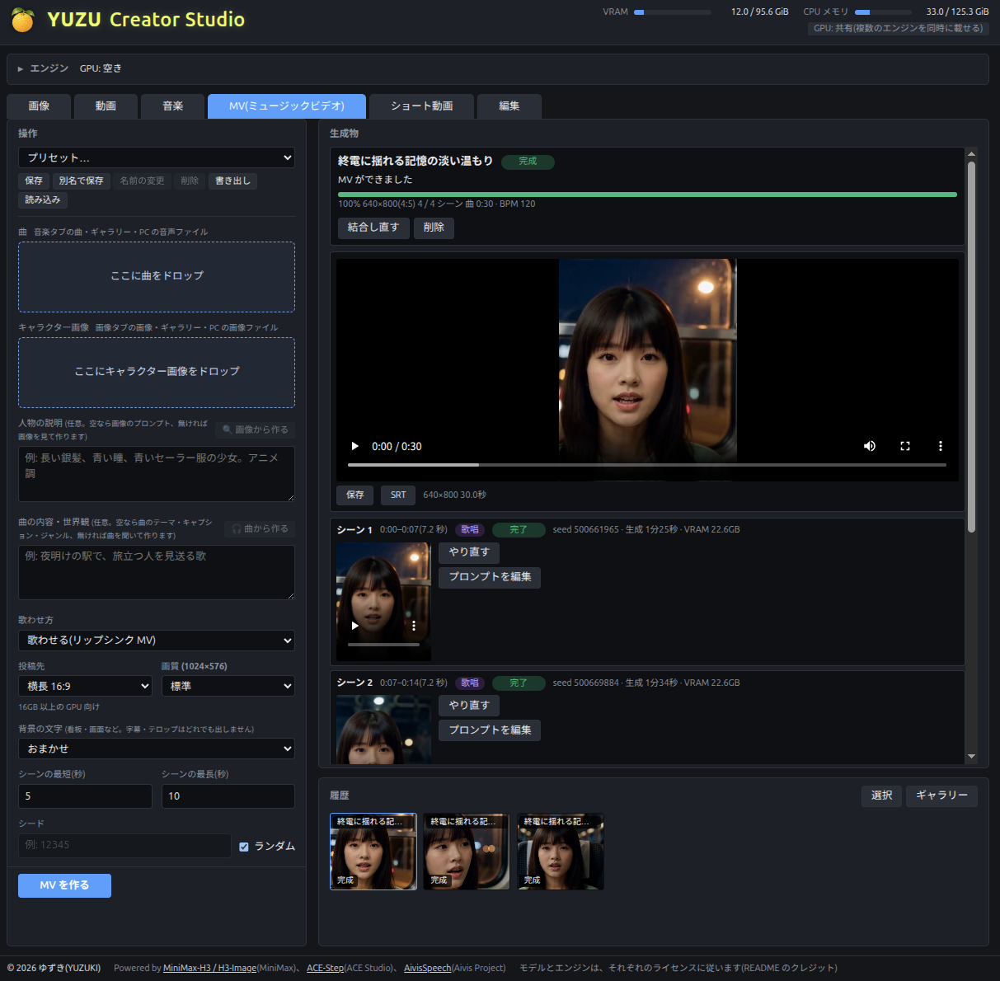

# YUZU Creator Studio

**日本語** | [English](README.en.md)

(リポジトリ名は `h3-creator-studio` のまま)

**最新版: v1.2.0(2026-11-28 JST)** — MV・ショート動画のシーンをやり直しても前の映像が残り、「テイクを比較」で見比べて「このテイクを採用」で戻せる(全シーンがそろっていれば生成し直さずに結合し直す。MCP にも `list_scene_takes` / `select_scene_take`。コントリビュータの PR)。Windows のセットアップで、Windows Terminal だと最後のメッセージ(失敗の理由や「もう一度実行」)が画面ごと消えていた不具合を修正し、経過を `logs\setup.log` にも残すように。デスクトップの起動アイコンを作れないときは理由を出し、`.\setup.bat --shortcut` でアイコンだけ作れる。v1.1.0(2026-11-27)で MCP サーバを試作、v1.0.0(2026-11-26)が最初の公開版。変更の履歴は [GitHub の commits](https://github.com/animede/h3-creator-studio/commits/main)。

画面の言語は、右上の「使い方」の隣で **日本語 / English** を切り替えられる(選んだ言語はブラウザに覚える。最初はブラウザの言語に合わせる。サーバからの進み具合・エラー・エンジンの状況の文も、選んだ言語で返る。訳の無い文とエンジン自身のログは日本語・原文のまま)。

**ブラウザ 1 枚で、画像・動画(音声つき)・音楽・読み上げ・ミュージックビデオ・物語の動画・編集まで。全部ローカルで、ノードをつなぐ必要はない。**
作者の以前の制作ツールの考え方を 1 つにまとめた、誰でも使える制作スタジオ。

## できること

- **画像**: テキストから生成、参照画像を使った編集(MiniMax-H3-Image)
- **動画(音声つき)**: テキストから / 最初・最後のフレームから / 参照画像・動画・音声から(MiniMax-H3)。静止画も作れる
- **音楽**: 歌つき・インストの曲を、テーマやジャンルから。歌詞は同梱 LLM が書く(ACE-Step)
- **読み上げ**: 文章から声を作って、動画の声の素材に(AivisSpeech)
- **MV**: キャラクター画像 1 枚と曲 1 つから、リップシンクミュージックビデオか、歌わないイメージ MV
- **ショート動画**: 物語の文章・曲・セリフ・参照画像から、物語性のある短い動画(長さの制限は無い。5 分を超えると生成に時間がかかると知らせる)。セリフは読み上げて口を合わせ、テロップも焼き込める
- **編集**: できた動画・画像・曲をつなぐ・切る・挿入する、色調・ズーム・パン・フェード、曲の差し替え。作った動画をつないで長い動画に仕上げられる。元に戻す / やり直す、プレビューつき(GPU 不要)
- **プロンプト強化・作詞・物語づくり**: 同梱 LLM(Gemma 4)が手伝う。画像を見て人物を説明し、曲を聞いて曲の内容を書く
- **ギャラリーとプリセット**: 作ったものはすべてギャラリーに残り、タブをまたいでドラッグ&ドロップで使い回せる。入力欄の値はプリセットに保存できる

## 特徴

- **目的ごとのワークフローをタブで切り替える**: 画像 / 動画 / 音楽 / MV / ショート動画 / 編集の 6 つのタブが、それぞれ完成までの手順(ComfyUI で言うワークフロー)を内蔵している。ノードをつなぐ代わりに、タブを選んで素材を落とすだけ。入力欄の値はプリセットとして保存でき、SNS 向けのサイズや曲調など、同梱のプリセットも選べる
- **低 VRAM で動く**: 各エンジンの低 VRAM 向けの経路(量子化キャッシュをディスクから流す、画角を絞る)を使い、**VRAM 6GB からでも動く**(推奨 12GB 以上)。CPU メモリは 32GB を前提に、16GB でも動画が作れる経路がある
- **VRAM の管理をアプリがする**: 40GB 未満の GPU では使うエンジンを 1 つずつ自動で載せ替え(降ろして載せる)、40GB 以上ではエンジンごとに VRAM の利用枠を決めて複数を同時に載せる。画面の上に VRAM・CPU メモリの使用量表示があり、Windows で VRAM があふれて共有 GPU メモリに逃げ始めたら警告する
- **生成の高速化**: 動画は turbo LoRA の 4 ステップ、音楽は 2B turbo の 8 ステップ、画像は W4A8 量子化で、入門機でも待てる時間に収める。GPU を使わない仕事(音声の分離・結合・編集)は生成を待たずに進む
- **停止しないジョブ実行**: 同梱 LLM は空き VRAM に入る分だけ載せ、GPU で生成する前に止める。生成中に頼まれたら CPU だけで動いて答える。長い制作(MV・ショート動画)は一時停止・再開・やり直しができ、管理役を再起動しても続きから進む
- **その他**: 編集は非破壊(元の動画は変えない)。すべてローカルで動き、外部に送らない。コードは Apache-2.0

## 作例

| ショート動画: 港町の一日(物語の文章だけ。曲も参照も無し、60 秒) | MV: 星降る夜に歌う(キャラクター画像 1 枚と曲から、リップシンク、30 秒) |
|---|---|
| [](samples/short-harbor-day/sample.mp4) | [](samples/mv-starry-night/sample.mp4) |
| [元の動画(音声つき、1024×576・60 秒)](samples/short-harbor-day/sample.mp4) | [元の動画(音声つき、768×448・30 秒)](samples/mv-starry-night/sample.mp4) |

GIF は冒頭 14 秒(クリックで元の動画)。元の動画と、作ったときの入力・素材は [samples/](samples/) にあり、アプリの各タブの **サンプル** ボタンからそのまま読み込める。

## VRAM・メモリの要件

| 項目 | 内容 |
|---|---|
| GPU | NVIDIA。VRAM の下限は設けない。6GB でも画角を絞れば動くが、時間がかかる。**推奨は 12GB 以上** |
| CPU メモリ | **32GB 以上を前提**。これより少ないと、動画の準備(量子化)と音楽の同梱 LLM が厳しくなる |
| ストレージ | **NVMe を推奨**。空きは **約 175GB**(4 つのエンジンのモデルと Python 環境の合計。内訳は下。`--no-ref` なら約 145GB) |

ストレージの内訳(モデルは各エンジンの低 VRAM 向けの準備経路で入れたときの大きさ。ダウンロード中に 1 つずつ量子化して元を消すので、途中で一時的に大きく膨らむことはない):

| エンジン | モデル | Python 環境 |
|---|---|---|
| MiniMax-H3(動画) | 約 60GB(量子化キャッシュ)+ 参照モード(Ref2VA / Vocal Lock)用 約 32GB(`--no-ref` で省ける) | 約 5GB |
| MiniMax-H3-Image(画像) | 約 25GB(うちテキストエンコーダ 約 17GB)+ 本体のキャッシュ 約 11GB(使うステップ数ごと。setup は既定の 6 だけ作る)。作るときに取得する bf16 のテキストエンコーダ 約 67GB と本体 約 62GB は、シャード 1 つずつ取得して消すので残らない(取得の合計は約 130GB)。動画のエンジンが 32B のテキストエンコーダを作ってあれば(32gb / 48gb 級、つまり およそ VRAM 20〜48GB のカードか、スタジオの共有モードで動いたとき。80gb / 96gb 級が作る層を減らさないエンコーダは使わない)、setup はそれを使い、約 67GB の取得を省く | 約 5GB |
| ACE-Step(音楽) | 約 15GB(2B 系。`--ace-xl` で +約 30GB) | 約 9GB |
| AivisSpeech(読み上げ) | 約 1.2GB(配布版。実行環境と標準の音声モデルを含む。取得は約 0.3GB) | —(配布版に含む) |
| 同梱 LLM / MV の道具 | 約 5.6GB(Gemma 4 E4B + 投影ファイル)/ 約 1.3GB | — |


## 稼働 OS

- **Windows 10 / 11**(x64、NVIDIA の GPU とドライバ。スタジオ本体は Windows 11(RTX 4060 Laptop 8GB、RAM 16GB)と Windows 10(RTX 3060 12GB、RAM 32GB)で、setup・MV・画像の edit・音楽・ショート動画を確認済み。各エンジン単体は RTX 3050 6GB / 3060 12GB / 4060 Laptop 8GB の実機でも確認済み)
- **Linux**(x64。Debian / Ubuntu 系。RTX A4000 16GB と RTX PRO 6000 96GB で確認)

### 前提

- **NVIDIA のドライバは CUDA 13 に対応したもの(580 以降)**。画像のエンジンが torch 2.11(cu130)を、動画と音楽のエンジンが cu128 の torch を使うため。ドライバが古いと、エンジンが CUDA を使えず起動に失敗する。
- **Windows 10** で下の「かんたん版」の 1 行(`winget`)を使うには、Microsoft Store の **アプリ インストーラー** が要る(Windows 11 には最初から入っている)。無ければ Store から入れるか、Git・Python 3.12・ffmpeg を手で入れる(uv は `setup.bat` が入れる)。

## 中で動いているエンジン

次の 4 つのエンジンを、別プロセスとして動かす(設定ファイルでは `[components.<名前>]` と呼ぶ)。どれも既存のリポジトリを、そのまま使っている。

| エンジン | 役目 |
|---|---|
| [MiniMax-H3](https://github.com/animede/Diffusers_minimax-h3) | 動画+音声(テキスト / 最初・最後のフレーム / 参照から)と静止画 |
| [MiniMax-H3-Image](https://github.com/animede/minimax-h3-image-server) | 画像(テキストから、参照画像で編集) |
| [ACE-Step](https://github.com/animede/ACE-Step-1.5-fast) | 音楽(歌つき、インスト) |
| [AivisSpeech](https://github.com/Aivis-Project/AivisSpeech-Engine) | 読み上げ(動画の声の素材づくり) |

**MV タブ** は、キャラクター画像 1 枚と曲 1 つから、口の合った MV(リップシンク MV)か、歌わないイメージ MV を作る。MiniMax-H3 の Ref2VA(+ 歌わせるときは Vocal Lock)をシーンごとに使い、ボーカルの分離には Demucs を使う(setup が既定で入れる)。
**ショート動画タブ** は、物語の文章・曲・セリフ・参照画像から、物語性のある短い動画を作る(長さは曲や文章しだい。5 分を超えると生成に時間がかかると知らせる)。MV タブの仕組みが土台で、H3 だけで作る。
**編集タブ** は、できた動画・画像・曲をつなぎ、切り、色を変え、音を差し替える簡単な編集。ffmpeg だけで動き、GPU は使わない(エンジンの起動も要らない)。

エンジンだけではできないのが **VRAM と CPU メモリの管理** で、それがこのアプリの役目(くわしくは「[VRAM と CPU メモリの管理](#vram-と-cpu-メモリの管理このアプリの特徴)」)。

## インストール

初回は **モデルのダウンロードで数時間**(約 175GB)かかる。回線が速くても 1 時間以上は見ておく。
途中で止めても、もう一度 setup を実行すれば続きから進む。

### Windows(かんたん版)

1. **PowerShell** を開き(スタートメニューで「PowerShell」と入力)、次の 1 行を貼り付けて実行する(Git、Python、ffmpeg の 3 つが入る)。

   ```powershell
   winget install --id Git.Git -e --source winget; winget install --id Python.Python.3.12 -e --source winget; winget install --id Gyan.FFmpeg -e --source winget
   ```

2. PowerShell を **閉じて開き直し**、次を貼り付ける(`C:\` 直下に取り込んで、セットアップを始める。モデルのダウンロードで数時間)。

   ```powershell
   cd C:\; git clone https://github.com/animede/h3-creator-studio.git; cd h3-creator-studio; .\setup.bat
   ```

   MV タブとショート動画タブ(曲を使うとき)が使う音声処理の道具(約 1.3GB)も、この 1 行で一緒に入る。要らなければ `.\setup.bat --no-mv` で飛ばせる。後からでも、MV タブの「道具を入れる」ボタンか `.\setup.bat --only mvtools` で入れられる。

   途中で「PowerShell を開き直してもう一度実行」と出たら、開き直して `cd C:\h3-creator-studio; .\setup.bat` をもう一度。途中で止まったときの理由も最後に出る(経過は `logs\setup.log` にも残る)。

3. 最後に「デスクトップに起動アイコン(YUZU Creator Studio)を作りますか? [Y/n]」と聞くので Enter。以後は**デスクトップのアイコンをダブルクリック**すると、スタジオが起動して、準備ができるとブラウザで **http://127.0.0.1:8700** が開く(起動中ならブラウザを開くだけ)。アイコンを作らなかったときは `.\run.bat` で起動し、ブラウザで開く。この質問が出なかったときや、後からアイコンだけ作るときは `.\setup.bat --shortcut`(作れなかったときは理由が出る)。

困ったら下の「Windows(詳しく)」と「トラブルシューティング」。

### Windows(詳しく)

PowerShell を開く(スタートメニューで「PowerShell」と入力)。次を順に実行する。

```powershell
winget install --id Git.Git -e --source winget
winget install --id Python.Python.3.12 -e --source winget
winget install --id Gyan.FFmpeg -e --source winget
```

入れ終えたら **PowerShell を閉じて、開き直す**(入れたものを認識させるため)。続けて、

```powershell
cd C:\
git clone https://github.com/animede/h3-creator-studio.git
cd C:\h3-creator-studio
.\setup.bat
```

- **置き場所は `C:\h3-creator-studio` のような短い英数字のパスにする。** 長いパスや日本語のユーザー名の下だと、動かない道具がある。
- **入手は `git clone` で行う(GitHub の ZIP は使わない)。** ZIP だと `.bat` の改行コード(CRLF)が崩れて動かないことがある。
- コンソールで Ctrl+C を押すと「バッチ ジョブを終了しますか」と聞かれる。**Y** を答える。また、簡易編集モードのままウィンドウの中をクリックすると出力が止まり、サーバーが固まったように見える(Enter で再開する)。

`setup.bat` は uv(Python の道具)を入れ、エンジンを `components\` に取り込み、環境とモデルを用意する。
uv を入れた直後に「PowerShell を開き直してもう一度実行」と出たら、その通りにする(ここまでで入れたのは uv だけ)。

### Linux

```bash
sudo apt install git ffmpeg curl      # Debian / Ubuntu の例
git clone https://github.com/animede/h3-creator-studio.git
cd h3-creator-studio
./setup.sh
```

### setup の主なオプション

| オプション | 意味 |
|---|---|
| `--no-models` | 環境だけ作る。モデルは後で(もう一度 setup を実行すると取得する) |
| `--only h3,ace` | 指定したエンジンだけ(`h3` `h3image` `ace` `aivis`。MV の音声処理の道具は `mvtools`)。`--only` を書いたときは書いたものだけを扱うので、道具も `mvtools` を並べなければ入れない |
| `--llm` | 同梱 LLM(約 5GB)と、画像・音声を読む投影ファイル(約 0.56GB。MV の「画像から作る」「曲から作る」用)も先に取得する。付けなくても、最初に使うときに取得する |
| `--no-mv` | MV タブの音声処理(Demucs・librosa、CPU 版 torch。ダウンロード約 0.3〜0.4GB、ディスク約 1.3GB)を入れない(既定では `components/mvtools/` に入れる)。`--only mvtools` でこれだけ。`--mv` は以前の名残で、付けても何も変わらない |
| `--ace-xl` | 音楽に XL モデルも入れる(約 45GB。既定は 2B のみで約 15GB) |
| `--no-ref` | 動画の参照モード(参照から・Vocal Lock)用のキャッシュ(約 32GB)を作らない。参照モードを使わない人向け(Windows と RAM 48GB 未満の PC では、MV と、参照画像を使う(人物の画像にセリフを合わせる、景色の画像を使う)ショート動画も作れなくなる。後から作るには下の「トラブルシューティング」) |
| `--components-dir <場所>` | エンジンの取り込み先を変える |
| `--clone-anyway` | 下の「既に入れている人」のフォルダがあっても、取り込み直す |

目安: MiniMax-H3 のモデル 約 60GB(いちばん時間がかかる)、MiniMax-H3-Image 約 25GB + 本体のキャッシュ 約 11GB(テキストエンコーダ 約 67GB と本体 約 62GB の bf16 を取得して量子化する。取得の合計は約 130GB、GPU を使う)、ACE-Step 約 15GB、AivisSpeech 約 0.3GB(取得。展開すると約 1.2GB)。

### 既に minimax-h3 などを入れている人

その場所を使える。コピーも再ダウンロードもしない。`studio.local.toml.example` を `studio.local.toml` という名前でコピーして、
使いたいエンジンの `dir` にフォルダを書く。

Windows の例(パスは `'...'` で囲むと、`\` をそのまま書ける):

```toml
[components.h3]
dir = 'C:\AI\minimax-h3'
[components.h3image]
dir = 'C:\AI\minimax-h3-image-server'
```

Linux の例:

```toml
[components.h3]
dir = "/home/you/minimax-h3"
[components.ace]
dir = "/home/you/ACE-Step-1.5-fast"
```

- `dir` を書いたエンジンは、setup が取り込みもモデル取得も飛ばす。そのフォルダに環境とモデルが済んでいることが前提。
- 書かなくても、setup は既に入れてあるエンジンを探す(ホーム直下と、ホームの `AI` `Documents` `github` `src`、Windows では各ドライブの直下と `\AI`。`Diffusers_minimax-h3` のような別名も)。見つけると「これを使いますか? [Y/n]」と聞き、**Enter(はい)で `studio.local.toml` に場所を自動で書いて**、取り込みもモデル取得も飛ばす。n なら書かずに、そのエンジンを飛ばす(勝手に取り込み直さない。取り込み直すなら `--clone-anyway`)。
- 既存の MiniMax-H3 は、setup が量子化キャッシュ(エンジンの `models\prequant` の、本体 `transformer_int8` と参照モード用 `transformer_ref_int8`)を確かめる。揃っていれば「キャッシュ: 本体 ✓ 参照用 ✓」と出るだけ。Windows と RAM 48GB 未満の PC で足りなければ、何が無いか(本体 約 60GB、参照モード用 約 32GB。作るのに数時間)を出して「いま作りますか? [Y/n]」と聞き、**Enter(はい)でエンジンの `scripts\prepare_lowvram.py --ref` を流す**(`--no-ref` なら `--ref` を付けず、参照モード用は数えない)。n のときと自動実行(端末でない)のときは、作るコマンドだけを出して先へ進む。エンジンの venv が無ければ、先にエンジンの install を、`prepare_lowvram.py` の無い古いエンジンなら、先に更新(下の「エンジンの更新」)を求める。RAM 48GB 以上の Linux では、エンジンが起動時に作れるので聞かない(作っておくコマンドを `--keep-source` 付きで出すだけ。prepare は量子化した bf16 の重みを消すため)。
- 既存の MiniMax-H3-Image は、setup が本体のキャッシュ(エンジンの `models\cache\ckw4a8_adaln_table` など。既定のステップ数 6、`[components.h3image.env]` に `H3IMG_STEPS` を書いていればその値)と、テキストエンコーダ(`models\te`)を確かめる。無ければ「いま作りますか? [Y/n]」と聞き、Enter(はい)でエンジンの `scripts\prepare_models.py --build-cache 6` を流す(1 時間ほど、GPU を使う。テキストエンコーダも無ければ、さらに約 67GB を取得する)。n のときと自動実行のときは、作るコマンドだけを出す。
- MiniMax-H3-Image にテキストエンコーダが無く、MiniMax-H3 が 32B のテキストエンコーダ(`models\prequant\te_bnb-4bit_prune1`。MiniMax-H3 が 32gb / 48gb 級、つまり およそ VRAM 20〜48GB のカードか、スタジオの共有モード(80〜96GB のカードでも 32gb 級になる)で動いたときに作られる。80gb / 96gb 級が作る層を減らさないエンコーダは使わない)を持っていれば、setup はそれを使うよう `studio.local.toml` の `[components.h3image.env]` に `H3IMG_TE_DIR` を書く(2 つのエンジンのテキストエンコーダは同じもの。約 67GB の取得と量子化を省く)。

## 起動と使い方

```powershell
.\run.bat        # Linux は ./run.sh
```

ブラウザで **http://127.0.0.1:8700** を開く。`.\run.bat --open`(Linux は `./run.sh --open`)なら、準備ができたらブラウザを自動で開く(Windows のデスクトップのアイコンはこれを呼ぶ)。止めるときは、起動した画面で `Ctrl+C` か、その画面を閉じる(エンジンもいっしょに止まる)。

**初回は、エンジンの起動にモデルの読み込みで数分かかる。** 画面の「エンジン」の行に進み具合が出る。待っていれば自動で使える状態になる。

### 画面

- **上**: メモリの使用量表示(VRAM・CPU メモリ。Windows では共有 GPU メモリも)と「エンジン」の一覧。今どのエンジンが GPU にいるか、起動中か、エラーかが分かる。その下に、GPU の使い方(エンジン 1 つずつ / 同時に複数)と、エンジンごとの実行中・待ちのジョブが出る。
- **使い方**(右上): 使い方の説明(docs/USAGE.md)がフローティングの窓で開く。いまのタブの節から表示する。
- **タブが 6 つ**: 画像 / 動画 / 音楽 / MV(ミュージックビデオ。リップシンク MV / イメージ MV)/ ショート動画 / 編集。
- **プリセット**: 編集以外の各タブの左上。入力欄の値に名前を付けて保存し、選ぶだけで呼び戻せる(下の「プリセット」)。
- **サンプル**: プリセットの欄の下の「サンプル」ボタン(サンプルのあるタブだけ。下の「サンプル」)。
- **左: 操作**。**右上: 生成物**(できたものを大きく表示、保存ボタン)。**右下: 履歴**(そのタブで作ったもの)。
- 履歴の「ギャラリー」ボタンで、右側が **ギャラリー**(すべての生成物。全て・画像・動画・音楽で絞り込み)に切り替わる。「戻る」で履歴に戻る。
- **ドラッグ&ドロップ**: 入力欄には、PC のファイルも、ギャラリーや履歴の生成物も、**同じ操作で落とせる**。作ったものを次の入力に使える。
- **削除**: 履歴・ギャラリーのサムネイルの「×」、生成物ビューアの「削除」、「選択」で選んでまとめて削除。ファイルも消え、元に戻せない。実行中・順番待ちのジョブや、続きのある MV の制作が使っているものは消せない。MV・ショート動画の制作を消すときは、完成した動画も消すか選べる。



### 画像タブ(MiniMax-H3-Image)

上の 2 つのボタンで作り方を選ぶ(名前は MiniMax-H3-Image と同じ)。

- **T2I(テキストから)**: プロンプトとサイズを決めて「生成」。
- **edit(参照画像で編集)**: 参照画像(最大 16 枚)を落とし、プロンプトで `<Picture 1>` のように番号で指して編集する。

「プロンプト強化」を押すと、短い指示を詳しいプロンプトに書き直してくれる(同梱 LLM)。
**画風** を選ぶと、生成のときに英語の画風の指示を足す(プロンプトの欄には入れない。edit では参照画像の見た目を保ち、背景・光・質感を画風に寄せる)。
edit では **アングル**(なし / 正面 / 斜め・左向き / 斜め・右向き / 真横 / 後ろ姿 / 見下ろし / 見上げ)を選ぶと、参照画像を別の向きから描き直す英語の指示を足す(人物・場所は保つ。左右は絵から見た向き。見上げは全身の絵になる。プロンプトが空でも作れる)。
**ステップ数** は、ステップ数ごとに本体のキャッシュ(約 11GB)を使う。既定は 6(モデル本来の手順。3 / 2 は近道で速いが、風景など広い面に格子状のざらつきが出ることがある)。setup が作るのは既定の 6 だけなので、2 や 3 を初めて選ぶと、その 1 回目はキャッシュ作り(62GB のダウンロード、1 時間以上)から始まる(欄の下に案内が出て、ジョブには「本体のキャッシュを作っています(初回だけ)」と出る)。先に作るなら、スタジオを止めて `cd <h3image のフォルダ>; .\.venv\Scripts\python.exe scripts\prepare_models.py --build-cache 2 3`。

### 動画タブ(MiniMax-H3)

上の 4 つのボタンで作り方を選ぶ(名前は MiniMax-H3 と同じ略語)。

- **T2VA(テキストから)**: 文章から動画と音声を作る。
- **FL2VA(最初・最後のフレームから)**: 最初の画像(と、あれば最後の画像)を指定して、その間を動かす。どちらか一方だけでもよい。
- **Ref2VA(参照から)**: 画像・動画・音声を参照にして作る。
- **T2I / Ref2I(静止画)**: 動画ではなく、静止画 1 枚を作る。参照があれば Ref2I、無ければ T2I。

解像度のネイティブは短辺 768。6GB のカードは 512²〜768×512 が現実的。長さは 5〜15 秒。

「音声を作る(読み上げ)」で、AivisSpeech が文章を読み上げた音声を作れる。それを**参照音声**として「参照から」に落とせば、声を指定した動画になる。
**Vocal Lock** にチェックすると、参照の音声をそのまま出力の音声にして、口の動きを合わせる。

**画風** は、生成のときにプロンプトの後ろに英語の指示を足す設定(欄の文は変わらない。プロンプト強化にも入らない)。

| 画風 | 足す指示(英語) |
|---|---|
| なし(参照画像に合わせる) | (足さない。既定) |
| リアル | photorealistic, natural lighting, real camera, true-to-life skin and materials |
| 映画 | cinematic film look, anamorphic framing, shallow depth of field, graded color |
| ドラマ | TV drama look, naturalistic lighting, handheld-feel camera, everyday locations |
| アニメ | Japanese anime style, clean line art, flat cel shading, expressive eyes |
| イラスト | digital illustration, clean shapes, bold colors, polished finish |
| スケッチ | pencil sketch, hand-drawn lines, hatching, paper texture, mostly monochrome |
| 水彩 | watercolor painting, soft bleeding edges, paper texture, muted palette |
| 油彩 | oil painting, visible brush strokes, rich impasto texture |
| 3DCG | 3D CG render, stylized characters, soft global illumination |

参照なしは `Visual style: <指示>.`、参照あり(Ref2VA / Ref2I / FL2VA、画像タブの edit、MV、画像を使うショート動画)は `Keep the referenced subject exactly as in the reference image; render the scene, background, lighting and materials in <指示>.` をプロンプトの後ろに足す。

### 音楽タブ(ACE-Step)

先頭の **作り方** で 2 つから選ぶ。

- **簡単(ジャンルから)**: ジャンルを選ぶだけで作れる。テーマ・歌詞・キャプションは、**空のものだけ**生成のときに AI が作る(自分で書いたものは作り直さない)。
  欄の横の 3 つのボタンで、生成の前に 1 つずつ作って直せる: **✨ テーマを作る** / **✍️ 作詞する**(テーマが空ならテーマも作る)/ **🎵 キャプションを作る**。
  「キャプション自動」(既定でオン)は、キャプションが空のとき生成時に AI が作る設定。ムード・ボーカル(もう一度押すと外れる)、歌の言語、長さ、**楽器のみ**(歌なし)も選べる。
  自分で書いたキャプションは、AI が作るテーマ・歌詞の雰囲気の参考にもなり(ムードを選んでいればムードが明示で、キャプションは補足)、ムードを選ばないときはスペクトラムの色もそこから決まる。
  **✍️ 歌詞を新しくして生成**(歌詞があるときだけ出る)は、歌詞を消して、テーマはそのままで歌詞とキャプションを作り直す。
  ジャンルのチップの **＋ 追加** で、自分のジャンルを作れる(名前を入れると、LLM が世界観・場面・感情の定義を作って保存し、✦ 付きのチップになる。中身は編集・削除できる)。**✎ 自由に書く** は、チップの代わりに「90 年代のシティポップに三味線を混ぜた、夏の終わりの切ない曲」のように文で指定でき(200 文字まで)、「ジャンルとして保存」でそれもチップにできる。
- **✨ おまかせ(一言から)**: 「雨の夜に聴く切ないバラード」のような一言だけで作る。管理役の LLM は使わず、ACE-Step の LM が歌詞・キャプション・BPM・調まで決める。

**詳細**(閉じてある)に、モデル(ACE の一覧から。未読込のモデルは生成の前に自動で読み込む。VRAM に載らないものは選べない)、STEP(Turbo 8、それ以外 50)、
Thinking、シード(ランダム / 指定 / **同じ骨格で作り直す** = 前回のシード)、ネガティブプロンプト、Shift、Sampler、曲数(1 / 2 / 4。2 曲以上は別々の生成物になる)がある。
作ったプラン(テーマ・キャプション・歌詞の先頭)は、生成中に下に表示される。曲名はテーマ(おまかせは一言)で、生成後に LLM は呼ばない。
曲の再生中は、生成物ビューアの曲のカードで**スペクトラム**が動く(色合いは自作のジャンルの雰囲気、無ければ曲のムード、それも無ければキャプションの言葉、それも無ければジャンルで決まる。カード右上の選択で、波形・リング・粒子・脈動・オーロラ・花火・マトリックス・軌道・炎・おまかせにも切り替えられ、選んだ表示は覚えておく。一時停止や終了で止まる)。

### MV タブ(リップシンク MV / イメージ MV)

キャラクター画像 1 枚と曲 1 つから、口の合った MV を作る(音声処理の道具は setup が既定で入れる。無ければタブに案内と「道具を入れる」ボタンが出る)。Windows と RAM 48GB 未満の PC では、MiniMax-H3 の参照モード用のキャッシュも要る(無ければタブの上に作るコマンドつきの案内が出て、**MV を作る** が押せない。作り方は「トラブルシューティング」)。
**歌わせ方** で「歌わせない(イメージ MV)」を選ぶと、キャラクターが歌わないイメージ映像(いわゆるイメージ PV)になる。曲は結合で付く(下の「歌わせない」を参照)。
**画風** を選ぶと、全シーンの演出をその画風にそろえる(キャラクターの見た目は画像のまま)。

1. **曲**(音楽タブの曲・ギャラリー・PC の音声ファイル)と **キャラクター画像**(画像タブの画像・ギャラリー・PC の画像)を落とす。
   ギャラリーから落とすと、画像のプロンプトが「人物の説明」に、曲のテーマとキャプションが「曲の内容」に入る(空のときだけ。自分で書き直してよい)。
   **外から持ち込んだ画像・曲**(プロンプトもテーマも無い)は、欄の横の **🔍 画像から作る**(同梱 LLM が画像を見て、髪・目・服・画風だけを日本語 1 行にする。CPU で 15 秒ほど、初回は画像・音声を読む投影ファイル 約 0.56GB を取得する)と
   **🎧 曲から作る**(同梱 LLM が曲の 30 秒を最大 2 か所聞いて、言語・ジャンル・雰囲気・楽器・ボーカル・テンポを読み取り、曲の内容・世界観の案を書く。CPU で 30 秒ほど。ACE-Step は使わず、GPU の載せ替えも要らない。読み取った内容は「曲の聞き取り(参考)」に閉じて出る。歌詞は聞き取らず、案にも使わない)で入れられる。
   入った文は確かめて直してから作れる(書いた文は、確認なしには置き換えない)。空のまま **MV を作る** を押しても、制作の中で同じことを自動でやり、制作の画面にどの説明が自動かが出る(曲を聞けなければ、曲の内容なしで作る)。
2. **画角**(横長 16:9 / 縦長 9:16 / 正方形 1:1 / 縦 4:5 / 横 4:5 / 手動入力)と **画質**(低 VRAM / 高速 / 標準 / 高画質)、シーンの長さ(5〜10 秒)を選んで **MV を作る**。

| 画角 | 低 VRAM | 高速 | 標準 | 高画質 |
|---|---|---|---|---|
| 横長 16:9 | 512×288 | 768×448 | 1024×576 | 1344×768 |
| 縦長 9:16 | 288×512 | 448×768 | 576×1024 | 768×1344 |
| 正方形 1:1 | 384×384 | 512×512 | 768×768 | 960×960 |
| 縦 4:5 | 416×512 | 512×640 | 640×800 | 768×960 |
| 横 4:5 | 512×416 | 640×512 | 800×640 | 960×768 |
| 手動入力 | 幅・高さを直接(256〜1344、32 の倍数に丸める。画質の欄は使わない) | | | |

低 VRAM は長辺 512 の小さな画で、6GB 以下の GPU や、まず速く試したいときに。

中では次の順に進む(右上に、シーンごとの状態と出来たクリップが出る)。

- **分離と分割**(CPU): Demucs でボーカルを分け、無音・息継ぎ・小節から 5〜10 秒のシーンに分ける。
- **曲を聞く**(同梱 LLM。曲の内容が空で、曲に台帳の情報が無いときだけ): 曲の一部を聞いて、曲の内容・世界観の案を作る(分析で分かった BPM も材料にする)。
- **演出**(同梱 LLM): 人物の説明が空なら画像を見て作ったうえで、人物の見た目(場所や光を除いたもの)を整理し、シーンごとの演出を MiniMax-H3 公式の Ref2VA の形式で書く。歌う区間は正面か 3/4 向きで口が見える構図にする。歌わない区間(前奏・間奏・後奏)は、引き・横から追う・見上げ・後ろからの構図を順に使い(曲の最後のシーンが歌わない区間なら、去っていく後ろ姿)、口を閉じた画にする。
- **シーンの生成**(MiniMax-H3): 画像とそのシーンのボーカルを参照に Ref2VA + Vocal Lock。1 シーン終わるごとに次を入れるので、その間に他のタブの生成が割り込める。
  **歌わせない**ときは、ボーカルを渡さず、画像だけを参照にシーンの尺(秒)を指定して作る(H3 が付ける音声は使わない)。口を動かしているのは音声の参照そのものなので、音声を渡さなければ「歌わない・口は閉じたまま」の指示が効く(作者の以前の制作ツールで確かめた)。演出も歌う前提を外し、歩く・見つめる・景色など、どんな構図でも使う。シーンの切れ目は同じ(分離したボーカルの谷・息継ぎ・小節)。
  口は動かないが、演出を書く LLM は「MV」からマイクやステージなど歌う場面を選ぶことがある(確認では、マイクを持って口が少し開くシーンが出た)。**景色や日常だけの映像にしたいときは、「曲の内容」に「マイクやステージは出さない。歌う場面は無い」のように、出したくないものを書く**(そのまま LLM に渡る。歌わせないを選ぶと、欄の下に同じ案内が出る)。
- **結合**: クリップをつなぎ、音声は元の曲に差し替えた MP4 にする(ギャラリーに入る)。

字幕・テロップ・歌詞の文字・タイトル・ロゴは、どのシーンにも出さないように指示している(H3 は MV らしい場面に字幕を描くことがあるため)。看板や画面などの **背景の文字** は、「おまかせ / 大きな文字だけ / 文字を出さない」から選べる(動画は大きく短い文字なら描けるが、小さな文章は崩れがち)。

一時停止 / 再開 / 中止、シーンごとの **やり直す**(seed を変える)と **プロンプトを編集** ができる。やり直したら自動で結合し直す。管理役を再起動しても、途中の MV は一時停止として残る。

時間の目安(同梱のサンプル「星降る夜に歌う」: 30 秒の曲、横長、歌わせる、5 シーン。シーンの長さは 6.3 / 5.4 / 6.5 / 6.5 / 5.2 秒。2026-11-26 の実測):

| GPU | 画質(大きさ) | シーンごとの生成時間 | シーンの合計 |
|---|---|---|---|
| RTX PRO 6000 96GB(Linux、共有モード) | 高速(768×448) | 1分33秒 / 1分12秒 / 1分13秒 / 1分14秒 / 1分12秒 | 6分25秒(分析・演出・結合を含む全体 7分30秒) |
| RTX 3080 Ti 12GB(Windows) | 高速(768×448) | 2分12秒 / 1分43秒 / 1分58秒 / 2分1秒 / 1分45秒 | 9分39秒 |
| RTX A4000 16GB(Linux) | 高速(768×448) | 約 3 分ずつ | 約 17 分 |
| RTX 4060 8GB(Windows) | 高速(768×448) | 5分23秒 / 3分48秒 / 4分9秒 / 4分5秒 / 3分36秒 | 21分1秒 |
| RTX 3060 12GB(Windows) | 高速(768×448) | 4分43秒 / 3分58秒 / 4分31秒 / 4分31秒 / 3分58秒 | 21分41秒 |
| RTX 3050 6GB(Windows) | 低 VRAM(512×288) | 4分14秒 / 3分36秒 / 3分6秒 / 3分59秒 / 3分39秒 | 18分34秒 |
| RTX 4060 Laptop 8GB(Windows、RAM 16GB、SATA 級の SSD) | 高速(768×448) | 5.5〜6.5 分ずつ | 約 31 分 |

最初のシーンはモデルの読み込みを含むので長め。曲が長いほど比例して増える。VRAM 14GB 未満のカードと Windows では、管理役が参照画像を読む大きさ(`H3_REF_IMAGE_SHORT_EDGE`)を自動で下げる(RTX 4060 Laptop は VRAM 7〜7.7GB、共有 GPU メモリ 0.8GB で安定)。

### ショート動画タブ

物語の文章から、物語性のある短い動画を作る。MV タブと同じ仕組み(分析 → 演出 → シーンごとの生成 → 結合)で、H3 だけを使う。曲だけの動画は MV と同じ音声分離(Demucs)を使うので、その場合だけ音声処理の道具が要る(setup が既定で入れる。セリフあり・どちらも無しなら要らない)。
**画風** を選ぶと、全シーンの演出をその画風にそろえる(参照画像があれば、その見た目は保つ)。

**入力**(左)

- **物語・映像のイメージ**: 何を描くか。LLM が全体の筋とシーン割りを書く材料になる。曲もセリフも無いときは必須、あれば任意。
- **曲**(任意。音楽タブの曲・ギャラリー・PC の音声ファイル): あれば BGM になる。
- **セリフ・ナレーション**(任意): あれば AivisSpeech で読み上げ、人物の画像があれば人物がそれに口を合わせる。人物の画像が無ければ **画面の外の声(ナレーション)** として景色のシーンに載せる(口は合わせない。下の表)。**📝 物語から作る** で、物語の文章からナレーションの案を書かせられる(確かめて直してから作る。書いた文は、確認なしには置き換えない)。空なら、セリフなしの動画。**話者** は動画タブの TTS と同じ AivisSpeech の一覧から選ぶ(セリフがあるときは必須)。
- **参照画像**(0〜4 枚。画像タブの画像・ギャラリー・PC の画像): 1 枚ごとに **役割** を選ぶ。落とした画像は **景色・物**(その場所・物を出すシーンの参照)になる。人物の画像なら役割を **人物** に選び直す(全シーンに同じ人物。1 枚まで。複数の出演者は扱わない)。画像タブの edit で作った画像は、その指示(「周囲を広げる」など)を説明に使わない(説明が空なら、制作の中で画像を見て作る)。人物の画像を入れると **人物の説明** の欄が出る(🔍 画像から作る は MV と同じ)。
- **長さ**: 曲があれば曲の長さ、セリフがあれば読み上げの長さ、どちらも無いときだけ指定する(30 秒〜1 時間、既定 60 秒)。セリフと曲の両方があれば読み上げの長さで、曲は BGM として下に敷く。
- **画角・画質・シーンの長さ(5〜10 秒)・背景の文字・シード** は MV と同じ。字幕・テロップは出さない。
- **最終の音声**: **自動** / **音声なし**(映像だけの MP4。他のツールで音を付けたい人向け)。完成後に **結合し直す** の横の選びで変えて、つなぎ直せる(前の動画はギャラリーに残る)。
- **セリフのテロップ(字幕)**: 「セリフのテロップ(字幕)を焼き込む」に印を付けると、読み上げの文の時刻どおりに白い字のテロップを画面の下(縦長は少し上)に焼き込む(音声認識は使わず、合成した文の時刻を使うので、ずれない)。同じ内容の **SRT** を最終の動画の隣に保存し(投稿サイトの字幕用)、完成の画面に **SRT** のリンクが出る。完成後に **結合し直す** の横の「テロップ」で付け外しできる。字体は `studio.local.toml` の `[mv] subtitle_font`(空なら Noto Sans CJK JP。無ければ ffmpeg(libass)が同じ文字を持つ字体に置き換える。Windows は Meiryo など)。セリフの無い制作では何もしない。

**時間軸は、入力で次のように決まる。**

| 入力 | 長さ | シーンの切り方 | シーンの音 |
|---|---|---|---|
| セリフあり + 人物の画像(曲は任意) | 読み上げの長さ | 文の切れ目で 5〜10 秒にまとめる | 人物の画像 + そのシーンの読み上げ(Ref2VA + Vocal Lock)。読み上げに口を合わせる |
| セリフあり、人物の画像なし(ナレーション) | 読み上げの長さ | 同じ | 景色の画像(あれば Ref2VA、無ければ T2VA)で、尺を指定して音なしで作り、結合で読み上げ(+ 曲を BGM)を載せる。演出は読み上げの文に沿って景色を描く(人物は映さない) |
| 曲だけ | 曲の長さ | MV と同じ(Demucs で分離し、無音・息継ぎ・小節で切る) | 音声を渡さず作り、結合で曲に差し替える |
| どちらも無し | 指定した長さ | LLM が物語から 5〜10 秒のシーンに割る | H3 が作る音(環境音・効果音)をそのまま残す |

- **セリフがあって人物の画像が無い**ときは、画面の外の声(ナレーション)になる(画面にも「人物の画像が無いので、ナレーション(画面の外の声)として景色に載せます」と出る)。口を合わせたいときは、役割を **人物** にした画像を入れる。人物の画像があるときは、読み上げが全編を通して流れるので、人物が映らないシーンは作れない。
- **最終の音声が自動のとき**: セリフがあれば読み上げ(曲は BGM として小さく混ぜ、読み上げの長さで切る。曲が短ければ繰り返さない)、曲だけなら曲、どちらも無ければ H3 の音。
- **5 分を超えると警告が出る**(止めはしない)。RTX A4000 の高速で 1 シーン約 3.5 分かかるので、5 分(約 40 シーン)の動画は約 2.3 時間、10 分なら約 4.7 時間。シーン数に比例して増える。PRO 6000 や 5090 ならその数分の 1。セリフの長さは読み上げを作るまで決まらないので、警告は文字数からの目安。

右側の制作の画面(進み・シーンごとの動画・最終の動画・履歴・削除)は MV タブと同じ。各シーンには、場所と、セリフ(あれば)・使った参照も出る。**seed・やり直す・プロンプトを編集・一時停止・再開・中止** も MV と同じように使える(やり直したら自動で結合し直す。管理役を再起動しても、途中の制作は一時停止として残る)。完成した動画は `outputs/video/short_<ID>.mp4`(結合し直すと `_2`…)。

### 編集タブ

ギャラリーの動画・画像・曲を、**つなぐ・区間を切る・途中に挿入する・色を変える・境目をつなぎ替える・曲を付け替える**、簡単な編集。**元の動画は一切変えない**(非破壊)。編集の中身は「どのクリップのどこを、どの順で、どんな効果で」という設定だけで、ffmpeg(CPU)で作り直す。**GPU もエンジンの起動も要らない**ので、MV や動画の生成と同時に使える。

1. 上の選びで **編集プロジェクト** を選ぶか、**新規** で名前を付けて作る(名前の変更・削除もここ)。
2. **クリップ** の欄に、動画・画像を落とす(動画タブ・MV・ショート動画の生成物、ギャラリー、PC のファイル)。**末尾に足されます**。
3. 区間や操作を選ぶと、**そのたびにプレビューが作り直される**。よければ **書き出し**。

| 操作 | できること |
|---|---|
| クリップの行 | **in / out**(動画のうち使う範囲。元の動画の秒)、画像は **秒数**(落としたときは 3 秒)。**▲▼** で並べ替え、**×** で外す(元の動画は残る)。サムネイルのクリックで、その位置を再生 |
| **区間を削除** | 開始〜終了を切り取って、前後をつなぐ。かかるクリップは、その位置で分けて(同じ動画の in / out を変えた 2 つに)入れ替える |
| **位置に挿入** | 別の動画・画像を、**開始** の位置に入れる(そこにあるクリップは分かれる)。画像は秒数を決める |
| **色調・調整** | 色調(見た目): モノクロ / セピア / 暖色 / 寒色 / フィルム風(退色)/ 周辺を暗く / 色を反転 / ぼかし。調整(値): 彩度(0〜3、1 でそのまま)/ コントラスト(0〜3、1 でそのまま)/ 明るさ(-1〜1、0 でそのまま)。**区間に適用** か **全体に適用**。付けた一覧の **×** で外す。いくつでも重ねられる |
| **選択区間の効果** | 区間の始めから終わりにかけて効く(区間の外は元のまま): 黒へフェード / 黒からフェード / 黒にする / 白へフェード / 白からフェード / ズームイン / ズームアウト(倍率 1.05〜2、中央へ寄る)/ 右へ・左へ・下へ・上へパン(倍率ぶん拡大して、見える窓を端から端へ動かす)/ ズームインしながら右へ・左へ。どれも挿入した静止画を動かす(ケン・バーンズ)のに向く。黒縁つきで入った静止画(正方形など)は、倍率を黒縁が消えるくらい(横長 16:9 に正方形なら 1.75 倍以上)にすると縁が見えない。黒で区切るなら「黒へフェード」→「黒にする」→「黒からフェード」を並べる |
| **境目の効果** | クリップの境目ごとに、カット / クロスフェード / 黒を挟む、と秒数(0.5〜2 秒。前後のクリップの短いほうの半分まで)。**区間の境目に適用** で、選択区間の中にある境目すべてに、区間の長さでまとめて付けられる。区間の削除や挿入で分けたところは、カットになる |
| **先頭フェードイン / 末尾フェードアウト** | 秒数。0 で無し |
| **音声** | 元の音 / 曲に差し替え / 元の音 + 曲(曲は -14dB で混ぜる)/ 音なし。曲は、欄に **音楽タブの曲・ギャラリー・PC の音声ファイル** を落とす(落とすと、元の音・音なしのときは「曲に差し替え」になる) |

**区間の指定の仕方**: **開始・終了** の秒を数字で入れる(矢印キーや Tab で動かせる)。または、右のプレビューを再生して目的の位置で止め、プレビューのすぐ下(左の区間の欄にも同じものがある)の **ここから** / **ここまで** を押すと、その位置が開始・終了に入る(いまの区間は右に「区間 a〜b 秒」と出る)。 **◀ 1 コマ** / **1 コマ ▶** で、止めた位置を 1 コマ(1/fps 秒)ずつ動かせる。 **クリア** で開始・終了を消す。**このコマを画像に** で、止めた位置のコマを元の動画から元の解像度の PNG にしてギャラリー(画像)に入れる(色調などの効果は掛からない。画像タブの参照や、編集の挿入にそのまま使える)。**全体** は 0〜最後。右の目盛り(クリップごとの帯)の上でクリックすると、その位置を再生でき、いまの区間が青い帯で重なる。

**ギャラリーから入れる**: 右下の **ギャラリー** を開くと(編集タブでは、上のプレビューは見えたまま右下に出る)、動画・画像をクリックするだけでクリップの末尾に入り、曲をクリックすると音声に入る(ギャラリーは開いたままなので、続けて選べる。「戻る」で履歴に戻る)。挿入は、挿入の欄へのドロップ。**区間の秒は、クロスフェードで縮む前の、クリップをつないだだけの時間** で数える(プレビューの再生位置からは「ここから」が自動で直してくれる)。区間を削除すると、色調の区間も削った分だけ詰まる。

**プレビューと書き出し**:

- 操作のたびに **プレビュー**(短辺 480 の軽い MP4)を作り直す。作っている間は動画がぼけて、進みが出る。続けて操作すると、作りかけは中止して新しく作る。「プレビューは古い版です」と出たら、**作り直す** を押す。
- **書き出し** は元の解像度の MP4(`outputs/video/edit_<ID>.mp4`。2 回目以降は `_2`…)で、ギャラリーに載る。数分かかることがある(進みが出る)。プレビューの下の「最後に書き出した動画」から保存でき、他のタブの入力欄にも落とせる。
- 出力の寸法とフレームレートは、**先頭のクリップ** に合わせる(画像だけなら 1024×576・24fps)。大きさの違う動画は、縮めて黒い縁を付ける。

**元に戻す / やり直す**: 操作 1 回が 1 段(最大 100 段)。管理役を再起動しても、戻せる。

右下の履歴は、**編集プロジェクトの一覧**(カードのクリックで開く。× で削除。「ギャラリー」で切り替え)。編集プロジェクトが使っている動画・画像・曲は、**ギャラリーから削除できない**。プロジェクトを消しても、書き出した動画はギャラリーに残る。

**やらないこと**: 字幕の入力、速度の変更、ピクチャインピクチャ、音量の細かい調整、キーフレーム、マウスで引くタイムライン。プリセットも無い(編集は素材ごとに違うため)。

### プリセット

編集以外の各タブの左上の欄で、入力欄の値(プロンプト・サイズ・秒数・STEP・モデル・ジャンルなど)に名前を付けて保存できる(編集は素材ごとに違うので、プリセットは無い)。選ぶと入力欄に反映する(生成はしない)。参照画像や曲など、落とした生成物はプリセットに含めない。

- **同梱のプリセット**(画像の画風、SNS 向けのサイズ、曲調、MV・ショート動画の画角など)は変更できない。「別名で保存」で複製してから編集する。
- 自分のプリセットは「保存」(選んでいるものの上書き)/「別名で保存」/「名前の変更」/「削除」。「書き出し」で JSON に保存し、「読み込み」で別の PC に移せる。

### サンプル

ショート動画タブと MV タブのプリセットの欄の下にある「サンプル」を押すと、同梱の見本(`samples/<id>/`)が並ぶ。各カードに、できあがりの動画(その場で再生できる)・説明・使う素材が出る。**「読み込む」** で、入力欄(物語・画角・画質・長さなど)と素材(参照画像・曲)が見本のとおりになる。生成はしないので、確かめてから「ショート動画を作る」「MV を作る」を押せば、同じ条件で作れる(いまの曲・参照画像・物語・セリフ・人物の説明は、見本のものに置き換わる)。

- いまのサンプルは 2 つ: ショート動画「港町の一日」(物語の文章だけ。曲もセリフも参照画像も無し)と、MV「星降る夜に歌う」(キャラクター画像 1 枚と音楽タブの曲から、歌う区間は口を合わせるリップシンク MV)。サンプルの無いタブでは、ボタンは出ない。
- 素材(画像・曲)は、読み込んだときに**ギャラリーへ 1 回だけ**コピーされる(`outputs/samples/<id>/`)。同じサンプルをもう一度読み込んでも、増えない。ギャラリーに入ったものは、ほかの生成物と同じに使え、消すこともできる(消してから読み込み直すと、また入る)。
- サンプルの動画・画像・曲は CC0(自由に使ってよい)。作例の素材は作者が各エンジンで生成したもの(画像は MiniMax-H3-Image、曲は ACE-Step、動画は MiniMax-H3)。
- 自分のサンプルを足すときは、`samples/<id>/sample.json`(タブ・題・説明・入力欄の値・素材・動画・サムネイル)と、そのファイルを置く(`<id>` はフォルダ名と同じ)。読めないもの・ファイルが足りないものは、管理役の起動時に警告を出して飛ばす。

## VRAM と CPU メモリの管理(このアプリの特徴)

GPU のメモリは足りない。4 つのエンジンを同時に載せると、すぐあふれる。そこで:

1. **載るだけ載せ、載らなければ待つ。** 生成はエンジンごとの通り道に並ぶ(同じエンジンは 1 つずつ)。別のエンジンの生成は、GPU に一緒に載るなら並行に走る。受け付けた順に見て、始められるものから始める。ただし先頭が「GPU の空き待ち」のときは、その仕事が降ろしたいエンジンに後から来た仕事を入れない(追い越され続けないように)。
   - **12〜24GB(`[gpu] mode` の既定 `auto` → エンジン 1 つずつ)**: GPU には 1 つだけ。画像なら MiniMax-H3-Image、動画なら MiniMax-H3、音楽なら ACE-Step。
   - **40GB 以上(`auto` → 同時に複数)**: エンジンごとに VRAM の利用枠を決め、起動するときに渡す(MiniMax-H3 は `H3_PROFILE` と `H3_VRAM_LIMIT_GB`、MiniMax-H3-Image は `H3IMG_VRAM_GB`、ACE-Step は `ACESTEP_GPU_PROFILE`)。利用枠の合計が GPU に収まる間は降ろさない。足りなくなったら、仕事中でないエンジンを使った時刻の古い順に降ろす。既定の利用枠は MiniMax-H3 = 総 VRAM の半分(最大 48GB)、MiniMax-H3-Image = 35%(最大 31GB)、ACE-Step = 14GB。`[components.<名前>] vram_budget_gb` で変えられる。
   - GPU を使わない仕事(MV の分離・分割・結合)は、GPU の生成と並行に進む(同時に 2 つまで)。
2. **載せ替えは自動。** 載せる場所が足りないとき、管理役が次の順で進める。
   1. 今 GPU にいるエンジンを空ける。**画像・動画のエンジンは退避**(モデルを GPU から降ろす。プロセスは残る)。**音楽は停止**(ACE-Step には降ろす方法が無いので、プロセスを止める)。生成中のエンジンがあると切り替えられない(「生成中のエンジンがあるので…」と出る)。終わってからもう一度押す。
   2. VRAM が空いたのを確かめる。
   3. 次のエンジンを起動、または再ロードして、準備ができるのを待つ(生成物の画面に手順が出る)。
3. **同梱 LLM(Gemma 4 E4B)** は、プロンプト強化・作詞・MV の演出と、画像から人物の説明を作る(画像入力)・曲を聞いて曲の内容を作る(音声入力)ために管理役が 1 つだけ持つ。GPU で生成している間に頼まれたら、**CPU だけで動かして答える**(GPU の生成は止めない)。最初に使うときに起こし、**いま GPU にいるエンジンの隣の空き VRAM に入る分だけ GPU に載せる**(入らない分は CPU)。**GPU で生成する直前に止めて** VRAM を返し、生成中は起こさない。各エンジンの内蔵 LLM は使わない。
4. **VRAM が 10GB 未満(8GB のカードなど)のときは、音楽に自動で省メモリの設定を入れる。** 次の 5 つ。
   - `ACESTEP_GPU_PROFILE=12gb`(2B モデルのプロファイル)
   - `ACESTEP_LM_OFFLOAD_TO_CPU=1`(言語モデルを CPU に置く)
   - `ACESTEP_RESIDENT_COMPONENTS=none`(常駐させるエンジンを無くす。空にはしない: Windows では空は未設定と同じ)
   - `ACESTEP_VAE_DECODE_CHUNK_SIZE=128`(最後のデコードを小さく区切る)
   - `ACESTEP_QUANTIZATION=int8_weight_only`(int8 に量子化)

   自分で変えたいときは、`studio.local.toml` の `[components.ace.env]` に書く。
5. **Windows の「共有 GPU メモリ」への退避に警告。** Windows は VRAM があふれると、CPU メモリを GPU メモリの代わりに使い始める。止まりはしないが、極端に遅くなる。画面の上に **「VRAM があふれて共有 GPU メモリに退避しています…」** と出たら、画角を小さくするか、他の GPU を使うアプリを閉じる。

6. **GPU が 2 枚以上ある PC。** 管理役が VRAM を数えるのは 1 枚だけ(管理役を起動した環境の `CUDA_VISIBLE_DEVICES` の先頭、無ければ 0 番)。既定(`[gpu] devices = "auto"`)では、すべてのエンジンと同梱 LLM に `CUDA_VISIBLE_DEVICES=<その番号>` を渡して同じ 1 枚に寄せる(MiniMax-H3-Image が 2 枚目の小さい GPU に TE を置いて OOM になる、などを防ぐ)。画面の上には「使用 GPU: 0 <名前>」と出る。別の GPU を使うなら `devices = "1"` など番号を、寄せたくなければ `devices = "all"` を `studio.local.toml` の `[gpu]` に書く(VRAM の計算は 1 枚分のまま)。管理役を起動する環境や `[components.<名前>.env]` に `CUDA_VISIBLE_DEVICES` を書いたときは、そちらが優先。

### メモリの使用量表示の見方

- **VRAM**: GPU のメモリの使用量(nvidia-smi を 2 秒おきに読む)。
- **共有 GPU メモリ**: Windows だけ。ここが増えたら、VRAM があふれている合図。
- **CPU メモリ**: エンジンのプロセスが使っている分も含めた、PC 全体の使用量。32GB に近づくと、量子化や LLM が遅くなる。

## エンジンの更新(git pull)

各エンジンは、`components\` の中の **普通の git のクローン**。更新は、そのエンジンのフォルダで `git pull` して、**そのエンジンのセットアップをもう一度**実行する(済んでいる所は飛ばすので、短く終わる)。

**更新の前に、管理役を止める**(`run.bat` の画面で `Ctrl+C`)。`studio.local.toml` の `dir` で別の場所を指しているエンジンは、その場所のフォルダで行う。

| エンジン | フォルダ | 更新 |
|---|---|---|
| MiniMax-H3 | `components\minimax-h3` | `git pull` → `.\scripts\install.bat`(Linux: `bash scripts/install.sh`)→ モデルの更新があるときだけ `.\venv\Scripts\python.exe scripts\prepare_lowvram.py --ref`(Linux: `venv/bin/python scripts/prepare_lowvram.py --ref`。`--no-ref` で入れた人は `--ref` を付けない) |
| MiniMax-H3-Image | `components\minimax-h3-image-server` | `git pull` → `uv pip install --python .venv\Scripts\python.exe -r requirements-windows.txt`(Linux: `uv pip install --python .venv/bin/python -r requirements.txt`)→ モデルの更新があるときだけ `.venv\Scripts\python.exe scripts\prepare_models.py`(Linux: `.venv/bin/python scripts/prepare_models.py`) |
| ACE-Step | `components\ACE-Step-1.5-fast` | `git pull` → `.\setup.bat --12gb`(Linux: `./setup.sh --12gb --no-client`)。XL モデルも入れているなら `--12gb` を外す |
| AivisSpeech | `components\AivisSpeech-Engine` | git ではない(配布版)。フォルダを消して、Studio の `setup` をもう一度実行すると、取得し直す |

たとえば Windows で MiniMax-H3 を更新するなら:

```powershell
cd components\minimax-h3
git pull
.\scripts\install.bat
cd ..\..
```

- モデルの更新があるかは、そのエンジンの README / 更新履歴に書いてある。迷ったら、準備のコマンドを実行してよい(済んでいるものは数秒で飛ばす)。
- `git pull` が「手元の変更があるので…」と止まったら、そのフォルダを自分で触った跡。`git status` で確かめてから、`git stash` するか、変更を戻す。

**Studio 自身の更新**:

```powershell
git pull
.\setup.bat --no-models
```

`--no-models` は管理役の環境(`.venv`)の更新と、足りないエンジンの取り込み、各エンジンの環境の確認(済んでいれば短く終わる)をする。エンジンのモデルは触らない。

**エンジンを入れ直したいとき**は、そのフォルダを消して、`setup` を実行し直す(消したフォルダだけ、取り込みから用意する)。`studio.local.toml` の `dir` で指しているフォルダは、setup は消さない。自分で消す。

## AI エージェントから使う(任意)

Claude などの AI エージェントから、言葉の指示でスタジオを操作することもできる(MCP サーバ、試作)。使う人向けの説明は [agent/README.md](agent/README.md)。**使わない人は何もしなくてよい**(setup は MCP の部品を入れず、スタジオの使い方も変わらない)。

## 設定

`studio.toml` が既定の設定(リポジトリに含まれる)。自分の PC の設定は **`studio.local.toml`** に書く(git の管理外。書いた項目だけが上書きされる。見本は `studio.local.toml.example`)。

| 項目 | 意味 |
|---|---|
| `host` / `port` | 管理役の待ち受け。既定は `127.0.0.1` / `8700`。他の PC に公開はしない(第 1 版) |
| `components_dir` | エンジンを取り込む場所。既定は `components` |
| `[components.<名前>]` の `dir` | エンジンの場所を直接指す。書くと、取り込みもモデル取得も飛ばす |
| 同 `enabled` | `false` でそのエンジンを使わない(例: 音楽は要らない) |
| 同 `port` | エンジンのポート(競合したとき変える) |
| 同 `env` | エンジンに渡す環境変数。`[components.h3.env]` のように書く |
| `[llm]` の `port` / `tools_dir` | 同梱 LLM(llama-server)のポート(既定 8701)と、取得先のフォルダ |
| `[llm]` の `gpu` | 同梱 LLM を載せる先。`auto`(空きに入る分だけ GPU)/ `off`(CPU のみ)/ `all` / 層数 |
| `[llm]` の `gguf` / `llama_server` / `mmproj` | 書くと、取得せずに、そのファイルを使う(`mmproj` は画像・音声を読む投影ファイル。空なら自動で探し、無ければ「画像から作る」「曲から作る」で 1 回だけ取得する) |
| `[gpu]` の `mode` | `auto`(総 VRAM 40GiB 以上なら同時に複数、未満なら エンジン 1 つずつ)/ `exclusive`(エンジン 1 つずつ)/ `share`(同時に複数) |
| `[gpu]` の `devices` | GPU が 2 枚以上ある PC で、エンジンを動かす GPU。`auto`(管理役が VRAM を数える 1 枚に、すべてのエンジンを寄せる)/ `all`(寄せない)/ `"1"` などの番号 |
| `[gpu]` の `free_cpu_engines` | GPU の仕事の前に、待機中の読み上げ(AivisSpeech)と同梱 LLM を止めて RAM を空けるか。`auto`(搭載 RAM 32GiB 未満のときだけ)/ `always` / `never` |
| `[components.<名前>]` の `vram_budget_gb` | 同時に複数載せるときの、そのエンジンの VRAM の利用枠(GB) |
| `[mv]` の `tools_python` | MV の音声処理(Demucs・librosa)を動かす Python。空なら setup が作る `components/mvtools/.venv` |
| `[mv]` の `device` | ボーカル分離の場所。既定 `cpu`(GPU の生成と並行に動く) |
| `[mv]` の `subtitle_font` | ショート動画のセリフのテロップ(字幕)の字体。空なら Noto Sans CJK JP(無ければ libass が同じ文字を持つ字体に置き換える。Windows は `"Meiryo"` など) |

エンジンの名前は `h3` / `h3image` / `ace` / `aivis`。

## トラブルシューティング

- **setup がどこで止まったか分からない**: 経過は `logs\setup.log`(Linux は `logs/setup.log`)に追記されている。最後の「===== 終わり … 終了コード N =====」の手前に、止まった手順と理由がある(エンジンのスクリプト自身の出力は画面にだけ出る)。以前の setup.bat は、Windows Terminal で最後のメッセージが画面ごと消えることがあった(2026-11-28 に直した)。
- **エンジンが「エラー」と出る**: その行の「ログ」を開く。同じ内容は `logs\<名前>.log`(`logs/h3.log` など)にある。モデルが無い、環境が無い、のときは、setup をもう一度実行する。
- **「〇〇 の Python 環境が不完全です(モジュール uvicorn がありません)」と出る**: そのエンジンの仮想環境の導入が途中で終わっている(ログに `No module named ...` がある)。スタジオを止めてから、`.\setup.bat --only <名前>`(Linux は `./setup.sh --only <名前>`)を実行する。名前は h3 / h3image / ace など、案内の文に出ているもの。
- **ポートが使われている**: 8700(管理役)、8701(同梱 LLM)、8611(動画)、8633(画像)、8001(音楽)、10101(読み上げ)のどれかを別のアプリが使っている。相手を止めるか、`studio.local.toml` でポートを変える。
- **「VRAM があふれて…」と警告が出る**: 画角(サイズ・解像度)を下げる。他の GPU アプリ(ブラウザの動画再生、ゲーム、別の生成ツール)を閉じる。
- **「中止」を押してもすぐ止まらない**: 中止は **いまのステップの後で止まる**。音楽は、言語モデル(LM)の段と、最後のデコードの最中は止まらないことがある。
- **外部で動いているエンジンは止めない**: 管理役が起動したものだけを止める。別に起動していたエンジンがすでにポートで待ち受けていれば、それをそのまま使い、停止はしない(画面にも「外部」と出る)。画像・動画のエンジンは外部でも GPU から降ろせるが、ACE-Step は降ろす方法が無く、止めるしかない。外部の ACE-Step が GPU にいて載せ替えが必要なときは、GPU に次のエンジンの分(目安: 動画 12GB、画像 13.5GB、音楽 14GB + 1GB)の空きがあれば止めずに同居し、無ければ「同居できません」と断る。その場合は先に自分で止めるか、`studio.local.toml` の `[components.ace]` に別の `port` を書いて管理役に起こさせる。
- **CPU メモリが足りない**: 動画の準備(量子化)中に落ちるときは、他のアプリを閉じる。32GB 未満では、動画と同梱 LLM が厳しい。搭載 RAM が 32GiB 未満の PC では、GPU の仕事(画像・動画・音楽・MV・ショート動画のシーン)を始める前に、待機中の AivisSpeech(管理役が起動したもの・読み上げ中でない)と同梱 LLM(使用中でない)を自動で止める(ジョブに「メモリを空けています(読み上げ・同梱 LLM を止めます)」と出る。どちらも次に使うときに起動し直す)。`studio.local.toml` の `[gpu] free_cpu_engines` で `"auto"`(既定)/ `"always"` / `"never"` を選べる。同梱 LLM はエンジンの欄にも行があり(停止 / 起動中 / 準備完了(GPU / CPU)・RAM)、**停止** で手で止められる。
- **「動画(MiniMax-H3) が終了していました(RAM 不足の可能性があります)。ログの最後: …」と出る**: 生成の途中でエンジンのプロセスが終わっていた(多くは RAM が足りず OS に止められた。ログが「Loading checkpoint shards」の途中で切れている、など)。管理役はそのエンジンを停止扱いにし、**1 回だけ自動で起動し直してやり直す**(MV・ショート動画のシーン、画像・動画・音楽のジョブ)。2 回目も終了したら失敗にする。他のアプリを閉じて RAM を空けてから、やり直す・再開する。ジョブの詳しいログ(`log_tail`)にエンジンのログの末尾が入る。
- **MV タブに「MV の音声処理の道具…が見つかりません」と出る**(`--no-mv` で入れなかったとき、または以前の setup のとき): タブの「道具を入れる(約 1.3GB)」ボタンを押すか、`.\setup.bat --only mvtools`(Linux は `./setup.sh --only mvtools`)で音声処理の道具を入れる。すでに Demucs と librosa の入った Python があれば `[mv] tools_python` に書けば入れなくてよい。
- **「MiniMax-H3 の参照モード用のキャッシュ(transformer_ref_int8、約 32GB)がありません」と出る**(MV タブ・ショート動画タブの上と、動画タブの Ref2VA / 静止画(参照あり)にも、同じ案内が出る。MV タブでは **MV を作る** が押せない): Windows と RAM 48GB 未満の PC では、エンジンが重みを量子化キャッシュのファイルから流すので、参照モード(MV、参照画像を使うショート動画、動画タブの Ref2VA / Ref2I)にこのキャッシュが要る(参照画像の無いショート動画は、セリフだけのナレーションでも要らない)。setup で入れたエンジンには作ってあるが、既に入れてあったエンジン(`dir` を書いた、または setup が見つけた)には無いことがある。`--no-ref` で入れた人も無い(`--no-ref` が省くのが、まさにこのキャッシュ)。1 回だけ、次の手順で作る。
  1. スタジオを止める(`run.bat` の画面で `Ctrl+C`)。RAM を空けるため。作るのに GPU は使わない。
  2. PowerShell で `cd <h3 のフォルダ>; .\venv\Scripts\python.exe scripts\prepare_lowvram.py --ref` を実行する(Linux は `cd <h3 のフォルダ> && venv/bin/python scripts/prepare_lowvram.py --ref`)。h3 のフォルダは、`studio.local.toml` の `[components.h3]` の `dir`。書いていなければ、スタジオのフォルダの `components\minimax-h3`(例: `C:\h3-creator-studio\components\minimax-h3`)。画面の案内とエラーには、この PC 用のコマンドがそのまま出る。
  3. これは transformer_ref(66GB)をシャード 1 つずつ取得して量子化し、取得した分は消しながら、`models\prequant\transformer_ref_int8` に約 32GB を書く。ディスクの空きが約 37GB 要る。回線次第で数時間。RAM 16GB でも作れる。できているキャッシュ(本体の `transformer_int8` など)は飛ばす。途中で止めても壊れない。同じコマンドをもう一度実行すればよい(ただし、作りかけの参照モード用は最初から作り直す)。
  4. 終わったら `run.bat` でスタジオを起動し、失敗した制作の **再開** を押す。曲の分析と演出はそのまま使い、シーンだけを作り直す(作る前に断られたときは、もう一度作ればよい)。
  5. 代わりに `.\setup.bat --only h3`(Linux は `./setup.sh --only h3`)でもよい。キャッシュを確かめて「いま作りますか?」と聞き、同じコマンドを流す。
- **MV・ショート動画・「参照から」が「CUDA out of memory. Tried to allocate 6.87 GiB … 6.88 GiB allowed」で失敗する**(Windows。8GB・12GB・16GB のカードで報告): 動画のエンジンは参照画像を短辺 2048 に拡大して読むのが既定で、Windows ではその注意の計算が 1 回で約 6.9GB を確保する(Windows 版の PyTorch には、Linux 版が使う省メモリの経路が無いと見ている。Linux では 16GB の Windows 相当の上限をかけても最大 7GB で通る)。管理役は、VRAM 14GB 未満では OS を問わず `H3_REF_IMAGE_SHORT_EDGE=768`、14GB 以上の Windows では `1024` を自動で入れるので、更新すれば起きない(768 は RTX 4060 Laptop 8GB で MV を通した値。拡大の量の 2 乗で効くので、1024 で約 1/16)。それでも出たら、`studio.local.toml` の `[components.h3.env]` に `H3_REF_IMAGE_SHORT_EDGE = "768"` を書く(参照の細部がわずかに減る。小さいほど速い)。6GB のカードは実機で未確認(Linux で 6GB 相当の上限をかけた模擬では通ったが、Windows の注意の計算の重さは再現できない)。
- **setup の途中で「原本を削除できません(他プロセスが開いているか mmap が残っています)」と出た / ディスクが思ったより減った**: 動画のエンジンの準備は bf16 のシャード(1 本 約 4.6GB)を 1 本ずつ取得して量子化し、読み終わったら消すが、Windows では Defender の検査などがファイルを掴んでいて消せないことがあり、残したまま続ける(キャッシュ自体は正しくできている)。新しいエンジンは準備の最後にもう一度消し、setup も次に実行したときに、使っていない版のフォルダ(配布元の更新の前に取得した `snapshots\\<英数字>`。`refs\\main` に書かれていないもの)と、int8 キャッシュが完成している分の原本(`%USERPROFILE%\.cache\huggingface\hub\models--MiniMaxAI--MiniMax-H3\snapshots\...\transformer` と `transformer_ref` の `diffusion_pytorch_model-*.safetensors`)を消して「◯GB を空けました」と出す。手で消す場合も同じファイルだけを、エンジンとスタジオを止めてから消す(`.json` や `vae` などの小さなファイルは残す)。
- **画像の生成が「画像のエンジン(MiniMax-H3-Image)のモデルの準備が終わっていません(テキストエンコーダがありません)」で失敗する**(画像タブにも同じ案内が出る): setup の途中で止めたか、既にあったエンジンを「使う」と答えて、モデルの準備がされていない。スタジオを止めてから `.\setup.bat --only h3image`(Linux は `./setup.sh --only h3image`)を最後まで実行する(テキストエンコーダの準備で約 67GB を取得する)。
- **最初の画像の生成が 1 時間以上かかる / ダウンロードが続く**(RAM が何度も埋まる): MiniMax-H3-Image の本体のキャッシュ(ステップ数ごと、約 11GB)が無く、最初の生成で bf16 の本体(約 62GB)をシャード 1 つずつ取得して量子化している。以前の setup はこのキャッシュを作らなかった。止めずに待てば、できあがった後は速い(ジョブには「本体のキャッシュを作っています(初回だけ)」と出る)。先に作るなら、スタジオを止めて PowerShell で `cd <h3image のフォルダ>; .\.venv\Scripts\python.exe scripts\prepare_models.py --build-cache 6` を実行する(Linux は `cd <h3image のフォルダ> && .venv/bin/python scripts/prepare_models.py --build-cache 6`。GPU を使う)。`.\setup.bat --only h3image` でも確かめて作れる。2 や 6 のステップ数を使うなら、その数も並べる。
- **ジョブに「GPU の空きを待っています」と出る**: 別のエンジンが生成中で、終わらないと載せられない。終われば自動で始まる(中止もできる)。
- **setup が途中で失敗した**: 失敗した手順と、それだけをやり直すコマンドが画面に出る。原因を直して、setup をもう一度実行すれば、続きから進む。
- **問題の報告**: [GitHub の Issues](https://github.com/animede/h3-creator-studio/issues) へ。そろえるものは [docs/USAGE.md の「不具合を知らせるとき」](docs/USAGE.md#不具合を知らせるとき)。

## アンインストール

setup は、取り込んだフォルダの外にはほとんど何も入れない。

1. スタジオを止めて(`run.bat` の画面で `Ctrl+C`)、**取り込んだフォルダ(`C:\h3-creator-studio` など)を丸ごと消す**。エンジン(`components\`)、同梱 LLM(`components\llm`)、MV の音声処理の道具(`components\mvtools`)、生成物(`outputs\`)、ログ(`logs\`)、管理役の環境(`.venv\`)は、すべてこの中にある。残したい生成物は、先に `outputs\` から出しておく。`studio.local.toml` の `dir` や `components_dir` で別の場所を指した人は、そこも消す。
2. フォルダの外に残るものは、要らなければ自分で消す。
   - **uv**(Python の道具): Linux は `~/.local/bin/uv`、Windows は winget で入れたもの(`winget uninstall --id astral-sh.uv`)か `%USERPROFILE%\.local\bin\uv.exe`。uv が入れた Python とキャッシュの場所は `uv python dir` と `uv cache dir` で分かる(キャッシュは `uv cache clean`)。
   - **Hugging Face のキャッシュ**: 動画・画像のエンジンがモデルを取得するときに使う。Linux は `~/.cache/huggingface`、Windows は `%USERPROFILE%\.cache\huggingface`。
   - **Demucs の重み**(MV の音声処理): torch のキャッシュ。Linux は `~/.cache/torch`、Windows は `%USERPROFILE%\.cache\torch`。
   - Git・Python・ffmpeg(winget で入れたもの)は一般の道具。ほかで使わないなら `winget uninstall` で消す。

## 構成

```
h3-creator-studio/
├── README.md / README.en.md  この説明(日本語 / 英語)
├── docs/USAGE.md / docs/USAGE.en.md  使い方(画面の「使い方」の窓にも出る。日本語 / 英語)
├── docs/img/              説明の画像(画面の例と作例の GIF)
├── setup.bat / setup.sh   セットアップ(uv を入れ、scripts/setup.py を呼ぶ)
├── run.bat / run.sh       管理役の起動
├── scripts/setup.py       エンジンの取り込み、環境とモデルの準備(エンジン自身のスクリプトを呼ぶ)
├── agent/                 AI エージェントから使う人向け(MCP サーバとスキル。任意。使わない人は不要)
├── studio/                管理役(FastAPI): エンジンの起動と停止、載せ替え、メモリ監視、ジョブ、LLM、MV・ショート動画の制作、編集
├── studio/mvtools/        MV・ショート動画の音声処理(ボーカル分離・シーン分割。components/mvtools の Python で動かす)
├── presets/               同梱のプリセット(タブごとの JSON)
├── samples/               同梱のサンプル(`<id>/` ごとに sample.json・できあがりの動画・サムネイル・素材の画像と曲。CC0)
├── web/                   画面(素の HTML / JavaScript / CSS。ビルド不要)
├── studio.toml            既定の設定
├── studio.local.toml      自分の設定(git の管理外)
├── studio.local.toml.example  自分の設定の見本
├── pyproject.toml / requirements.txt  管理役の Python の依存
├── LICENSE / NOTICE       Apache-2.0 と、移植したファイル・使う第三者のソフトウェアの記録
├── components/            取り込んだエンジン(それぞれ独立した git リポジトリ。git の管理外)と、llm(同梱 LLM)、mvtools(MV の音声処理の環境)
├── outputs/               生成物と台帳(studio.db)(git の管理外)
├── logs/                  エンジンのログ(git の管理外)
├── tests/                 テスト(`python -m unittest discover -s tests -t .`)
└── docs/SPEC.md           仕様
```

## クレジット

- **このアプリ**: © 2026 ゆずき(YUZUKI、GitHub: animede)。コードは Apache License 2.0([LICENSE](LICENSE)、[NOTICE](NOTICE))。
- **[MiniMax-H3 / MiniMax-H3-Image](https://huggingface.co/MiniMaxAI)**(MiniMax): 動画・音声・静止画・画像のモデル。モデルの重みは MiniMax Community License(非商用は無料、商用は年商 $20M 未満まで、要クレジット。本家のモデルカードを確認)。このアプリは [Diffusers_minimax-h3](https://github.com/animede/Diffusers_minimax-h3) と [minimax-h3-image-server](https://github.com/animede/minimax-h3-image-server)(Diffusers_minimax-h3 は Apache-2.0、minimax-h3-image-server は MIT)をエンジンとして動かす。
- **[ACE-Step](https://github.com/ace-step/ACE-Step)**(ACE Studio / StepFun): 音楽のモデル(MIT)。エンジンは [ACE-Step-1.5-fast](https://github.com/animede/ACE-Step-1.5-fast)(MIT)。
- **[AivisSpeech-Engine](https://github.com/Aivis-Project/AivisSpeech-Engine)**(Aivis Project): 読み上げ(LGPL-3.0。別プロセスとして HTTP で呼ぶだけで、組み込まない)。音声モデル(aivm)は、それぞれの作者の利用規約に従う。
- そのほか: [llama.cpp](https://github.com/ggml-org/llama.cpp)(MIT)と Google の Gemma 4(同梱 LLM。GGUF(Gemma 4 E4B)は `setup --llm` か、最初に使うときに [ggml-org/gemma-4-E4B-it-GGUF](https://huggingface.co/ggml-org/gemma-4-E4B-it-GGUF) から取得する。[Gemma Terms of Use](https://ai.google.dev/gemma/terms) と、その禁止用途の方針(Prohibited Use Policy)に従うもので、取得して使うことはそれらに同意することになる)、[Demucs](https://github.com/facebookresearch/demucs)(MIT)、[librosa](https://librosa.org/)(ISC)、[ffmpeg](https://ffmpeg.org/)(LGPL/GPL。PATH のものを使う)。

画面の下にも、著作権と主なエンジンのクレジットを出している。

## ライセンス

Apache License 2.0([LICENSE](LICENSE))。© 2026 YUZUKI(ゆずき)。再配布のときは著作権表示と [NOTICE](NOTICE) を保つ(Apache-2.0 第 4 条)。エンジンとモデルは、それぞれのライセンスに従う。MV のシーン分割と演出の組み立て(`studio/mvtools/`、`studio/mvscript.py`、`studio/mvclip.py`、`studio/mvdescribe.py`、`studio/mvsub.py`)は、同じ作者の [Minimax-H3-lipsync-mv](https://github.com/animede/Minimax-H3-lipsync-mv)(Apache-2.0)からの移植([NOTICE](NOTICE))。

## 謝辞

- [MiniMax-H3 / MiniMax-H3-Image](https://huggingface.co/MiniMaxAI)(MiniMax)のモデルと、diffusers への対応。
- [minimax-h3(Diffusers_minimax-h3)](https://github.com/animede/Diffusers_minimax-h3)、[minimax-h3-image-server](https://github.com/animede/minimax-h3-image-server)、[ACE-Step-1.5-fast](https://github.com/animede/ACE-Step-1.5-fast)(元の ACE-Step の公開モデルを使う)。
- [AivisSpeech-Engine](https://github.com/Aivis-Project/AivisSpeech-Engine)(Aivis Project)。
- [llama.cpp](https://github.com/ggml-org/llama.cpp) と、Google の Gemma 4(同梱 LLM)。
- [Demucs](https://github.com/facebookresearch/demucs)(Meta、ボーカル分離)と [librosa](https://librosa.org/)(シーン分割)。
