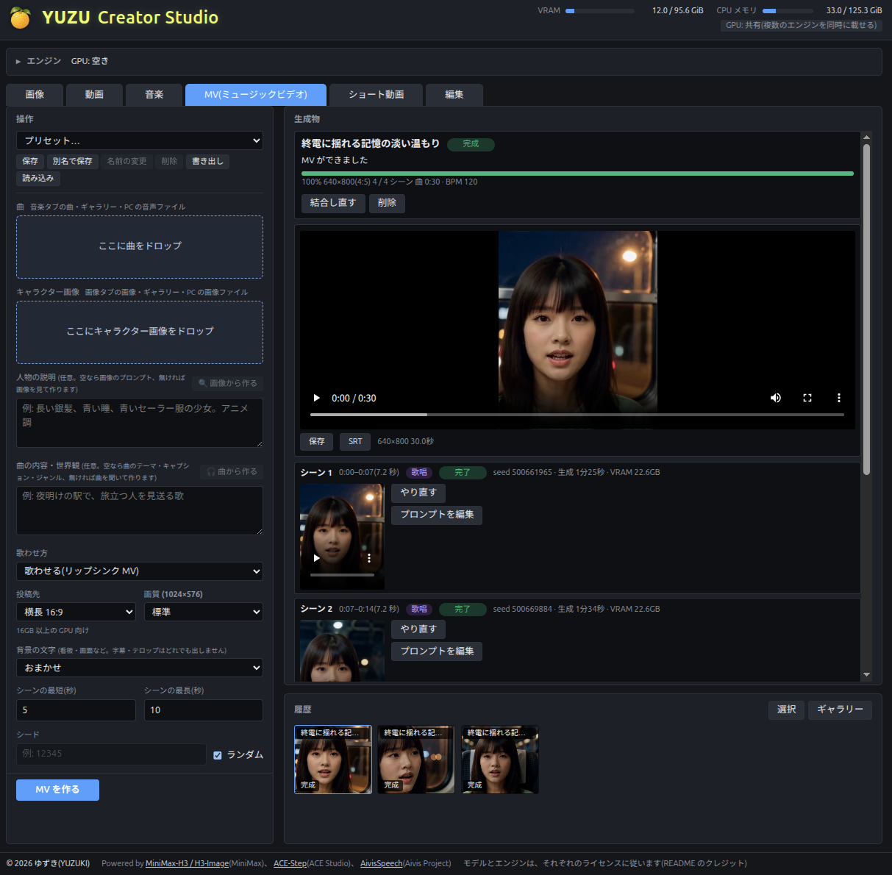
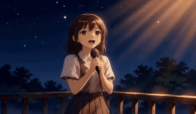

# YUZU Creator Studio — User guide

[日本語](USAGE.md) | **English**

A guide for people who have finished installing and want to start making images, videos, songs, and music videos. Installation and update steps are in the [README](../README.en.md).

- [Getting started](#getting-started)
- [The screen](#the-screen)
- [Image tab](#image-tab)
- [Video tab](#video-tab)
- [Music tab](#music-tab)
- [Music Video tab](#music-video-tab)
- [Short Video tab](#short-video-tab)
- [Edit tab](#edit-tab)
- [Samples and presets](#samples-and-presets)
- [Engines and memory](#engines-and-memory)
- [Troubleshooting](#troubleshooting)
- [Appendix: files and API](#appendix-files-and-api)

## Getting started

YUZU Creator Studio is a production studio in a single browser page: images, videos (with audio), music, text-to-speech, music videos, story videos, and editing. Everything runs on your PC; nothing is sent outside. There are no nodes to wire up. Pick a tab, drop in your material, and press a button.

Start it with `run.bat` (`./run.sh` on Linux), then open **http://127.0.0.1:8700** in your browser. To stop it, press `Ctrl+C` in the window where you started it.

### The six tabs

| Tab | What it does |
|---|---|
| Image | Makes images from text (T2I). Redraws based on reference images (edit) |
| Video | Makes videos with audio from text, first and last frames, or references (images, videos, audio). Can also make still images and text-to-speech voices |
| Music | Makes songs with vocals or instrumentals from a genre, a theme, or one line. The AI writes the lyrics |
| Music Video | From one character image and one song, makes a lip-synced music video or an image MV without singing |
| Short Video | Makes a short video with a story from story text, a song, narration, and reference images |
| Edit | Joins, cuts, inserts, recolors, and swaps the music of your videos, images, and songs (no GPU needed) |

### Engines

Generation is done by four "engines" running in the background, plus the bundled LLM held by the supervisor.

| Engine | Role |
|---|---|
| MiniMax-H3 (video / stills) | Video with audio, and still images. Also makes the scenes for music videos and short videos |
| MiniMax-H3-Image (image) | Images in the Image tab |
| ACE-Step (music) | Songs in the Music tab |
| AivisSpeech (speech synthesis) | Text-to-speech (runs on the CPU) |
| Bundled LLM (Gemma 4) | Prompt enhancement, lyric writing, music video direction, describing a character from an image, describing a song by listening to it |

Engines start automatically when needed and are swapped onto the GPU automatically. You don't need to start them yourself.

### Only one rule about GPU memory

- **GPUs with less than 40GB of VRAM**: engines are loaded onto the GPU **one at a time**. If you make an image and then a video, the image engine is unloaded and the video engine is loaded (this takes tens of seconds to a few minutes).
- **GPUs with 40GB or more**: each engine gets a **VRAM allocation** (the amount of VRAM it may use), and **several engines** are loaded **at once**. Generations on different engines run in parallel.

If you keep working in the same tab, no swapping happens. See "[Engines and memory](#engines-and-memory)" for details.

### Where your outputs go

- Everything you make is saved under `outputs/` and listed in the **Gallery** (ギャラリー) on screen.
- Anything in the gallery can be reused by dragging and dropping it onto any tab's input fields: an image from the Image tab into a music video, a song from the Music tab into a short video, and so on.
- To get a file onto your computer, use **Save** (保存) below the output.

You can also read this guide in a movable window by pressing **Help** (使い方) at the top of the screen (it opens at the section for the current tab; Esc closes it).

## The screen



### Top bar

- **Usage meters** (使用量表示): three bars at the top right.
  - **VRAM**: GPU memory usage (read every 2 seconds). The bar changes color above 90%.
  - **Shared GPU memory** (共有 GPU メモリ): shown on Windows only. If this rises, VRAM has overflowed and is spilling into CPU memory (things become extremely slow).
  - **CPU memory**: usage of the whole PC, including the engines. As it approaches 32GB, video preparation and the LLM slow down.
- **Job status**: the line under the usage meters. It starts with the GPU mode (**GPU: one engine at a time** (GPU: エンジン 1 つずつ) or **GPU: shared (several engines loaded at once)** (GPU: 共有(複数のエンジンを同時に載せる))). Then, for each engine, the running job and its progress, and the number of queued jobs (e.g. `H3: scene 45% / queued 1`). In shared mode, it also lists the loaded engines and their VRAM allocations (e.g. `H3 allocation 24.0 GiB (busy)`).
- **Warnings**: a banner appears when VRAM overflows or the supervisor can't be reached ("VRAM overflowed and is spilling into shared GPU memory…" (VRAM があふれて共有 GPU メモリに退避しています…), "Cannot connect to the supervisor" (管理役に接続できません), and so on).

### The engine panel

The **Engines** (エンジン) heading above the tabs. Click it to open or close it (it closes automatically once the engines are ready, and a one-line status appears next to the heading). When open, it shows one row per engine.

- Name, state (**Stopped** (停止) / **Starting** (起動中) / **Ready** (準備完了) / **Offloading** (退避中) / **Stopping** (停止中) / **Error** (エラー)), a **GPU** badge if it is loaded on the GPU (with its VRAM allocation in shared mode), an **External** (外部) badge for engines started separately outside the app, the port, and memory in use (RSS).
- Buttons: **Start** (起動) (start the process) / **Stop** (停止) / **Prepare** (準備) (load it onto the GPU so it's ready to use) / **Log** (ログ) (open that engine's output).
- While swapping, the current step is shown under the row. On failure, "Failed: …" (失敗: …) and the end of the log are shown.
- External engines and busy engines cannot be **stopped**.

Normally you don't need to touch this. When you press generate, the supervisor starts and swaps in whatever engines are needed.

### Inside a tab: controls on the left, results on the right

- **Left: controls**. Input fields and the generate buttons (**Generate** (生成) and **Cancel** (中止); **Make music video** (MV を作る) in the Music Video tab; **Make short video** (ショート動画を作る) in the Short Video tab).
- **Top right: outputs**. Shows the newest (or selected) output large. Below it: name, dimensions, length, generation time, **Save** / **Delete** (削除), and tab-specific buttons. Jobs in progress show their progress on top (queued, preparing, elapsed time).
- **Bottom right: history**. What you made in that tab. Click a thumbnail to show it top right.
  - In the Music Video, Short Video, and Edit tabs, history shows "project" and "edit project" cards.
- **Gallery** at the top right of the history switches the right side to the **Gallery** (all outputs, newest first). Filter with **All** (全て) / **Images** (画像) / **Videos** (動画) / **Music** (音楽). **Back** (戻る) returns to the history.
- Clicking a thumbnail in the gallery shows it in the current tab's output area (so that tab's buttons work; for example, opening an image in the Video tab gives you **Use as first frame** (最初のフレームに使う)).

Thumbnail badges: **Imported** (取込) means it was imported from your PC, ▶ and a length mean a video, 🎵 and a length mean a song.

### Buttons in the output area

| Tab | Button | What it does |
|---|---|---|
| Image | Use as reference (参照に使う) | Puts the image into the Image tab's reference images and switches to edit |
| Video | Use as first frame | (For images) puts it into the FL2VA first frame |
| Video | Use as reference | Puts it into the Ref2VA references |
| Music | Use as video reference (動画の参照に使う) | Puts the song into the Video tab's Ref2VA references (audio) |

Every tab has **Save** (to your computer) and **Delete**.

### Drag and drop

You can drop **files from your PC** and **outputs from the gallery or history** onto input fields the same way. Images in the output area and material already placed in input fields can also be dragged to other fields.

| Drop target | What you can drop |
|---|---|
| Image tab (anywhere in the controls) | Images. They go into the reference images and the mode switches to edit (up to 16) |
| Video tab FL2VA **First frame** / **Last frame** | One image each |
| Video tab Ref2VA / still image **References** | Images (up to 9), videos (up to 3), audio (up to 3) |
| Music Video tab **Song** / **Character image** | One audio file / one image |
| Short Video tab **Song** / **Reference images** | One audio file / up to 4 images |
| Edit tab **Clips** / insert field / **Audio** song field | Videos and images (several at once is fine) / one video or image / one audio file |

- Files from your PC are first imported into the gallery (badge: **Imported**). If the type doesn't match (a song on an image field, for example), it's only saved to the gallery and not placed in the field.
- Dropping outside the drop areas never makes the browser open the file.

### Deleting and "Select"

- One at a time: the **×** on a thumbnail, or **Delete** in the output area.
- Several at once: press **Select** (選択) in the history or gallery, click thumbnails to tick them ✓, then **Delete**. **Select all** (すべて選択) selects everything visible; **Done** (やめる) exits.
- Deleting also removes the files and **cannot be undone** (you'll be asked to confirm).
- What can't be deleted: anything used by a running or queued job; songs and images used by a music video or short video project (even finished or cancelled ones, since retries and re-assembly need them); and videos, images, and songs used by an edit project. If a delete is refused, the reason is shown.
- When deleting a music video or short video project, tick **Also delete the finished MV** (完成した MV も削除する) in the confirmation window to delete the finished video too. Otherwise it stays in the gallery.

### The presets bar

At the top left of every tab except Edit. Save the current input values under a name, and restore them just by picking it.

- The picker (**Presets…** (プリセット…)) lists **Built-in** (同梱) and **My presets** (自分のプリセット) separately. Picking one fills the input fields (it doesn't generate).
- Buttons: **Save** / **Save as** (別名で保存) / **Rename** (名前の変更) / **Delete** / **Export** (書き出し) / **Import** (読み込み). When asked for a name, type it and press **OK** (Enter); to back out, press **Cancel** (取消) (Esc).
- See "[Samples and presets](#samples-and-presets)" for details.

### The samples button

**Samples** (サンプル), under the presets bar in the Music Video and Short Video tabs. Opens the built-in examples; **Load** (読み込む) sets the input fields and material to match the example (it doesn't generate). Tabs without samples don't show it.

## Image tab

Makes images with MiniMax-H3-Image. Choose the mode with the two buttons at the top.

- **T2I (from text)** (T2I(テキストから)): set a prompt and size, then **Generate**.
- **edit (edit with reference images)** (edit(参照画像で編集)): drop reference images and redraw them with a prompt.

### Prompt

- Japanese or English both work (the field's hint also says "Describe the image you want in Japanese or English" (作りたい画像を日本語や英語で書きます)).
- A rough order to write in: what (person, object) → appearance (hair, clothes, colors) → where (background) → style (anime, photo-like, watercolor) → lighting and composition.
- If you just want a style, pick a built-in preset (**Anime illustration** (アニメ調イラスト) / **Photo-like** (写真風) / **Watercolor** (水彩画)) to insert an English style sentence, then add to it.
- `Ctrl+Enter` also generates.

### Prompt enhancement

Pressing **Enhance prompt** (プロンプト強化) rewrites a short instruction into a detailed prompt that follows H3-Image's official prompting style (using the bundled LLM).

- After rewriting, an **Undo** (元に戻す) appears next to it. Press it to restore the original text.
- If a recommended size comes back, it's shown like "Recommended size: 1024×1024" (推奨サイズ: 1024×1024).
- In edit mode, it also looks at the reference images when rewriting.
- It wakes up the engine and the LLM, so it can take a few minutes.

### Visual style

Choosing a **Visual style** (画風: None / Realistic / Cinematic / TV drama / Anime / Illustration / Sketch / Watercolor / Oil painting / 3D CG) appends an English style instruction to the prompt at generation. It is not written into the prompt box (a note such as "Visual style: Anime (an instruction is added at generation)" appears under it) and prompt enhancement does not include it. In edit mode the reference's look is kept and the background, lighting and materials follow the style. The sentences are in the table under "Video tab". Presets store it too.

### Camera angle (edit only)

The **Camera angle** (アングル) field appears only in edit mode. Choosing one appends an English instruction to the prompt at generation (a note such as "Camera angle: Three-quarter, facing left (an instruction is added at generation)" appears under the prompt). Every angle ends with a sentence that keeps the same person (face, hair, outfit, art style) and the same place, lighting and background, and adds no other people. With an angle selected you can generate even with an empty prompt (the angle sentence becomes the prompt). The order sent is **prompt box → angle → visual style**. Presets store it too.

| Camera angle | What you get |
|---|---|
| None | nothing added |
| Front | straight on, at eye level |
| Three-quarter, facing left | body and face turn toward the **left** edge of the picture (more of the right cheek) |
| Three-quarter, facing right | body and face turn toward the **right** edge of the picture (more of the left cheek) |
| Side profile | full profile (90 degrees to the side) |
| From behind | from the back |
| High angle (looking down) | from above the head, looking down |
| Low angle (looking up; becomes full body) | from near the floor looking up; the full body is in frame and the sky or ceiling fills the top two-thirds |

Left/right mean which way the person faces in the picture, not how the camera moves.

Tip: even without an angle, edit can convert the style or extend the picture (outpainting) by prompt alone, e.g. "Turn this picture into a watercolor" or "Extend the background on both sides to make it wide" (set a landscape output size for that).

### Size

- The picker: **1024×1024** / **1344×768** / **768×1344** / **1536×1536** / **2048×2048** / **Custom** (自由入力). You can also type the width and height directly into the two fields next to it.
- **Rounded to a multiple of 32 (256–4096)**. Go smaller if you have little VRAM. Around 12GB, 1024×1024 or 1344×768 is a safe choice.
- For portrait social media images, use the built-in preset **Portrait 9:16 for social media** (縦長 9:16 SNS 用) (768×1344).

### Steps and seed

- **Steps**: **Server default** (サーバ既定) / **2** / **3** / **6**. Server default is 6 (the model's own schedule). Fewer is faster and rougher, and 3 can leave a grid-like grain on wide areas such as landscapes. Use 2 or 3 for drafts (built-in presets **Quick draft (2 steps)** (ラフ確認用(2 ステップ)) and **Faster (3 steps)** (速め(3 ステップ))).
  Each step count uses its own main-model cache (about 11GB). Setup builds only the default, 6, so the first time you pick 2 or 3, that first run starts by building the cache (a 62GB download, over an hour). A note appears under the field, and the job shows "Building the main-model cache (first time only)". To build ahead, stop the studio and run `cd <h3image folder>; .\.venv\Scripts\python.exe scripts\prepare_models.py --build-cache 2 3` (Linux: `.venv/bin/python scripts/prepare_models.py --build-cache 2 3`).
- **Seed**: with **Random** (ランダム) ticked, it changes every time. Untick it and enter a number to get the same picture for the same prompt. Fix it when you want to keep a composition you like while tweaking only the text.

### edit (edit with reference images)

1. Drop the image you want to use as a reference anywhere in the controls (from the gallery, history, or a PC file). The mode switches to edit automatically. **Use as reference** in the output area also works.
2. Up to 16 references. The number on each slot is the number you refer to in the prompt (you can write `<Picture 1>`).
3. Write something like "Have the girl in `<Picture 1>` stand in a city at night" and press **Generate**.
4. Remove a reference with its ×.

### Making a character image for music videos and short videos

In music videos and short videos, one character image is **the basis of every scene**. The image's background, props, and lighting carry over into all scenes as they are (an image taken by a window resulted in 4 of 5 scenes being in the same room; with a night-time image or one holding a microphone, every scene tends to be at night or have a microphone).

1. In T2I, make a person with a **plain or single-color background**, **no props**, and **a clearly visible face**. Example: "Plain white background. Upper body of a girl with shoulder-length brown hair, brown eyes, white short-sleeved blouse. Facing forward. No props. Anime style."
2. Front or 3/4 view works best (singing and speaking scenes use compositions that show the mouth).
3. Make several with different seeds and pick the one you like.
4. Drop that image onto the **Character image** in the Music Video tab or **Reference images** in the Short Video tab. For images made in the Image tab, the prompt is copied into **Character description** (人物の説明) as is (only when it's empty).

Write places and mood not in the image but in the music video's **Song concept** (曲の内容・世界観) or the short video's **story**.

## Video tab

Makes videos with audio using MiniMax-H3. Choose the mode with the four buttons at the top.

| Button | Mode | What you need |
|---|---|---|
| **T2VA** from text | Makes video and audio from text | A prompt |
| **FL2VA** from first / last frames | Animates between the first image (and the last image, if any) | 1–2 images |
| **Ref2VA** from references | Makes a video using images, videos, and audio as references | At least one reference |
| **T2I / Ref2I** still image | One still image instead of a video. Ref2I if there are references, otherwise T2I | A prompt |

### Prompt

- Write the scene, motion, dialogue, and sound in Japanese or English. Japanese works fine as is.
- A rough order: scene → characters → motion → camera → sound → how it ends.
- **Enhance prompt** rewrites the text following MiniMax's official prompting style (in T2VA / FL2VA / Ref2VA). It can't be used for still images (use the Image tab's enhancement for still image prompts). **Undo** restores the original text.
- If you want dialogue spoken clearly, making a voice with "Make audio" below and using it as a reference is more reliable than writing it in the text.

### Visual style

The same **Visual style** selector as the Image tab: an English instruction is appended to the prompt at generation (the prompt box is unchanged). Ref2VA / Ref2I / FL2VA use the form that keeps the look of the references or frames.

| Visual style | Instruction added (English) |
|---|---|
| None (match the reference) | (nothing; the default) |
| Realistic | photorealistic, natural lighting, real camera, true-to-life skin and materials |
| Cinematic | cinematic film look, anamorphic framing, shallow depth of field, graded color |
| TV drama | TV drama look, naturalistic lighting, handheld-feel camera, everyday locations |
| Anime | Japanese anime style, clean line art, flat cel shading, expressive eyes |
| Illustration | digital illustration, clean shapes, bold colors, polished finish |
| Sketch | pencil sketch, hand-drawn lines, hatching, paper texture, mostly monochrome |
| Watercolor | watercolor painting, soft bleeding edges, paper texture, muted palette |
| Oil painting | oil painting, visible brush strokes, rich impasto texture |
| 3D CG | 3D CG render, stylized characters, soft global illumination |

Without a reference, `Visual style: <instruction>.` is appended to the prompt; with one (Ref2VA / Ref2I / FL2VA, Image tab edit, music videos, short videos with images), `Keep the referenced subject exactly as in the reference image; render the scene, background, lighting and materials in <instruction>.`

### Resolution and length

- **Resolution**: **768×768** / **1344×768** / **768×1344** / **512×512** / **768×512** / **512×768**. The native short side is 768. On 6GB cards, 512² to 768×512 is realistic.
- **Length**: 5–15 seconds (slider). Because of frame counts, the actual length may be rounded up slightly. Not shown for still images.
- **Seed**: same as the Image tab. Untick **Random** to fix it.

### FL2VA (first / last frames)

- Drop one image each onto **First frame (either one alone is fine)** (最初のフレーム(どちらか一方だけでも可)) and **Last frame** (最後のフレーム).
- With both, it moves from the first picture to the last. With only one, it moves from (or toward) that picture.
- Making two images of the same character in the Image tab and using them makes it easy to create changes in expression or pose.

### Ref2VA (from references)

- Drop images (up to 9), videos (up to 3), and audio (up to 3) onto the references field. **The order matters.** Reorder with ‹ ›, remove with ×. Counts such as "Images 1/9" appear under the field.
- In the prompt, refer to each type in the order added: `<Picture 1>` `<Picture 2>` …, `<Video 1>` …, `<Audio 1>` … (MiniMax-H3's syntax). Example: "The woman in `<Picture 1>` speaks to the camera in the voice of `<Audio 1>`."
- **Match audio length** (音声の長さに合わせる): appears only when there is exactly one audio. When ticked, the video length follows the audio instead of the length slider. If you start by adding audio, it's ticked automatically.
- **Vocal Lock (sync the mouth to the reference audio)** (Vocal Lock(参照の音声に口を合わせる)): appears when there is at least one audio. When ticked, the reference audio is used as the output audio as is, and the mouth movement is matched to it. Use it to lip-sync to singing or speech.
- The built-in preset **Singing Ref2VA + Vocal Lock** (歌唱 Ref2VA + Vocal Lock) fills in a singing-character prompt and both checkboxes.

### Make audio (text-to-speech)

Open **Make audio (text-to-speech)** (音声を作る(読み上げ)) at the bottom of the Video tab to make a voice reading your text with AivisSpeech.

1. Write the text to read (up to 2000 characters).
2. Choose a **Voice** (話者) (the list loads when you open the section; AivisSpeech is started if it's stopped). **Speed** (話速) is 0.5–2.0.
3. Press **Make audio** (音声を作る). You can listen to the result right away, and it goes into the gallery (the Video tab's history).
4. In Ref2VA mode, the new voice is added to the references automatically ("Audio created and added to the references" (音声を作って、参照に加えました)).

The chosen voice is remembered and carried over to the Short Video tab's voice.

### Common combinations

- **Make a character talk**: put a character image and a text-to-speech voice into Ref2VA → tick **Match audio length** and **Vocal Lock** → "The person in `<Picture 1>` speaks quietly to the camera."
- **Make a character sing along to a song**: **Use as video reference** on a song in the Music tab → add the character image too → built-in preset **Singing Ref2VA + Vocal Lock**. To sing through a song longer than 15 seconds, use the Music Video tab.
- **Animate a still image**: put the image in the FL2VA first frame and describe only the motion.

### VRAM and time

- Videos are made in 4 steps with a turbo LoRA, so even entry-level cards finish in a bearable time. They still take longer than images, and time grows with resolution and length.
- The first video you make, and any time you come from the Image or Music tab, adds tens of seconds to a few minutes for swapping engines.
- If it takes too long, or "VRAM overflowed…" appears at the top, lower the resolution to 512×512 or 768×512.

## Music tab

Makes songs with ACE-Step. Choose one of two options under **Mode** (作り方) at the top.

- **Simple (from genre)** (簡単(ジャンルから)): pick a genre; theme, lyrics, and caption are optional. **Only the empty fields** are filled in by the AI at generation time (what you wrote isn't rewritten).
- **✨ Auto (from one line)** (✨ おまかせ(一言から)): just write one line such as "a bittersweet ballad for a rainy night" in the **What kind of song?** (どんな曲?) field. ACE-Step's LM decides the caption, lyrics, BPM, and key (the supervisor's LLM isn't used).

### Genre (Simple mode)

- 12 built-in chips: J-POP / Rock / Ballad / Anime / Hip Hop / R&B / Enka / EDM / Reggaeton / K-POP / City Pop / Jazz. Pick one.
- **+ Add** (＋ 追加): create your own genre. Enter a name (e.g. Japanese-style electro) and an optional one-line description, then **Add**. The AI writes definitions of the world, scenes, and emotions (10–60 seconds on CPU), and it becomes a chip marked ✦.
- Picking a ✦ chip shows **Genre details** (ジャンルの中身) below. Edit the name, world, scenes, emotions, and spectrum mood and press **Save**, or **Delete**. Once saved, it's used from the next song.
- **✎ Write freely** (✎ 自由に書く): describe the genre in a sentence instead of a chip (up to 200 characters). Example: "A bittersweet end-of-summer song mixing 90s city pop with shamisen." This sentence is also used when writing the theme, lyrics, and caption. **Save as genre** (ジャンルとして保存) gives it a short name and turns it into a ✦ chip.

### Shared fields

- **Lyrics language** (歌の言語): 日本語 / English / 中文 / 한국어 / Español / Français / Deutsch / Italiano / Português / Русский.
- **Length** (曲長): **Auto** (自動) / 30 s / 60 s / 90 s / 120 s / 180 s / 240 s. For a music video, trying 30–60 seconds first is quicker.
- **Instrumental (no vocals)** (楽器のみ(歌なし)): makes an instrumental. The lyrics and vocal fields are no longer used.

### Theme, lyrics, and caption (Simple mode)

| Field | Content | AI button |
|---|---|---|
| Theme / scenario | The song's subject (e.g. the sunrise seen from a night bus window). Also becomes the song title | **✨ Make theme** (✨ テーマを作る) |
| Lyrics | Tags such as `[Verse]` `[Chorus]` can be used | **✍️ Write lyrics** (✍️ 作詞する) (also makes a theme if it's empty) |
| Caption | A description of the sound (English) | **🎵 Make caption** (🎵 キャプションを作る) |

- With these three buttons you can make and edit each one before generating. Clear each field with its ✕.
- After writing lyrics, "AI's suggested length: about N seconds" (AI の推奨の長さ: 約 N 秒) appears. Use it as a guide for the length.
- **Auto caption (AI writes one at generation if empty)** (キャプション自動(空なら生成時に AI が作る)): on by default.
- A caption you write yourself is also used as a mood reference when the AI writes the theme and lyrics.
- **Mood** (ムード) (😊 Bright / 😢 Bittersweet / 🔥 Intense / 🍃 Calm / ✨ Mysterious / 💕 Romantic / 🎉 Fun / 🌙 Melancholic / 🏔️ Epic / 😎 Cool) and **Vocals** (ボーカル) (👩 Female / 👨 Male / 🎤 Powerful / 🌬️ Whisper / 🎵 Falsetto / 👥 Harmony) are optional. Press again to deselect.

### Generate and "New lyrics and generate"

- Pressing **Generate** shows the plan it made (theme, caption, start of the lyrics) under **Song plan** (曲のプラン). What the AI wrote also stays in the fields (next time it's used as is, or you can edit it).
- **✍️ New lyrics and generate** (✍️ 歌詞を新しくして生成) (shown only when there are lyrics): clears the lyrics, keeps the theme, rewrites the lyrics and caption, and generates.

### Details (collapsed)

| Field | Meaning |
|---|---|
| Model | From ACE's list. Models not yet loaded are loaded automatically before generating (tens of seconds). Models that don't fit in VRAM can't be selected |
| STEP | **8 (Turbo)** / **20 (Fast)** / **50 (Standard)** / **80 (High quality)** / **100 (Best quality)**. Set automatically when you choose a model (8 for Turbo, 50 otherwise) |
| Songs | **1 song** / **2 songs** / **4 songs**. Two or more become separate outputs (up to 2 for SFT models) |
| Thinking (higher quality using ACE-Step's LM) | On by default |
| Seed | **Random** or fixed. **Rebuild on the same skeleton (use the previous seed)** (同じ骨格で作り直す(前回のシードを使う)) lets you change only the lyrics or caption and keep the same song skeleton |
| Negative prompt | Sounds to avoid (English). A default text is filled in |
| Shift | **Auto** / 1.0 (detail-focused) to 5.0 (maximum). Lower favors sound quality, higher favors structure |
| Sampler | **Auto (ODE)** / **ODE (stable, clean)** / **SDE (organic, varied)** |

### Spectrum

While a song plays, a light visualizer moves on the song card in the output area. The picker at the top right of the card switches between Spectrum / Waveform / Ring / Particles / Pulse / Aurora / Fireworks / Matrix / Orbit / Flame / Auto (your choice is remembered). The colors come from your custom genre's mood; if there is none, the Mood; if none, words in the caption; if none, the genre. Open **Lyrics** (歌詞) on the card to see the full lyrics.

### Using songs in other tabs

- **Music video**: drop the song onto **Song** in the Music Video tab. Its theme, caption, and genre go into **Song concept** (only when it's empty).
- **Short video**: dropped onto **Song**, it becomes the background music (with no narration, the song length is the video length).
- **Video**: **Use as video reference** in the output area makes it an audio reference for Ref2VA.
- **Edit**: drop it onto the song field under **Audio** to use it for replacing the music.

## Music Video tab

Makes a music video from one character image and one song. The song is split into 5–10 second scenes, each scene is made as a video with MiniMax-H3, and the original song is attached at the end. It needs the vocal separation tools (installed by setup by default). Without them, a notice and an **Install tools (about 1.3GB)** button appear at the top of the tab, and **Make music video** is disabled until they are installed.

On Windows and on PCs with less than 48GB of RAM, it also needs MiniMax-H3's reference-mode cache (transformer_ref_int8, about 32GB), because every music video scene is made with Ref2VA. Without it, a notice with the command to build it on this PC appears at the top of the tab, and **Make music video** is disabled. See "The reference-mode cache is missing" under "[Troubleshooting](#troubleshooting)".

### Inputs

- **Song** (曲): a song from the Music tab, the gallery, or an audio file from your PC. You can listen in the field. Remove it with ×.
- **Character image** (キャラクター画像): an image from the Image tab, the gallery, or an image file from your PC. See the end of "[Image tab](#image-tab)" for how to choose the image.
- **Character description** (optional): write only the appearance — hair, eyes, clothes, art style, and so on. If empty, the image's prompt is used; if there is none, it's made by looking at the image.
  - Dropping an image made in the Image tab fills in its prompt (only when empty).
  - **🔍 From image** (🔍 画像から作る): the bundled LLM looks at the image and writes its appearance (who, face, hair, clothes, art style) as one line. Place, lighting, and pose are left out. About 10–60 seconds on CPU (the first time, it downloads the projector file (mmproj) of about 0.56GB used to read images and audio).
- **Song concept** (optional): the song's subject, or the world you want on screen. If empty, the song's theme, caption, and genre are used; if there are none, it's made by listening to the song.
  - Dropping a song from the Music tab fills in its theme, caption, and genre (only when empty).
  - **🎧 From song** (🎧 曲から作る): the bundled LLM listens to up to two 30-second parts of the song, picks up the language, genre, mood, instruments, vocals, and tempo, and drafts a song concept. About 20–60 seconds on CPU. For songs from the Music tab, it writes from the theme and caption without listening. It doesn't transcribe lyrics.
  - What it heard is shown, collapsed, under the field as **What the song sounded like (for reference)** (曲の聞き取り(参考)) (it can mishear).
- You can check and edit text that was filled in automatically before making the video. Text you wrote yourself is never replaced without asking.
- If you bring in an image or song from outside and the fields are empty, "Left empty, these will be filled in automatically" (空のまま作ると、自動で入れます) appears. If you press **Make music video** as is, the project does the same thing automatically.

### Vocals

- **Lip-sync (music video with singing)** (歌わせる(リップシンク MV)): for each scene, the separated vocals are passed to H3 to sync the mouth (Vocal Lock). In sections without singing (intro, interludes, outro) the mouth stays closed and the framing changes (a wide shot, a side tracking shot, a low angle, a view from behind; a walk away from the camera when the song ends on such a section).
- **No singing (image MV)** (歌わせない(イメージ MV)): no vocals are passed; scenes are made using only the image as a reference. The character doesn't sing. Any composition is used — walking, gazing, scenery. The song is attached during assembly.

Even with no singing, the LLM writing the direction may pick a microphone or stage because it's a "music video" (the mouth didn't move, but a scene holding a microphone appeared). If you want only scenery or everyday life, write what you don't want in **Song concept**.

```
夜明けの駅で、旅立つ人を見送る歌。マイクやステージは出さない。歌う場面は無い。
```

(A song about seeing someone off at a station at dawn. No microphones or stages. No singing scenes.) This text goes to the direction LLM as is. When you choose No singing, the same advice also appears under the field.

### Aspect and quality

- **Aspect** (画角): **Landscape 16:9** / **Portrait 9:16** / **Square 1:1** / **Portrait 4:5** / **Landscape 5:4** / **Custom**.
- **Quality** (画質): **Low VRAM** / **Fast** / **Standard** / **High**. The actual dimensions appear next to the quality.

| Aspect | Low VRAM | Fast | Standard | High |
|---|---|---|---|---|
| Landscape 16:9 | 512×288 | 768×448 | 1024×576 | 1344×768 |
| Portrait 9:16 | 288×512 | 448×768 | 576×1024 | 768×1344 |
| Square 1:1 | 384×384 | 512×512 | 768×768 | 960×960 |
| Portrait 4:5 | 416×512 | 512×640 | 640×800 | 768×960 |
| Landscape 5:4 | 512×416 | 640×512 | 800×640 | 960×768 |

| Quality | Suited GPU |
|---|---|
| Low VRAM | 6GB or less. Small pictures, 512 on the long side. Also good for a quick first try |
| Fast | 6–12GB. The fastest |
| Standard | 16GB or more |
| High | 24GB or more. Takes time |

- The default quality is Standard with 16GB of VRAM or more, Fast below that.
- **Custom**: enter **Width (px)** (幅(px)) and **Height (px)** (高さ(px)) directly (256–1344, rounded to a multiple of 32). The quality field isn't used.
- The built-in presets include aspect and quality combinations for YouTube, TikTok, and Instagram.

### Visual style

Choosing a **Visual style** tells the direction-writing LLM to keep every scene in that style, and replaces the style sentence of each scene's final prompt (by default "cinematic music-video style") with that style's sentence. The character keeps the look of the image. None works as before.

### Other fields

- **Background text** (背景の文字): text drawn on signs and screens. **Auto** / **Large text only** / **No text**. Video can render large, short text, but small sentences tend to break up. Subtitles, captions, lyric text, titles, and logos are never drawn, whichever you choose.
- **Min scene length (s)** (シーンの最短(秒)) / **Max scene length (s)** (シーンの最長(秒)): 5–10 seconds (min no greater than max). Shorter means more cuts and a quicker pace, and also more scenes (= more time). For portrait shorts, 5–7 seconds.
- **Seed**: when fixed, the same inputs give a similar music video.

### Making it

1. Drop in the song and the character image.
2. Check the character description and song concept (empty is fine).
3. Choose the vocals, aspect, and quality.
4. **Make music video**. The project view appears at the top right.

### What happens inside, in order

| Stage | What it does | Uses |
|---|---|---|
| Separation and splitting | Separates the vocals and splits the song into 5–10 second scenes at silences, breaths, and bars | CPU (Demucs) |
| Listening to the song | Only when the song concept is empty and the song has no clues. Listens to the song and writes the concept | Bundled LLM (CPU) |
| Direction | Organizes the character's appearance and writes the direction for each scene. Singing sections get compositions that show the mouth | Bundled LLM |
| Scene generation | Makes each scene's video with Ref2VA (plus Vocal Lock for lip-sync) | MiniMax-H3 (GPU) |
| Assembly | Joins the clips and makes an MP4 with the audio replaced by the original song | CPU (ffmpeg) |

- The next scene is queued only after each scene finishes, so generations from other tabs can cut in between.
- If listening to the song fails, it doesn't stop; it continues without a song concept.

### The project view (top right)

- Title, state (**Analyzing** (分析中) / **Writing direction** (演出を作成中) / **Generating scenes** (シーンを生成中) / **Assembling** (結合中) / **Paused** (一時停止) / **Done** (完成) / **Failed** (失敗) / **Cancelled** (中止)), progress, dimensions, number of scenes, song length and BPM, elapsed time.
- If descriptions were filled in automatically, it shows which ones ("Made automatically by looking at the image" (画像を見て自動で作りました), "Made automatically by listening to the song" (曲を聞いて自動で作りました), etc.).
- Buttons: **Pause** (一時停止) (running work continues until it finishes; queued work is withdrawn) / **Resume** (再開) (continues from what's done) / **Cancel** (can be resumed later) / **Re-assemble** (結合し直す) / **Delete**.
- When finished, the final video and **Save** appear.
- Even if you restart the supervisor, unfinished projects remain as paused. **Resume** continues from where they left off.

### Retrying individual scenes

Each scene row shows the time, length, a **Vocal** (歌唱) or **Instrumental** (器楽) badge, state (**Waiting** (待機) / **Generating** (生成中) / **Done** (完了) / **Failed**), seed, generation time, and peak VRAM.

- **Retry** (やり直す): remakes it with a different seed.
- **Edit prompt** (プロンプトを編集): edit the direction text passed to H3 and the seed, then **Retry with this** (この内容でやり直す). **Close** (閉じる) backs out.
- When all scenes are done, it re-assembles automatically. The previous music video stays in the gallery.
- **Re-assemble**: rejoins the current clips into a new music video. Before re-assembling, the video shows "This is an old version. Re-assemble to update it." (古い版です。結合し直すと更新されます)

### Tips

- **Use a character image with a plain background and no props.** Background, props, and lighting get into every scene.
- Write the place and mood in **Song concept** ("a seaside town, a summer evening, bicycles", etc.).
- State clearly what you don't want (microphones, stages, subtitles, etc.).
- Start with a 30-second song at **Fast** or **Low VRAM**, then raise the quality if you like it.
- **Retry** only the scenes you don't like. It's faster than remaking everything.

### Time estimates

| GPU | Conditions | Time |
|---|---|---|
| RTX A4000 (16GB) | Landscape, Fast, 30-second song (5 scenes) | About 17 minutes (about 3–3.5 minutes per scene) |

Time grows in proportion to song length (about 1 hour 40 minutes for a 3-minute song). Standard and High take longer. On big GPUs (RTX PRO 6000 or 5090) it's a fraction of that.

## Short Video tab

Makes a short video with a story from story text. It works like the Music Video tab (preparation → direction → per-scene generation → assembly) and uses only MiniMax-H3. Song-only videos use the same vocal separation as music videos, so only in that case you need the same tools (installed by setup by default; otherwise an **Install tools** button appears).

### Three kinds of timeline

What you put in decides the video's length and how scenes are cut.

| Input | Length | How scenes are cut | Scene audio |
|---|---|---|---|
| With narration + a person image (song optional) | Length of the speech | Grouped into 5–10 seconds at sentence breaks | The character lip-syncs to the speech. The song plays underneath as background music |
| With narration, no person image (voice-over) | Length of the speech | Same | An off-screen voice. Scenery scenes are made silent; the speech (+ the song as background music) is laid on at assembly |
| Song only | Length of the song | Same as music videos (separate vocals, cut at silences, breaths, and bars) | Made without passing audio; replaced by the song during assembly |
| Neither | The length you set | The LLM divides the story into 5–10 second scenes | The sound H3 makes (ambience, sound effects) is kept as is |

The length field appears or disappears and the hint (such as "Length: song length (1:30)" (長さ: 曲の長さ(1:30))) changes automatically to match your inputs.

### Inputs

- **Story / visual idea** (物語・映像のイメージ): what to show. Required when there's no song and no narration (the hint becomes "Required: with no song or narration, this is the basis" (必須: 曲もセリフも無いので、これが元になります)). Optional otherwise.
- **Song** (optional): a song from the Music tab, the gallery, or an audio file from your PC. With narration, "With narration, the song plays underneath as background music" (セリフがあるので、曲は BGM として下に敷きます) appears.
- **Narration** (セリフ・ナレーション) (optional): if present, it's read aloud with AivisSpeech. With a person image the character lip-syncs to it; without one it plays as an off-screen voice-over over the scenery. Left empty, the video has no narration.
  - **📝 From story** (📝 物語から作る): the bundled LLM drafts narration from the story text (it also uses the song's content if there is one). About 20–60 seconds on CPU. Check and edit it before making the video.
- **Voice**: required when there's narration. The list loads when you enter narration (AivisSpeech is started if it's stopped). It carries over the voice chosen in the Video tab's text-to-speech.
- **Burn in narration captions (subtitles)** (セリフのテロップ(字幕)を焼き込む): burns white captions at the bottom of the screen (a little higher for portrait), timed to the speech. An SRT with the same content is also saved next to the final video (for subtitles on video sites). Does nothing in projects without narration.
- **Reference images** (参照画像) (0–4): choose a **Role** (役割) for each.
  - **Scenery / object** (景色・物): a reference for scenes showing that place or object. Dropped images start with this role.
  - **Person** (人物): appears as the same person in every scene. **One at most** (multiple cast members aren't supported). Switch a person image's role to Person (so a landscape is never made to lip-sync).
- **Character description**: appears when you add a person image. As in music videos, if empty the image's prompt is used, or the image is looked at. The prompt of an image made with the Image tab edit is an edit instruction (such as "extend the surroundings"), so it is not used (the image is looked at instead); the Music Video tab does the same. **🔍 From image** works the same as in music videos.
- **Length (s)** (長さ(秒)): shown only when there's no song and no narration. 30 seconds or more, up to 3600 seconds (1 hour). Default 60 seconds.
- **Aspect** / **Quality** / **Background text** / **Min scene length (s)** / **Max scene length (s)** / **Seed**: same as music videos (see the tables in "[Music Video tab](#music-video-tab)"). Subtitles and captions are never drawn by the model (burned-in captions are separate).
- **Final audio** (最終の音声): **Auto** / **No audio (video only)** (音声なし(映像だけ)).
  - Auto: with narration, the speech (the song mixed in quietly and cut to the speech length; a short song isn't looped); with only a song, the song; with neither, H3's sound.
  - No audio: a video-only MP4. For people who want to add sound in another tool.

### Visual style

Same as the Music Video tab. A **Visual style** keeps every scene's direction in that style; if there is at least one reference image (person or scenery), the form that keeps the references' look is used. A note appears under the story box.

### Rules for the person and narration

- **Narration without a person image** becomes an **off-screen voice-over**. "There is no person image, so the narration plays as an off-screen voice over the scenery. To lip-sync, add an image with the role "Person"" (人物の画像が無いので、ナレーション(画面の外の声)として景色に載せます…) appears.
  - Length and scene cuts are the same as with lip-sync (speech length, sentence breaks).
  - Scenes use the scenery / object images as references (or none) and are made silent with the scene length given. The direction follows the narration sentences and shows no people.
  - The speech is laid on at assembly (mixed with the song as background music if there is one). Captions and SRT work the same.
- With a person image, the speech runs through the whole video, so **scenes without the person (scenery only) can't be made**.

### Length warning

- If the expected length exceeds 5 minutes, a warning appears before making it (it doesn't stop you). Example: "Over 5 minutes. At about 3.5 minutes per scene on an A4000 at Fast → about 2.3 hours." (5 分を超えます。A4000 の高速で 1 シーン約 3.5 分 → 約 2.3 時間)
- The narration length isn't known until the speech is made, so the warning is an estimate from the character count.

### Making it

1. Write the story (or add a song, narration, and reference images).
2. Choose the aspect, quality, and final audio.
3. **Make short video**. The project view appears at the top right.

Inside, it runs in this order: **audio preparation** (make the speech and split it by sentence / separate and split the song) → **scene division** (only when there's neither) → **writing direction** (the plot and per-scene direction) → **scene generation** → **assembly**.

### The project view

Same as the Music Video tab. Pause / Resume / Cancel, per-scene **Retry** and **Edit prompt**, **Re-assemble**, and **Delete** are available. Short videos also have:

- At the top: "Timeline: narration / song / set length" (時間軸: セリフ / 曲 / 指定の長さ), "Final audio", and "Captions on" (テロップあり).
- Scene rows show the **Place** (場所), **Narration** (or **Scene** (場面)), and the **References** used (such as "1: Person"). Narration scenes have a **Narration** badge.
- Next to **Re-assemble** there's an **Audio: Auto** / **Audio: No audio** choice and a **Captions** (テロップ) checkbox (narration projects only). Change them and re-assemble (the previous video stays in the gallery).
- With captions, an **SRT** link appears under the final video.
- The finished video is `outputs/video/short_<ID>.mp4` (`_2`, `_3`… after re-assembly).

### Tips

- Write the story as short sentences listing scenes in time order, like "A lighthouse at dawn, fishermen returning to port, a bustling market, the sun sinking into the evening sea."
- If you don't want any people, write "No people appear" in the story.
- As with music videos, a person image with a **plain background and no props** is recommended. H3 carries the image's night lighting or microphone into every scene.
- Write what you don't want in the story. Examples: "No microphones or stages", "Don't sing. Speak quietly."
- Longer videos take more time. Try 30–60 seconds at Fast first.

### Time estimates

| GPU | Conditions | Time |
|---|---|---|
| RTX A4000 (16GB) | Fast | About 3.5 minutes per scene. About 2.3 hours for a 5-minute video (about 40 scenes), about 4.7 hours for 10 minutes |
| RTX PRO 6000 (shared, H3 allocation 24GiB) | Landscape, Standard, no references | About 55 seconds per scene. About 9 minutes for 60 seconds (8 scenes) |

Time grows in proportion to the number of scenes.

## Edit tab

Simple editing of videos, images, and songs from the gallery: join, cut ranges, insert in the middle, change colors, change the cuts between clips, and replace the music.

- **The original videos are never changed** (non-destructive). An edit is just settings — "which part of which clip, in what order, with which effects" — and the result is rebuilt with ffmpeg (CPU).
- **No GPU and no engines needed.** You can use it while music videos or videos are generating.
- There are no presets or samples (every edit depends on its material).

### Edit projects

- Choose an **Edit project** (編集プロジェクト) in the picker at the top.
- **New** (新規): you're asked for a name (empty means "Untitled" (無題)).
- **Rename** / **Delete**: apply to the selected project. Deleting it leaves exported videos and the original clips in the gallery.
- The history at the bottom right shows edit project cards (length, number of clips). Click to open; × to delete.
- The last project you had open opens again next time.

### Clips

- Drop videos and images onto the **Clips** (クリップ) field (outputs from the Video, Music Video, and Short Video tabs, the gallery, or PC files). **They're added to the end.** Several at once is fine.
- You can also open the **Gallery** at the bottom right and **just click** a video or image to add it to the end (clicking a song puts it into **Audio**). The gallery stays open, so you can keep picking. In the Edit tab, the preview stays visible while the gallery is open.
- Each row:
  - Thumbnail (click to play from that position), name, length ("4.5 s (original 10 s)" (4.5 秒(元 10 秒))).
  - Videos have **in** / **out** (the part of the original video to use, in the original video's seconds). Images have **Seconds** (秒数) (3 seconds when dropped).
  - Reorder with **▲** / **▼**, remove with **×** (the original video remains).
- Output dimensions and frame rate follow **the first clip** (1024×576 at 24fps if there are only images). Videos and images of other sizes are scaled down and letterboxed with black.

### Range

The range is the span that operations apply to. **It's measured in plain joined time** (the time before crossfades shorten it). "Total N s (joined length)" (全体 N 秒(つないだだけの長さ)) appears next to the fields.

- Type seconds into **Start** (開始) / **End** (終了) (arrow keys also work; up to 3 decimal places).
- **Set start** (ここから) / **Set end** (ここまで): play the preview, stop at the position you want, and press to put that position into start or end. Positions from the preview are automatically corrected for crossfades.
- **Whole** (全体): from 0 to the end.
- **Clear** (クリア): clears start and end (no range).
- The same **Set start** / **Set end** / **Clear** buttons are also right under the preview on the right. The current range is shown as "Range a–b s" (区間 a〜b 秒) and overlaid on the timeline as a blue band.

### Buttons under the preview

- Playback position ("Position 0:12.3 / 0:30.0 (project 13.5 s)" (再生位置 0:12.3 / 0:30.0(プロジェクトの 13.5 秒))).
- **◀ 1 frame** (◀ 1 コマ) / **1 frame ▶** (1 コマ ▶): pause, then step one frame at a time.
- **Set start** / **Set end** / **Clear**: same as the range fields on the left.
- **Grab this frame** (このコマを画像に): turns the frame at the paused position into a PNG at the original resolution, taken from the original video, and adds it to the gallery (images). Looks and other effects aren't applied. You can use it directly as a reference in the Image tab or as an insert in Edit. Press it after the preview is ready.
- Clicking the timeline (one band per clip) plays from that position. Effect bands and cut markers are shown on it too.

### Operations

- **Delete range** (区間を削除): cuts out start–end and joins what's before and after. Clips overlapping the range are split at those positions and replaced.
- **Insert at position** (位置に挿入): drop a video or image onto the insert field and press **Insert at position**. It goes in at the **Start** position (a clip there is split). Images go in for **Image seconds** (画像の秒数) (0.5–60 seconds, default 3).

### Looks and Adjust

- **Looks** (色調) (pick a look): **Monochrome** (モノクロ) / **Sepia** (セピア) / **Warm** (暖色) / **Cool** (寒色) / **Faded film** (フィルム風(退色)) / **Vignette** (周辺を暗く) / **Invert colors** (色を反転) / **Blur** (ぼかし).
- **Adjust** (調整) (set a value): **Saturation** (彩度) (0–3, 1 = unchanged) / **Contrast** (コントラスト) (0–3, 1 = unchanged) / **Brightness** (明るさ) (-1 to 1, 0 = unchanged). Set the value with the slider.
- Both use **Apply to range** (区間に適用) or **Apply to all** (全体に適用). You can stack as many as you like.

### Range effects

These act from the start to the end of the range (outside the range stays as is). A range is required. Add them with **Apply to range**.

| Effect | What it does |
|---|---|
| Fade to black / Fade from black | Within the range, fades down to black / up from black |
| Black | Solid black for the range |
| Fade to white / Fade from white | To white / from white |
| Zoom in / Zoom out | Moves toward / away from the center at 1.05–2× |
| Pan right / Pan left / Pan down / Pan up | Scales up by the zoom factor and moves the visible window from one edge to the other |
| Zoom in and pan right / Zoom in and pan left | Moves sideways while zooming in |

- Zoom and pan are good for animating inserted stills (Ken Burns). The zoom slider appears only when a zoom or pan is selected.
- For stills that came in letterboxed (a square image in a landscape video, for example), set the zoom high enough to hide the black bars (1.75× or more for a square image in landscape 16:9).
- To separate with black, line up "Fade to black" → "Black" → "Fade from black".

### Applied looks, adjustments, and range effects

A list of what you've applied (type, value, and range, or "All"). Remove with **×**. When you delete a range, effect ranges shrink by the amount cut.

### Transitions

- With two or more clips, a row appears for each cut ("1 → 2"). **Cut** (カット) / **Crossfade** (クロスフェード) / **Dip to black** (黒を挟む), and a duration (0.5–2 seconds).
- The duration is reduced to at most **half the shorter of the two clips**. Both must be at least 1 second long.
- **Apply to cuts in range** (区間の境目に適用): applies the chosen transition to every cut inside the selected range, with the range's length (rounded to 0.5–2 seconds) as the duration. If the range doesn't cross a cut, "There are no cuts in the range" (区間の中に境目がありません) appears.
- Points split by deleting a range or inserting become cuts.
- Crossfade and Dip to black overlap the clips by their duration, so the export is shorter than the plain joined length.

### Fade in / out

**Fade in at start (s)** (先頭フェードイン(秒)) and **Fade out at end (s)** (末尾フェードアウト(秒)). 0 means none. Together they can be at most the export length.

### Audio

- **Original audio** (元の音) / **Replace with song** (曲に差し替え) / **Original audio + song** (元の音 + 曲) (the song is mixed at -14dB) / **No audio** (音なし).
- Drop **a song from the Music tab, the gallery, or an audio file from your PC** onto the field below. Dropping one switches Original audio or No audio to "Replace with song".
- The song is used from the start and cut to the video length. If you choose "Replace with song" without a song, you're prompted to drop one first.

### Undo / Redo

- Each operation is one step (up to 100 steps). Undo still works after restarting the supervisor.
- When you undo, if a preview of that state still exists, it's shown without rebuilding.

### Preview

- After every operation, the **preview** (a light MP4, 480 on the short side) is rebuilt automatically. While it builds, the video is blurred and progress is shown.
- If you keep operating, the half-built preview is cancelled and a new one starts.
- If "**The preview is out of date**" (プレビューは古い版です) appears, press **Rebuild** (作り直す).

### Export

- **Export** makes an MP4 at the original resolution: `outputs/video/edit_<ID>.mp4` (`_2`… from the second time). It appears in the gallery.
- Long videos take a few minutes (progress is shown). It runs separately from the preview.
- The exported video can be viewed under **Last exported video** (最後に書き出した動画) below the preview, and **Save** gets it onto your computer. You can also drag it to other tabs' input fields.

### Fine print

- All times are measured in **plain joined time** (before transitions shorten it).
- **No fragments shorter than 0.1 seconds are created.** If deleting a range or inserting would leave a shorter piece, that piece is discarded. Inserts within 0.1 seconds of a cut snap to the cut.
- Videos, images, and songs used by an edit project can't be deleted from the gallery.
- Not supported: typing subtitles, speed changes, picture-in-picture, fine volume control, keyframes, a mouse-draggable timeline.

### Example: joining your videos into one

1. Make "Compilation" with **New**.
2. Open the gallery and click the finished music videos and short videos in order.
3. Set the cuts to **Crossfade**, 1 second.
4. Set **Audio** to "Replace with song" and drop in a song from the Music tab.
5. Set **Fade out at end (s)** to 2.
6. Check the preview, then **Export**.

## Samples and presets

### Samples

Pressing **Samples** in the Music Video or Short Video tab lists the built-in examples (`samples/<id>/`). Each card shows the finished video (playable on the spot), a description, and the material used.

| Sample | Tab | Contents |
|---|---|---|
| A day in the harbor town (no song, no narration) (港町の一日(曲もセリフも無し)) | Short Video | 60 seconds, 8 scenes, from story text only. No reference images; H3's ambient sound kept as is. Landscape, Standard |
| Singing on a starry night (lip-sync music video) (星降る夜に歌う(リップシンク MV)) | Music Video | From a J-POP song (30 seconds) made in the Music tab and one character image. 5 scenes, singing sections lip-synced. Landscape, Fast |




- **Load** sets the input fields (story, character description, song concept, aspect, quality, length, etc.) and the material (reference images, song) to match the example. **It doesn't generate.** Check it and press **Make short video** / **Make music video** to make it under the same conditions.
- Your current song, reference images, story, narration, and character description are replaced by the example's.
- The material (images, songs) is copied **into the gallery only once** when loaded (`outputs/samples/<id>/`). Loading again doesn't add more. If you delete it and load again, it's added again.
- The sample videos, images, and songs are CC0 (free to use). The sample materials were generated by the author with the engines themselves (the image with MiniMax-H3-Image, the song with ACE-Step, the videos with MiniMax-H3).

### Presets

Named saves of input values (prompt, size, seconds, STEP, model, genre, etc.). Available in the Image, Video, Music, Music Video, and Short Video tabs.

- Picking one fills the input fields (it doesn't generate). Values that can't be applied (a model that isn't loaded, a voice not on this PC, etc.) are skipped and reported as "Items left unchanged" (そのままにした項目).
- Text fields (prompt, theme, lyrics, etc.) are replaced only if the preset's text isn't empty (so a size-only preset doesn't erase text you're writing). The music caption alone is applied even when empty.
- Dropped material (reference images, frames, songs, character images) and the text-to-speech fields aren't included. For short videos, story, narration, and character description aren't included either. For music videos, the character description and song concept are included only if you wrote them yourself.

### Built-in presets

| Tab | Presets |
|---|---|
| Image | Anime illustration / Photo-like / Watercolor / Portrait 9:16 for social media / Quick draft (2 steps) / Faster (3 steps) |
| Video | Portrait short 9:16 5 s / Landscape 16:9 MV style 10 s / Square social 5 s / Light trial (for 6GB) / Singing Ref2VA + Vocal Lock |
| Music | J-POP ballad / Driving anime song (90 s) / City pop / Lo-fi instrumental for working / Auto: bittersweet ballad |
| Music Video | YouTube landscape 16:9 Standard / YouTube landscape 16:9 Fast / TikTok・Reels portrait 9:16 Fast / Instagram square 1:1 Standard / Instagram feed portrait 4:5 Standard / High quality landscape 16:9 (24GB or more) |
| Short Video | YouTube landscape 16:9 Standard / Portrait 9:16 Fast (TikTok・Reels・Shorts) / Square 1:1 Standard / Video only (no audio) landscape 16:9 / Long 3 min landscape 16:9 Fast |

Built-in presets can't be changed. To adjust one, pick it, duplicate it with **Save as**, and edit the copy.

### Making your own presets

1. Set the input fields the way you like.
2. Press **Save as**, enter a name, and press **OK**. If the name already exists, a number is added, like "Name (2)".
3. After changes, keep that preset selected and press **Save** (overwrites; you'll be asked to confirm).
4. **Rename** / **Delete** work only on your own presets.

### Export and import

- **Export**: saves that tab's own presets to a JSON file.
- **Import**: choose an exported JSON. Lets you move presets to another PC. Presets for other tabs in the file become available in those tabs. If even one entry is invalid, nothing is imported (up to 200 entries at a time).

The JSON format:

```json
{"presets": [
  {"tab": "mv", "name": "縦長 9:16 低 VRAM", "values": {"aspect": "9:16", "quality": "low", "min_s": 5, "max_s": 7}}
]}
```

### Adding your own samples

Create a folder `samples/<id>/` (`<id>` uses lowercase letters, digits, `-`, and `_`) and put `sample.json` and the files it uses there. They're read when the supervisor restarts. Samples that can't be read or are missing files are skipped with a warning at startup.

| Key | Contents |
|---|---|
| `id` | Same as the folder name |
| `tab` | `image` / `video` / `music` / `mv` / `short` |
| `title` | Title (required) |
| `description` | Description |
| `values` | Input field values (same format as presets; short videos can also include `story` / `narration` / `character`, music videos `character` / `concept`) |
| `assets` | Array of material. Each item has `role` (`person` / `scenery` / `song`), `kind` (`image` for images, `audio` for songs), `file` (file name in the folder), and optionally `description` and `params` (`prompt` for images; `theme` / `caption` / `genre` / `lyrics` etc. for songs) |
| `video` / `thumb` | File names of the finished video and thumbnail (optional) |
| `made` | Notes on how it was made (GPU, quality, etc.; optional) |
| `license` | License text (optional) |

The quickest way is to copy the built-in `samples/mv-starry-night/sample.json` and edit it.

## Engines and memory

### Reading the engine panel

- **Start**: starts that engine's process.
- **Stop**: stops it. External engines and busy engines can't be stopped.
- **Prepare**: loads it onto the GPU so it's ready to use (unloading others if needed).
- **Log**: opens the latest 100 lines. The same content is in `logs/<name>.log`.
- **Bundled LLM** row: the supervisor's LLM (llama-server). Shows its state (Stopped / Starting / Ready (GPU) / Ready (CPU)) and RAM, with a **Stop** button (disabled while in use; it restarts automatically the next time the LLM is needed).
- **External** badge: an engine that was already listening on its port rather than started by the supervisor. The supervisor uses it as is and doesn't stop it. Prompt enhancement may not work with external engines (it works if the supervisor restarts them).

### One engine at a time (under 40GB) vs. several at once (40GB or more)

| Mode | When | Behavior |
|---|---|---|
| One engine at a time (exclusive) | Total VRAM under 40GiB (default) | Only one on the GPU. When another engine is needed, the current one is unloaded and the new one loaded |
| Several at once (share) | Total VRAM 40GiB or more (default) | Each engine gets a VRAM allocation; nothing is unloaded while the total fits. If space runs out, idle engines are unloaded, least recently used first |

- How engines are unloaded: image and video engines are **offloaded** (the model leaves the GPU; the process stays). Music (ACE-Step) has no way to unload, so it's **stopped**.
- Default VRAM allocations: MiniMax-H3 = half of total VRAM (max 48GB), MiniMax-H3-Image = 35% (max 31GB), ACE-Step = 14GB. Change them in `studio.local.toml` (see the appendix).
- You can also force the mode with `[gpu] mode` (`exclusive` / `share` / `auto`).
- Work that doesn't use the GPU (text-to-speech, music video separation, assembly, editing) runs in parallel with GPU generation (up to 2 at once).

### Queueing and "Waiting for the GPU"

- Generations queue per engine (one at a time per engine). They're checked in the order received, and whatever can start, starts.
- Messages in the progress field:
  - "Waiting in queue" (順番を待っています): waiting for the previous job to finish.
  - "Preparing the engine" (エンジンを準備しています): the engine is starting or being swapped in.
  - "Waiting for the GPU (MiniMax-H3 is generating)" (GPU の空きを待っています(MiniMax-H3 が生成中)): another engine is generating and must be unloaded before this one fits. It starts automatically when that finishes. You can also **Cancel**.
- While the head of the queue is waiting for the GPU, later jobs aren't let into that engine (so it doesn't keep getting overtaken).

### Bundled LLM

- A single LLM (Gemma 4 E4B) held by the supervisor, used for prompt enhancement, lyric writing, music video and short video direction, character descriptions from images, and song concepts from songs.
- It loads onto the GPU only as much as fits in the free VRAM next to the engine currently on the GPU (the rest runs on CPU).
- **If asked while the GPU is generating, it answers using the CPU only** (GPU generation isn't interrupted, though the LLM is slower). So you can write lyrics while making a video.
- It's stopped just before GPU generation to give back the VRAM.
- The projector file (mmproj, about 0.56GB) for reading images and audio is downloaded the first time you use "From image" or "From song".

### PCs with 2 or more GPUs

- The supervisor counts VRAM on one GPU only (the first entry of `CUDA_VISIBLE_DEVICES` in its environment, or GPU 0). The top bar shows "GPU in use: 0 <name>" (only with 2 or more GPUs).
- By default (`[gpu] devices = "auto"`) every engine and the bundled LLM get `CUDA_VISIBLE_DEVICES=<that index>` and run on that same GPU.
- For another GPU write `devices = "1"` etc., to not pin write `devices = "all"`, in `[gpu]` of `studio.local.toml`. An engine with `CUDA_VISIBLE_DEVICES` in `[components.<name>.env]` keeps that setting.

### Shared GPU memory on Windows

When VRAM overflows, Windows starts using CPU memory in place of GPU memory. It doesn't stop, but it gets extremely slow. If "**VRAM overflowed and is spilling into shared GPU memory (this is extremely slow).**…" (VRAM があふれて共有 GPU メモリに退避しています(極端に遅くなります)。…) appears at the top:

1. Make the aspect, resolution, or size smaller.
2. Close other apps that use the GPU (video playback in the browser, games, other generation tools).
3. Check that **Shared GPU memory** in the usage meters goes down.

### Working on small GPUs (6–12GB)

- **Make one kind at a time**: keep working in the same tab and no swapping happens. Make all your images, then the videos, and so on.
- **Set music videos and short videos to "Low VRAM" or "Fast" quality.** 6GB or less: Low VRAM (512 on the long side).
- **In the Video tab, use 512×512 / 768×512 / 512×768.** Built-in preset **Light trial (for 6GB)** (軽量お試し(6GB 向け)).
- **In the Image tab, use 1024×1024 or smaller**, with 2–3 steps for drafts.
- **Music**: with under 10GB of VRAM (8GB cards, etc.), memory-saving settings are applied automatically (the 2B model profile, the language model on CPU, int8, etc.). Keep STEP at 8 (Turbo).
- **Run the bundled LLM on CPU only**: set `gpu = "off"` under `[llm]` in `studio.local.toml`. No more competing for VRAM (the LLM becomes slower).
- **Save disk space with `--no-ref`**: adding it to setup skips the reference-mode cache (about 32GB). It doesn't reduce VRAM. In exchange, on Windows and on PCs with less than 48GB of RAM, Ref2VA, Ref2I, and Vocal Lock become unavailable, and so do music videos and short videos that use reference images. For people who don't use references.
- **CPU memory**: 32GB is assumed. With 16GB, video preparation and the LLM are tight. Close other apps.

## Troubleshooting

### Common issues

- **"Video (MiniMax-H3) had exited (possibly out of RAM). Last log lines: …"**: the engine process ended in the middle of a job (usually the OS killed it for lack of RAM). The supervisor marks it stopped and **restarts it and tries once more automatically** (Music Video / Short Video scenes, Image / Video / Music jobs). If it exits again, the job fails. Close other apps, then retry or resume.
- **PCs with little RAM (under 32GiB)**: before a GPU job starts, idle AivisSpeech (started by the supervisor, not speaking) and the bundled LLM (not in use) are stopped automatically (the job shows "Freeing memory (stopping text-to-speech and the bundled LLM)"; both restart when next needed). `[gpu] free_cpu_engines` = `"auto"` (default) / `"always"` / `"never"`.
- **Image generation fails with "The image engine (MiniMax-H3-Image) has not finished preparing its models"**: stop the studio, then run `.\setup.bat --only h3image` to the end (preparing the text encoder downloads about 67GB; the Image tab shows the same note).
- **The first image takes over an hour / downloads keep going** (RAM fills up repeatedly): MiniMax-H3-Image's main-model cache (per step count, about 11GB) is missing, so the first generation fetches the bf16 model (about 62GB) one shard at a time and quantizes it (earlier setup did not build it). If you wait, it is fast afterwards. To build it ahead, stop the studio and run in PowerShell `cd <h3image folder>; .\.venv\Scripts\python.exe scripts\prepare_models.py --build-cache 6` (uses the GPU). `.\setup.bat --only h3image` also checks and builds it.
- **"The Python environment of ... is incomplete (module uvicorn is missing)"**: that engine's virtual environment was only partly installed (its log has `No module named ...`). Stop the studio, then run `.\setup.bat --only <name>` (Linux: `./setup.sh --only <name>`). The name (h3 / h3image / ace, etc.) is in the message.
- **An engine shows "Error"**: open **Log** on that engine's row in the engine panel. The same content is in `logs\<name>.log` (`logs/h3.log`, etc.). If a model or environment is missing, run setup again.
- **A port is in use**: another app is using one of 8700 (supervisor), 8701 (bundled LLM), 8611 (video), 8633 (image), 8001 (music), or 10101 (text-to-speech). Stop that app, or change the port in `studio.local.toml`.
- **"Cannot connect to the supervisor" appears**: check that the `run.bat` (`run.sh`) window hasn't frozen. In the Windows console, clicking inside the window pauses its output (QuickEdit mode). Press Enter to resume.
- **A "VRAM overflowed…" warning appears**: lower the aspect (size, resolution). Close other GPU apps.
- **Stuck on "Waiting for the GPU"**: another engine is generating. It starts automatically when that finishes. If you're in a hurry, cancel that generation.
- **"Cancel" doesn't stop right away**: cancel takes effect after the current step. For music, it may not stop during the language model stage or the final decode.
- **An external engine won't stop, or enhancement doesn't work**: the supervisor only stops engines it started itself. It doesn't stop engines started elsewhere (**External** badge). Prompt enhancement may only work with engines started by the supervisor. Stop it yourself once and let the supervisor start it.
- **An external ACE-Step is on the GPU and "cannot coexist" (同居できません) appears**: ACE-Step can't be unloaded from the GPU. Stop it yourself first, or set a different `port` under `[components.ace]` in `studio.local.toml` and let the supervisor start it.
- **The screen is still old after updating**: the browser has old JS cached. Reload with `Ctrl+F5` (`Cmd+Shift+R` on Mac).
- **ffmpeg isn't found** ("ffmpeg not found (add it to PATH)" (ffmpeg が見つかりません(PATH に入れてください)) in Music Video, Short Video, or Edit): on Windows, run `winget install --id Gyan.FFmpeg -e --source winget`, then reopen PowerShell and `run.bat`. On Linux, `sudo apt install ffmpeg`.
- **The Music Video tab says the MV audio tools were not found**: press **Install tools (about 1.3GB)** on the tab (progress appears next to the button; the log is logs/mvtools-install.log), or run `.\setup.bat --only mvtools` (`./setup.sh --only mvtools` on Linux). If you already have a Python with Demucs and librosa, set it in `[mv] tools_python` and you don't need to install them. The Short Video tab's "song only" mode uses the same tools.
- **"The MiniMax-H3 cache for the reference modes (transformer_ref_int8, about 32GB) is missing" appears** (the same notice also appears at the top of the Music Video and Short Video tabs and on the Video tab for Ref2VA and stills with references; on the Music Video tab, **Make music video** is disabled): on Windows and on PCs with less than 48GB of RAM, the engine streams its weights from the quantized cache files, so the reference modes (music videos, short videos that use reference images, and the Video tab's Ref2VA / Ref2I) need this cache. Engines installed by setup have it, but an engine you already had (set in `dir`, or found by setup) may not. If you ran setup with `--no-ref`, you don't have it either (this cache is exactly what `--no-ref` skips). T2VA, FL2VA, T2I, and short videos without reference images work without it (narration alone is fine too: without a person image, the scenery is made from the text). Build it once:
  1. Stop the studio (the supervisor) with `Ctrl+C` in the `run.bat` window. This frees RAM; building it does not use the GPU.
  2. In PowerShell, run `cd <h3 folder>; .\venv\Scripts\python.exe scripts\prepare_lowvram.py --ref` (on Linux, `cd <h3 folder> && venv/bin/python scripts/prepare_lowvram.py --ref`). The h3 folder is `dir` under `[components.h3]` in `studio.local.toml`; if it isn't set, it's `components\minimax-h3` in the studio folder (for example `C:\h3-creator-studio\components\minimax-h3`). The on-screen notice and the error show the exact command for this PC.
  3. It downloads transformer_ref (66GB) one shard at a time, quantizes each shard and deletes it, and writes about 32GB to `models\prequant\transformer_ref_int8`. It needs about 37GB of free disk, takes hours depending on your connection, and works with 16GB of RAM. Caches that already exist (such as the main `transformer_int8`) are skipped. Interrupting it is safe: just run the same command again (the partly built reference-mode cache is then rebuilt from the start).
  4. When it's done, start the studio with `run.bat` and press **Resume** on the failed project. The song analysis and direction are kept; only the scenes are redone (if it was refused before it started, just make it again).
  5. Alternatively, run `.\setup.bat --only h3` (`./setup.sh --only h3` on Linux). It checks the caches, asks "いま作りますか?" (build them now?), and runs the same command.
- **No voices appear (AivisSpeech isn't working)**: if "Can't get voices" (話者を取得できません) appears, click the voice field to reload (it starts AivisSpeech if stopped). If that doesn't fix it, check **Log** on the AivisSpeech (speech synthesis) row in the engine panel. If the folder is broken, delete `components\AivisSpeech-Engine` and run setup again.
- **Captions show tofu (□) or the wrong font (Windows)**: add the following to `studio.local.toml` and restart the supervisor.

```toml
[mv]
subtitle_font = "Meiryo"
```

- **Not enough CPU memory**: if it crashes during video preparation (quantization), close other apps. Under 32GB, video and the bundled LLM are tight.
- **Every music video scene is in the same room with the same lighting**: the character image's background and lighting are carrying over. Remake it with a plain-background image (see "[Image tab](#image-tab)").
- **Subtitle-like text appears in music videos or short videos**: the model is told not to draw subtitles, but text on signs and the like can still appear. Set **Background text** to **No text** and **Retry** that scene.
- **Can't delete something**: it's used by a project, edit project, or job. Delete the project named in the reason first.

### Reporting a problem

Gathering the following makes the cause easier to track down. Report it at [GitHub Issues](https://github.com/animede/h3-creator-studio/issues).

1. What you did (tab, buttons pressed, input values; you can also attach a preset from **Export**).
2. Messages on screen ("Failed: …" in the progress field or in the engine panel).
3. Logs in the `logs/` folder (`h3.log`, `h3image.log`, `ace.log`, `llm.log`, etc.; the ones for the engine involved).
4. What was shown in the `run.bat` (`run.sh`) window.
5. GPU (name and VRAM), amount of CPU memory, and whether you're on Windows or Linux.

## Appendix: files and API

### Inside outputs/

| Location | Contents |
|---|---|
| `outputs/image/` | Images from the Image tab, stills from the Video tab, Edit's "Grab this frame" |
| `outputs/video/` | Videos from the Video tab, music videos (`mv_<ID>.mp4`), short videos (`short_<ID>.mp4` and SRT), Edit exports (`edit_<ID>.mp4`). Re-assemblies and repeat exports get `_2`, `_3`… |
| `outputs/audio/` | Songs from the Music tab, text-to-speech voices |
| `outputs/uploads/` | Files imported from your PC |
| `outputs/mv/<ID>/` | Working files for music video projects (scene clips, separated vocals, etc.) |
| `outputs/short/<ID>/` | Working files for short video projects |
| `outputs/edit/<ID>/` | Edit previews |
| `outputs/samples/<id>/` | Material from loaded samples |
| `outputs/thumbs/` | Thumbnails |
| `outputs/studio.db` | The ledger (records of outputs, jobs, projects, and presets) |

Deleting files directly makes them go out of sync with the gallery. Use the on-screen delete instead.

### Main settings in studio.local.toml

`studio.toml` holds the defaults. Put settings for your own PC in `studio.local.toml` (only the keys you write are overridden; see `studio.local.toml.example` for an example). Restart the supervisor after changing it.

| Key | Meaning |
|---|---|
| `host` / `port` | Where the supervisor listens. Default `127.0.0.1` / `8700` |
| `components_dir` | Where engines are installed. Default `components` |
| `dir` in `[components.<name>]` | Points directly to an engine's location (name is `h3` / `h3image` / `ace` / `aivis`) |
| `enabled` (same section) | `false` disables that engine |
| `port` (same section) | The engine's port |
| `vram_budget_gb` (same section) | That engine's VRAM allocation (GB) when running several at once |
| `[components.<name>.env]` | Environment variables passed to the engine |
| `mode` in `[gpu]` | `auto` (default) / `exclusive` (one at a time) / `share` (several at once) |
| `devices` in `[gpu]` | With 2 or more GPUs, which GPU the engines run on. `auto` (pin them to the one the supervisor counts) / `all` (don't pin) / an index such as `"1"` |
| `free_cpu_engines` in `[gpu]` | Whether to stop idle text-to-speech and the bundled LLM before a GPU job to free RAM. `auto` (only on PCs with under 32GiB of RAM) / `always` / `never` |
| `port` in `[llm]` | Port of the bundled LLM (default 8701) |
| `gpu` in `[llm]` | `auto` (as much on the GPU as fits in free VRAM) / `off` (CPU only) / `all` / number of layers |
| `gguf` / `llama_server` / `mmproj` / `tools_dir` in `[llm]` | To point to the LLM files yourself / the download folder |
| `tools_python` in `[mv]` | Python for music video and short video audio processing (empty means `components/mvtools/.venv`) |
| `device` in `[mv]` | Device for vocal separation. Empty means CPU (`cuda` for GPU) |
| `subtitle_font` in `[mv]` | Caption font. Empty means Noto Sans CJK JP |

### Main API (for scripting)

The supervisor exposes a JSON API at `http://127.0.0.1:8700`, which the UI also uses. Generation works through jobs (submit one, then poll its state).

| Call | What it does |
|---|---|
| `GET /api/status` | VRAM, CPU memory, engine states, lanes |
| `POST /api/components/{name}/start` ・ `stop` ・ `ensure` | Start, stop, or prepare an engine |
| `GET /api/components/{name}/log` | Engine log |
| `POST /api/jobs` | Submit an image, video, or music job. `{"tab", "kind", "params"}` |
| `GET /api/jobs/{id}` ・ `POST /api/jobs/{id}/cancel` | Job state / cancel |
| `GET /api/gallery` ・ `POST /api/gallery/delete` | List / delete outputs (`{"ids": [...]}`) |
| `POST /api/uploads` | Import files (form field `files`) |
| `POST /api/enhance` | Prompt enhancement (`{"tab", "text"}`) |
| `GET /api/tts/speakers` ・ `POST /api/tts` | List voices / text-to-speech (`{"text", "style_id", "speed"}`) |
| `POST /api/music/theme` ・ `lyrics` ・ `caption` | Make a theme, lyrics, or caption |
| `GET /api/mv` ・ `POST /api/mv` ・ `GET /api/mv/{id}` | List, create, and get music video projects |
| `POST /api/mv/{id}/pause` ・ `resume` ・ `cancel` ・ `reassemble` | Pause, resume, cancel, re-assemble |
| `POST /api/mv/{id}/scenes/{number}/retry` | Retry a scene (`{"prompt", "seed"}`) |
| `/api/short/...` | Short videos (same shape as MV) |
| `/api/edit/...` | Edit projects (state, undo, redo, preview, export, frame) |
| `GET /api/presets?tab=` ・ `POST /api/presets/import` ・ `GET /api/presets/export?tab=` | Presets |
| `GET /api/samples?tab=` ・ `POST /api/samples/{id}/load` | Samples |

`kind` is one of `h3image.t2i` / `h3image.edit` / `h3.t2va` / `h3.fl2va` / `h3.ref2va` / `h3.t2i` / `h3.ref2i` / `ace.simple` / `ace.omakase`. Music video, short video, and edit jobs can't be submitted through `/api/jobs` (use their own APIs).

Example: make one image.

```bash
curl -s -X POST http://127.0.0.1:8700/api/jobs -H "Content-Type: application/json" \
  -d '{"tab": "image", "kind": "h3image.t2i", "params": {"prompt": "a girl on a plain white background, anime style", "width": 1024, "height": 1024}}'
# check the state with the returned id
curl -s http://127.0.0.1:8700/api/jobs/<id>
```

Finished outputs can be fetched from the `url` (`/outputs/...`) in `GET /api/gallery`.
